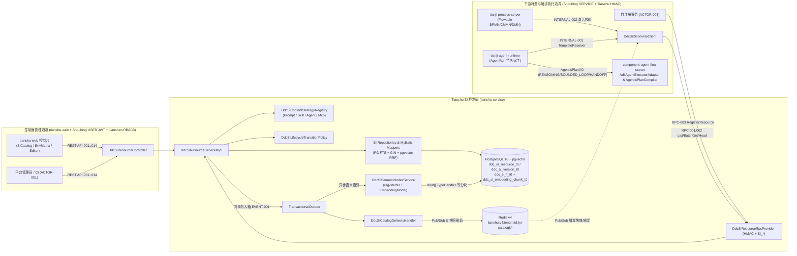
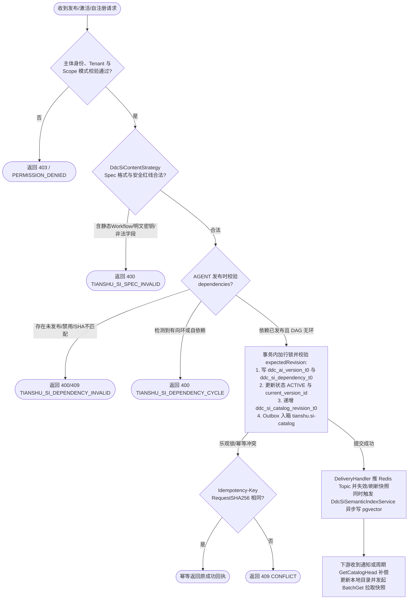
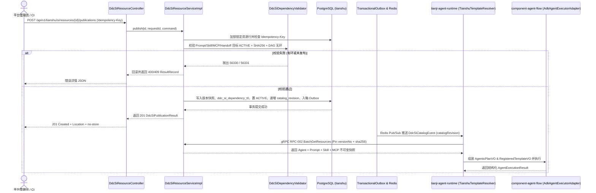
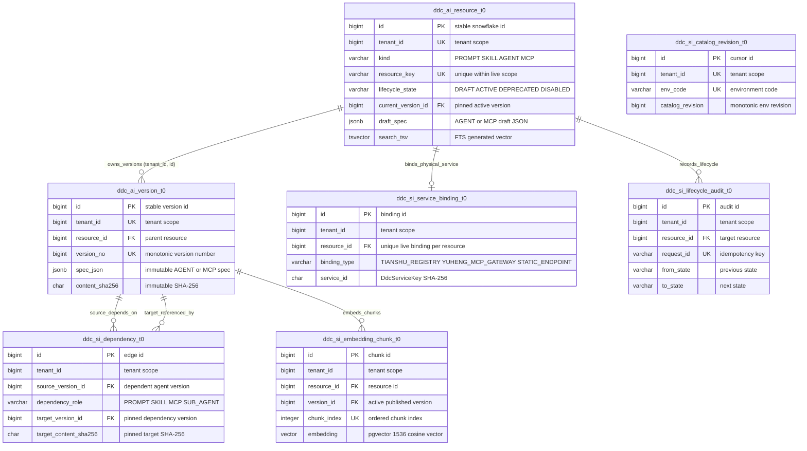

# Tianshu 超级智能（SI）资源治理中心与跨仓编排协同设计规格

| Field | Value |
| --- | --- |
| Document | [2026-11-16-10-35-tianshu-si-resource-governance-spec.md](./2026-11-16-10-35-tianshu-si-resource-governance-spec.md) |
| Template Version | `9` |
| Archetype Cleanup | `Not applicable` |
| Status | `Review` |
| Type | `Feature` |
| Complexity | `Complex` |
| Complexity Drivers | 跨四仓八模块（tianshu-service、tianshu-web、rpc-tianshu-adapter、component-agent-flow-starter、tianji-service）全链路端到端设计与契约对齐；多租户与多Env目录隔离；事务性Outbox与Redis目录游标一致性；原子Agent依赖拓扑无环及不可变版本固定；PostgreSQL原生FTS/JSONB GIN与rag-starter/pgvector RRF混合语义检索；前端RBAC3权限与双语目录全覆盖 |
| Created | `2026-11-16 10:35 -04:00` |
| Updated | `2026-11-16 10:55 -04:00` |
| Owner | `mario` |
| Repository | `tianshu-service（协同 tianshu-web、Stellar-Enclosure-Components、tianji-service）` |
| Scope | `stellar-enclosure-tianshu-starter`、`stellar-enclosure-tianshu-ai-starter`、`stellar-enclosure-tianshu-admin`、`tianshu-web`、`stellar-enclosure-component-rpc-tianshu-adapter`、`stellar-enclosure-component-agent-flow-starter`、`stellar-enclosure-tianji-process-server`、`stellar-enclosure-tianji-agent-runtime` |
| Change Surface | `DdcAiResourceServiceImpl`、`DdcSiResourceController`、`DdcSiResourceRpcProvider`、`DdcSiContentStrategy`、`DdcSiSemanticIndexService`、SI MyBatis DAO/Mapper/PO/BO/DTO/Converter、`V20261116_001__tianshu_si_resource_governance.sql`、`ddc_si_embedding_chunk_t0`、`tianshu_si_resource.proto`、`DdcRpcOperation`、`DdcSiDiscoveryClient`、`AgentFlowAutoConfiguration`（旧静态编排标弃用）、`TianshuTemplateResolver`、`TianshuAgentBindingVerifier`、`tianshu-web/src/api/si.ts`、`tianshu-web/src/pages/Si*.tsx` |
| Affected Chapters | `§7, §8, §9, §10, §11, §12, §13, §14, §15, §16, §17, §18` |
| Source Requirement | 用户要求在 Tianshu 新增超级智能 SI 模块管理原子化 Agent、MCP、Prompt、Skill 的定义、注册发现、版本管理、发布回滚、配置分发、生命周期、下游 List、多租户、多 Env 与检索（含语义混合检索与完整前后端管控页面），并确立“Tianshu 定义注册原子 Agent、Tianji Flowable 承担业务 Workflow 编排、component-agent-flow 仅承担单 Agent 与 Agentic-Flow 自主决策执行”的跨仓协同架构，于本版本一次性完整交付不拆一期/二期 |
| Baseline Revision | `tianshu-service @ b1c607f`、`Stellar-Enclosure-Components @ cf66934`、`tianji-service @ e5d4551` |
| Amends | `None` |
| Supersedes | `None` |
| Depends On | `None` |
| Related Specs | `None` |
| Related Plans | [2026-11-16-11-24-tianshu-si-resource-governance-implementation.md](../plan/2026-11-16-11-24-tianshu-si-resource-governance-implementation.md) |

## 1. Summary

当前平台在智能体资产管理与流程编排之间存在双重断层：一方面，Tianshu 现有的 AI 资源能力仅覆盖 `PROMPT` 与 `SKILL`，机器客户端只有按精确 ID 点查的 gRPC 接口，既缺少 `AGENT` 与 `MCP` 的逻辑资源定义、生命周期状态机（启停/废弃）及服务自注册机制，也缺少下游获取授权资源列表（List）、多 Env 视图对比与结构化检索能力；另一方面，`component-agent-flow-starter` 遗留的静态 `Sequential`/`Parallel` YAML 编排、`tianji-process-server` 的 Flowable BPMN/CMMN/DMN 引擎与潜在的 Agent Workflow 定义职责相互重叠，导致“谁定义原子能力、谁编排业务流程、谁执行自主推理”边界模糊。

本规格确立单期完整交付的跨仓协同与 Tianshu SI（Super Intelligence）演进方案：**Tianshu (`tianshu-service` & `tianshu-web`)** 负责原子逻辑资源（`AGENT`、`MCP`、`PROMPT`、`SKILL`）的统一定义、不可变版本、发布回滚、跨 Env 推广、生命周期管控、自注册发现、Outbox/Redis 目录分发、基于 PostgreSQL 原生全文/GIN 与 `stellar-enclosure-component-rag-starter`/`pgvector` RRF 融合的多维混合检索，以及完整的 `tianshu-web` 控制台页面（目录检索、多 Env 版本矩阵、Agent/MCP 编辑器、版本回滚、依赖影响面图、物理服务绑定与生命周期治理），并向下游暴露跨应用 `ListResources`/`SearchResources`/`BatchGetResources` 契约；**`component-agent-flow-starter`** 收敛为“单 Agent 与 Agentic-Flow（`REASONING`/`BOUNDED_LOOP`/`HANDOFF`）执行内核”，将旧静态顺序/并行 Workflow Builder 标记弃用；**`tianji-service`** 由 Flowable（`tianji-process-server`）独占确定性业务 Workflow 编排并在流程激活期校验 Tianshu SI 原子 Agent 绑定，由 `tianji-agent-runtime` 通过新增的 `TianshuTemplateResolver` 批量拉取并缓存 Tianshu SI 快照交由 `AdkAgentExecutorAdapter` 执行。

数据库层面采用向后兼容的向前 DDL 演进策略，扩展现有 `ddc_ai_resource_t0` 与 `ddc_ai_version_t0` 并新增依赖拓扑、物理服务绑定、生命周期审计、目录游标与向量分块（`ddc_si_embedding_chunk_t0`）五张表；保持现有 `/api/v1/tianshu/ai/resources` 与 `DdcAiResourceService` gRPC 契约零破坏，预计交付后彻底消除三套流程重叠，实现多租户、多 Env 下智能资产从控制台定义注册到运行时消费的端到端完整闭环。

## 2. Background and Current State

### 2.1 Business and user context

随着平台业务智能体数量增长，业务应用（如 `tianji-service` 编排与执行引擎、`yuheng-service` MCP 网关以及业务微服务）需要一个统一控制面来定义和治理四大逻辑智能资产：`PROMPT`（提示词模板）、`SKILL`（技能指令包与目录树）、`MCP`（逻辑 MCP Server 能力声明与路由凭据引用）以及原子化 `AGENT`（单 Agent 的模型路由、Prompt/Skill/MCP 绑定、输入输出 Schema、安全预算及内部自主决策策略）。同时，用户明确要求彻底厘清跨层边界：Tianshu 只定义并注册**原子化 Agent**，不承载业务流程图；所有确定性业务 Workflow（串行、并行分支、条件网关、人工审批、长周期等待）统一落在 Tianji 的 Flowable 引擎；`component-agent-flow` 专注单 Agent 能力实现及自主决策型 Agentic-Flow。

### 2.2 Repository evidence

| Evidence ID | Classification | Exact path/symbol/decision/command | Observed fact | Design significance | Verification limit/freshness |
| --- | --- | --- | --- | --- | --- |
| `EVD-001` | Static repository | `tianshu-service/stellar-enclosure-tianshu-starter/src/main/java/top/egon/cola/component/tianshu/model/ai/DdcAiKindEnum.java`、`tianshu-service/stellar-enclosure-tianshu-admin/src/main/resources/db/egon-mp/V20261018_001__tianshu_fresh_baseline_and_constraints.sql#L324-L377` | `DdcAiKindEnum` 仅含 `PROMPT`、`SKILL`，数据库 CHECK 约束硬编码限制 `kind IN ('PROMPT', 'SKILL')`，且 `ck_ai_resource_draft_prompt` 与 `ck_ai_version_content` 仅覆盖此两类载体 | 需通过向前 DDL 扩展 `kind` CHECK、增加 `draft_spec`/`spec_json` jsonb 列以兼容 `AGENT` 与 `MCP` | 2026-11-16 静态源码与 SQL 核查 |
| `EVD-002` | Static repository | `Stellar-Enclosure-Components/stellar-enclosure-component-rpc/stellar-enclosure-component-rpc-tianshu-adapter/src/main/proto/tianshu_ai_resource.proto`、`tianshu-service/stellar-enclosure-tianshu-admin/src/main/java/top/egon/cola/component/tianshu/admin/controller/ai/DdcAiResourceController.java#L138-L168` | gRPC `DdcAiResourceService` 仅提供 `GetPrompt`/`GetSkill`/`GetVersionHead`/`ReportUsage`/`ReplaceSkillDraft`/`PublishSkillDraft`，无 `ListResources`/`BatchGet`/`Search`；REST `page` 强要求全四维参数必填 | 下游无法获取授权范围内资源列表与增量游标；需新增 `tianshu_si_resource.proto` 与 `/api/v1/tianshu/si/resources` | 2026-11-16 静态源码核查 |
| `EVD-003` | Static repository | `tianshu-service/stellar-enclosure-tianshu-admin/src/main/resources/mybatis/mapper/tianshu/DdcAiResourceMapper.xml#L36-L49`、`Stellar-Enclosure-Components/stellar-enclosure-component-rag-starter/pom.xml`、`yuheng-service/.../GatewayVectorTypeHandler.java` | `ActiveResourceFilter` 仅支持 `resource_key LIKE 'prefix%'` 与 `display_name ILIKE '%kw%'`，无 JSONB/`tsvector`/向量检索；工作区已有 `rag-starter` 与 `pgvector` 无第三方驱动依赖绑定惯例 | 采用 PostgreSQL `tsvector` + `pg_trgm` + JSONB GIN + `rag-starter`/`pgvector` RRF 混合语义检索一次性完整落地 | 2026-11-16 静态源码与 SQL 核查 |
| `EVD-004` | Static repository | `tianshu-service/stellar-enclosure-tianshu-admin/src/main/java/top/egon/cola/component/tianshu/admin/service/ai/notification/DdcAiPublicationNotifier.java`、`.../redis/DdcRedisKeys.java#L82-L84` | 发布/回滚/推广在事务内写 Outbox 通道 `tianshu.ai-publication` 并推租户隔离 Redis Topic；`DdcRedisKeys` 采用 `tianshu:v4:tenant:<tenantId>:{<tag>}:...` | SI 目录变更事件直接复用同款 Outbox + Redis v4 键体系保障租户隔离与最终一致性 | 2026-11-16 静态源码核查 |
| `EVD-005` | Static repository | `Stellar-Enclosure-Components/stellar-enclosure-component-agent-flow-starter/src/main/java/top/egon/cola/component/agentflow/agentic/AgenticPlanVO.java`、`.../AgenticPlanCompiler.java`、`.../adapter/adk/AdkAgentExecutorAdapter.java`、`.../workflow/AgentWorkflowBuilderStrategy.java` | `agent-flow-starter` 已具备 `AgenticPlanCompiler`（支持 `REASONING`/`SEQUENTIAL`/`PARALLEL`/`BOUNDED_LOOP`/`HANDOFF`）及扩展点 `AdkAgentExecutorAdapter.TemplateResolver`，同时还保留旧版静态 `AgentWorkflowConfigDTO` 构建策略 | 可将旧静态 YAML `workflow/*` 策略标 `@Deprecated`，新路径完全由 `AdkAgentExecutorAdapter` 消费 Tianshu 原子 Agent 注册表 | 2026-11-16 静态源码核查 |
| `EVD-006` | Static repository | `tianji-service/stellar-enclosure-tianji-process-server/src/main/java/top/egon/cola/platform/tianji/process/server/bridge/AgentDispatchBinding.java`、`.../release/AutomationActivationService.java`、`tianji-service/stellar-enclosure-tianji-agent-runtime/src/main/java/top/egon/cola/platform/tianji/agent/autoconfigure/TianjiAgentRuntimeAutoConfiguration.java#L114-L120` | `tianji-process-server` 用 Flowable 编排并经 `AgentDispatchBinding` 绑定 `(definitionKey, definitionVersion, definitionContentSha256)`；`tianji-agent-runtime` 消费名为 `agentExecutionTemplateResolver` 的 `AdkAgentExecutorAdapter.TemplateResolver` Bean | 天机两端扩展点天然齐备：Process 激活时向 Tianshu 校验 Agent 有效性，Runtime 注册 `TianshuTemplateResolver` 即可接通全链路 | 2026-11-16 静态源码核查 |
| `EVD-007` | Static repository | `yuheng-service/stellar-enclosure-yuheng-admin/src/main/java/top/egon/cola/component/yuheng/admin/mcp/domain/po/McpServerRecordPO.java` | 玉衡已有物理 MCP 网关配置（`serverCode`、`instructions`、`dialects`、`resourceUri`、`listCacheTtlSeconds`）及向 Tianshu Registry 注册租约的 `DdcServiceKey` | Tianshu SI 只需建 `ddc_si_service_binding_t0` 建立逻辑 MCP 资源与物理 `DdcServiceKey`/`serverCode` 的绑定，无需复制网关执行逻辑 | 2026-11-16 静态源码核查 |
| `EVD-008` | Static repository | `tianshu-service/stellar-enclosure-tianshu-admin/src/main/resources/db/egon-mp/repository-manifest.json`、`tianshu-service/stellar-enclosure-tianshu-admin/src/main/java/top/egon/cola/component/tianshu/admin/config/DdcAiWebConfiguration.java`、`DdcAiOpenApiConfiguration.java`、`DdcAiExceptionAdvice.java` | Tianshu Admin 使用 `egon-mp` 托管 DDL（不可改动既有脚本）、`OPENAPI_3_1` + `tianshu` 分组、Jackson2 严格命令反序列化与 `563xx` 错误码体系 | 新增 DDL 必须注册于 `repository-manifest.json`；REST 控制器需纳入 `DdcAiWebConfiguration` / `DdcAiOpenApiConfiguration` 严格校验与规范化 | 2026-11-16 静态源码核查 |
| `EVD-009` | User decision | 本轮用户确认 DEC-001 至 DEC-004 及“不拆一期/二期，本轮完整交付”指示 | 确认全量囊括三后端仓七模块 + `tianshu-web` 控制台页面 + `rag-starter`/`pgvector` RRF 语义混合检索，不留待二期 | 锁定本 Spec 的完整单期交付边界、表结构、前后端全量契约与技术选型 | 2026-11-16 用户明确指示 |
| `EVD-010` | Static repository | `tianshu-web/src/App.tsx`、`.../src/pages/AiResourcesPage.tsx`、`.../src/permissions/resources.ts`、`.../src/api/ai.ts` | 控制台目前仅注册 `/ai/prompts` 与 `/ai/skills` 两条路由，依赖全四维 `ScopeSelects` 与 `AI_*` 权限；权限中心与页面框架支持平滑扩展路由、按钮权限与双语目录 | 在 `tianshu-web` 补全 SI 目录混合检索、多 Env 版本矩阵、Agent/MCP 分类、详情编辑器、依赖影响面与服务绑定交互页面 | 2026-11-16 前端静态核查 |

### 2.3 Problem statement and gap

| 维度 | 现状行为 | 目标行为 | 差距与影响 |
| --- | --- | --- | --- |
| 逻辑资源覆盖与状态 | 仅有 `PROMPT`/`SKILL`，无 `AGENT`/`MCP`，无 `ACTIVE`/`DEPRECATED`/`DISABLED` 显式状态机 | 统一治理 `AGENT`/`MCP`/`PROMPT`/`SKILL`，具备完整生命周期、服务自注册与物理服务绑定 | 无法集中管理 Agent 与 MCP 资产，紧急下线或标废缺少统一开关与影响面追踪 |
| 编排与职责边界 | `agent-flow` 混杂静态 `Sequential`/`Parallel` Workflow 与 `AgenticPlanCompiler`，与 `tianji` Flowable 重叠 | Flowable 独占业务 Workflow，`agent-flow` 聚焦单 Agent 与自主决策，`tianshu` 管原子定义注册 | 消除三套流程定义打架，让业务流与推理流各自按最佳引擎演进 |
| 下游 List 与跨 Env 发现 | gRPC 仅有精确 `GetPrompt`/`GetSkill`，REST 强绑定四维全填；无跨 Env 版本对照 | gRPC 提供 `ListResources`/`BatchGetResources`/`GetCatalogHead` 增量同步；REST 提供多维过滤、详情/回滚/删除/依赖图/服务绑定与跨 Env 矩阵 | 下游 Tianji/Yuheng 无法自动发现可用 Agent/MCP 清单，控制台亦缺乏版本对照与影响分析能力 |
| 检索与依赖完整性 | Mapper 仅支持 key 前缀和名称 `ILIKE`；无跨资源版本引用完整性校验，无语义召回 | PostgreSQL `tsvector` + `pg_trgm` + JSONB GIN + `rag-starter`/`pgvector` RRF 混合检索；发布时校验依赖已发布且无环 | 资产规模扩大后既难以按工具/能力过滤，也难以通过自然语言描述语义召回合适 Agent/Skill/MCP |
| 前端控制面入口 | `tianshu-web` 仅展示 `PROMPT`/`SKILL` 静态四维列表与编辑器 | 新增 SI 统一目录混合检索页、Env 矩阵页、Agent/MCP 专属入口及完整的依赖图/绑定/生命周期弹窗 | 管理员若无控制台页面，所有 SI 新能力只能停留在脚本/curl 调用阶段，无法形成产品闭环 |

### 2.4 Evidence and current-chain map

| Entry/trigger | Current call chain | Data read/written | External dependency | Consumers | Evidence |
| --- | --- | --- | --- | --- | --- |
| 管理台创建发布 AI 资源 | `DdcAiResourceController#create/publish` -> `DdcAiResourceServiceImpl` -> `DdcAiScopeValidator` -> `DdcAiResourceRepository` -> `DdcAiPublicationNotifier` | 写 `ddc_ai_resource_t0`、`ddc_ai_version_t0`、`ddc_ai_publication_t0`、`egon_cola_outbox_message` | PostgreSQL、Redis Pub/Sub | `tianshu-web`、`tianshu-ai-starter` | `EVD-001`, `EVD-004` |
| 下游 gRPC 拉取 Prompt/Skill | `RpcDdcPromptClient`/`RpcDdcSkillClient` -> `DdcAiResourceRpcProvider#getPrompt/getSkill` -> `DdcAiResourceServiceImpl#getPublishedVersion` | 读 `ddc_ai_resource_t0`、`ddc_ai_version_t0`、`ddc_ai_version_node_t0` | HMAC gRPC、PostgreSQL | 业务服务、`tianshu-ai-starter` | `EVD-002` |
| 流程节点派发 Agent 执行 | `ProcessActivationService#activate` -> `AgentStartWorker` -> `StartAgentRunCommand` -> `TianjiAgentRuntimeAutoConfiguration` -> `AdkAgentExecutorAdapter#execute` -> `AgenticPlanCompiler#execute` | 写 `tianji_process` 激活与派发 intent、`tianji_agent.agent_run` | Flowable 8、ADK 1.13、Spring AI 2.0 | 业务流程发起方、人工审批工作台 | `EVD-005`, `EVD-006` |

### 2.5 Archetype example cleanup

Cleanup disposition: Not applicable

Reason: `tianshu-service`、`Stellar-Enclosure-Components` 与 `tianji-service` 均为既有平台控制面、通用基础设施 Starter 与编排引擎仓库，非新生成的业务脚手架工程，不存在未清理的 Archetype 示例域代码。

## 3. Goals and Non-goals

### 3.1 Goals

1. 在 `tianshu-service` 建设统一的 **超级智能 SI 模块**：支持 `AGENT`、`MCP`、`PROMPT`、`SKILL` 的定义、Schema 校验、详情读取、软删除、不可变版本管理、发布回滚、同租户跨 Env 推广、物理服务绑定及生命周期流转（`DRAFT`/`ACTIVE`/`DEPRECATED`/`DISABLED`）。
2. 在 `rpc-tianshu-adapter` 与 `tianshu-starter`/`tianshu-ai-starter` 补齐下游发现与分发闭环：支持按租户授权裁剪的多 Env、多类型 `ListResources`、增量 `since_catalog_revision` 拉取、`BatchGetResources`、应用启动自注册 `RegisterResource`，以及 Outbox + Redis 快照/PubSub 实时同步与对账。
3. 落地完整的 **PG 原生结构化+全文+`pgvector` RRF 混合检索**：将 PostgreSQL `search_tsv` 全文检索、`pg_trgm` 模糊前缀、`tags`/`labels`/`capabilities` JSONB GIN 过滤，与基于 `stellar-enclosure-component-rag-starter` + `pgvector` HNSW 余弦相似度检索的异步向量索引及 RRF 融合排序合二为一，并在未启用向量模型时平滑降级到 `KEYWORD` 模式。
4. 彻底收口跨仓架构职责：Tianshu 仅注册原子化 Agent；`component-agent-flow-starter` 聚焦单 Agent 执行与 `REASONING`/`BOUNDED_LOOP`/`HANDOFF` 自主决策流并标记弃用旧静态业务 Workflow Builder；`tianji-process-server` 承担全部确定性业务 Workflow 并校验 SI Agent 绑定，`tianji-agent-runtime` 通过 `TianshuTemplateResolver` 批量获取不可变 SI 快照执行。
5. 在 `tianshu-web` 交付完整控制台体验：提供 SI 统一目录混合检索页、多 Env 版本矩阵对比页、Agent/MCP 入口、支持结构化/JSON 双模式编辑的 SI 详情页、版本历史/回滚面板、正反向依赖影响面面板、物理服务绑定及生命周期流转对话框，全量接入 Jianshen RBAC3 与双语体系。

### 3.2 Non-goals

1. 不在 Tianshu SI 模块内执行 Agent 推理循环或承载 LLM/MCP 数据面流量（继续由 Tianji 与 Yuheng 承担）。
2. 不在 Tianshu `AGENT` Spec 中定义确定性业务流程图（如 BPMN、CMMN、Sequential/Parallel DAG 编排）；跨步骤业务流转完全交由 Tianji Flowable 管理。
3. 不引入 Elasticsearch 等独立外部搜索引擎或 `pgvector-java` 第三方客户端驱动，全文与向量混合检索统一复用现有 PostgreSQL 16（`tsvector` + `pg_trgm` + JSONB `GIN` + `pgvector`）与 `stellar-enclosure-component-rag-starter`。
4. 不在 SI Spec 中保存明文 API Key、OAuth Client Secret 或数据库密码，仅允许保存 `credentialRef` 引用标识；不修改既有已应用 DDL 脚本原文与原有 `PROMPT`/`SKILL` 的 `/ai/resources` 兼容性契约。

### 3.3 Change Surface and Design Depth

| Area/layer | Disposition | Exact repository evidence | Changed or preserved behavior/contract | Required Spec treatment | Chapter(s) |
| --- | --- | --- | --- | --- | --- |
| Tianshu SI 持久化表与受管 DDL | Affected | `tianshu-service/stellar-enclosure-tianshu-admin/src/main/resources/db/egon-mp/V20261018_001__tianshu_fresh_baseline_and_constraints.sql`、`repository-manifest.json` | 新增 `V20261116_001__tianshu_si_resource_governance.sql`，向前扩展 `ddc_ai_resource_t0`/`ddc_ai_version_t0` 并新建 5 张 `ddc_si_*_t0` 表（含 `ddc_si_embedding_chunk_t0` 向量分块表），保留原有表不变 | 完整列设计、约束、GIN/FTS/HNSW 索引、访问路径、ER 图与历史数据迁移策略 | `§11, §15, §16` |
| Tianshu SI Admin 控制面服务与混合检索 | Affected | `tianshu-service/stellar-enclosure-tianshu-admin/src/main/java/top/egon/cola/component/tianshu/admin/controller/ai/DdcAiResourceController.java`、`DdcAiResourceServiceImpl.java`、`DdcAiContentStrategy.java`、`pom.xml` | 新增 `/api/v1/tianshu/si/resources` 全套 14 项 REST API、`DdcSiResourceService`、`DdcAgentContentStrategy`/`DdcMcpContentStrategy`、生命周期、DAG 校验、Outbox 目录通知，以及集成 `rag-starter` + `pgvector` 的异步向量索引与 RRF 混合检索 | 完整架构三图、包树、14 项 REST API + OpenAPI 3 契约、POJO/MapStruct 模型与检索设计 | `§7, §8, §9, §10, §13, §14, §15, §16, §17, §18` |
| Tianshu SI 权限、配置与 Outbox 分发 | Affected | `DdcPermissionCodes.java`、`DdcOutboxConfiguration.java`、`DdcRedisKeys.java`、`application*.yml` | 新增 `TIANSHU_SI_*` 权限码、`tianshu.si-catalog` Outbox 通道、Redis v4 SI 键及三环境 YAML 键一致性同步（含 `rag` 与语义搜索配置） | 权限表、Outbox/Event 契约、Redis 隔离键设计与多环境配置校验 | `§7, §8, §9, §15, §16` |
| Tianshu Starter 与 AI Starter 客户端 | Affected | `stellar-enclosure-tianshu-starter/.../api/client/`、`stellar-enclosure-tianshu-ai-starter/` | 新增 `DdcSiDiscoveryClient`、`DdcSiRegistrationClient`、本地目录缓存同步器与自注册组件 | 公开端口契约、缓存对账流程、类清单与单元测试 | `§7, §8, §9, §10, §14` |
| 前端控制台（tianshu-web） | Affected | `tianshu-web/src/App.tsx`、`src/pages/AiResourcesPage.tsx`、`src/permissions/resources.ts`、`src/api/ai.ts` | 新增 `/si/resources`、`/si/env-matrix`、`/ai/agents`、`/ai/mcps`、`/si/resources/:id` 路由与对应组件、API 客户端、Jianshen 按钮/页面/字段权限声明及双语文案；保留既有 `/ai/prompts` 与 `/ai/skills` 零破坏运行 | 完整路由、组件树、交互校验、状态/API 映射、无障碍交互安全与前端测试设计 | `§8, §9, §12, §14` |
| Components RPC Tianshu 适配器 | Affected | `Stellar-Enclosure-Components/stellar-enclosure-component-rpc/stellar-enclosure-component-rpc-tianshu-adapter/src/main/proto/`、`DdcRpcOperation.java` | 新增 `tianshu_si_resource.proto`（`DdcSiResourceService`）、`DdcSiResourceRpcProvider`、gRPC Client 适配器与 `SI_*` RPC 权限枚举 | Proto 契约定义（含混合检索模式）、HMAC/Scope 鉴权过滤逻辑与契约测试 | `§7, §8, §9, §10, §14, §16` |
| Components Agent-Flow 内核收敛 | Affected | `Stellar-Enclosure-Components/stellar-enclosure-component-agent-flow-starter/src/main/java/top/egon/cola/component/agentflow/` | 聚焦单 Agent 执行与 `AgenticPlanCompiler`（`REASONING`/`BOUNDED_LOOP`/`HANDOFF`）；旧静态 `workflow/*` Strategy 与 `AgentFlowConfigDTO` 标 `@Deprecated` 并保留开关兼容 | 边界定义、弃用说明、与 Tianji 对接约束及回归验证 | `§7, §8, §13, §14, §16, §17` |
| Tianji Process 与 Agent Runtime 接入 | Affected | `tianji-service/stellar-enclosure-tianji-process-server/.../AutomationActivationService.java`、`tianji-agent-runtime/.../TianjiAgentRuntimeAutoConfiguration.java` | Process 激活时调用 `TianshuAgentBindingVerifier` 校验 SI 原子 Agent；Runtime 实现 `TianshuTemplateResolver` 对接 `BatchGetResources` 并缓存不可变模板 | 内部接口契约、本地不可变缓存与失败降级边界、集成测试 | `§7, §8, §9, §13, §14, §15` |
| Tianshu 原有 AI REST/gRPC 接口与页面 | Context-only | `DdcAiResourceController.java`、`DdcAiResourceRpcProvider.java`、`tianshu_ai_resource.proto`、`DdcAiFeedbackServiceImpl.java` | 保持既有 `/api/v1/tianshu/ai/resources` 与 `DdcAiResourceService` RPC 签名、反馈与优化作业语义完全向后兼容 | 仅记录保持不变的边界及兼容回归用例 | `§7, §9, §14, §16` |
| Tianshu 服务注册中心（物理租约） | Context-only | `DdcServiceRegistryService`、`DdcServiceKey.java`、`DdcServiceKind.java` | 物理实例租约仍由 Redis 维护；SI 通过 `ddc_si_service_binding_t0` 引用 `serviceId` 并按需反查在线实例数 | 仅说明关联方式与零结构侵入边界 | `§7, §11` |
| Tianji 流程编排前端（tianji-web） | Context-only | `tianji-web/src/pages/` | Flowable 流程设计器既有 `AgentDispatchBinding` 字段（`definitionKey/Version/Sha256`）天然兼容，本轮无需改动 `tianji-web` 代码 | 记录边界无需修改证据 | `§7, §12` |

## 4. Requirements and Acceptance Criteria

| ID | Atomic requirement | Priority | Observable acceptance criteria | Source |
| --- | --- | --- | --- | --- |
| `REQ-001` | Tianshu SI 必须统一支持 `PROMPT`、`SKILL`、`AGENT`、`MCP` 四类逻辑资源的创建、草稿替换、不可变版本快照保存、SHA-256 完整性校验与软删除；其中 `AGENT` 为原子化定义，包含模型路由、Prompt/Skill/MCP 依赖引用、输入输出 JSON Schema、`agenticStrategy`（仅允许 `REASONING`/`BOUNDED_LOOP`/`HANDOFF`）及 `ExecutionPolicy` 预算策略，禁止内嵌确定性业务 Workflow（如 `SEQUENTIAL`/`PARALLEL` 流程图）。 | Must | 对 `AGENT` 与 `MCP` 提交合法草案返回 `201 Created` 及唯一 `resourceId`；提交含明文 `secret`/`apiKey` 字段的 `MCP` Spec 或含 `SEQUENTIAL`/`PARALLEL` 静态编排的 `AGENT` Spec 时返回 `400 Bad Request`（`56333 TIANSHU_SI_SPEC_INVALID`）；既有 `PROMPT`/`SKILL` 接口全量回归通过。 | 用户确认原子 Agent 收口及 DEC-002、DEC-003 |
| `REQ-002` | SI 资源必须支持显式生命周期状态机（`DRAFT` -> `ACTIVE` <-> `DISABLED`、`ACTIVE` -> `DEPRECATED` -> `ACTIVE/DISABLED`），并支持服务启动/运行期通过 `RegisterResource` gRPC 接口按 `content_sha256` 幂等自注册（支持 `UPSERT_DRAFT_ONLY` 与受环境策略控制的 `UPSERT_AND_AUTO_PUBLISH`）。 | Must | 未发布前资源处于 `DRAFT` 对默认 `ACTIVE` 发现列表不可见；首次发布自动置为 `ACTIVE`；执行 `DISABLE` 后默认列表立即不可见并写入 `ddc_si_lifecycle_audit_t0`；重复提交相同 `content_sha256` 的自注册请求返回 `changed=false` 且不自增草稿版本号；非法状态迁移返回 `409 Conflict`（`56332`）。 | 用户需求“注册发现、生命周期管理” |
| `REQ-003` | 发布、回滚与跨 Env 推广必须严格原子化且幂等（`Idempotency-Key` + `expectedRevision`）；发布 `AGENT` 时必须校验其 `dependencies` 引用的同租户 `PROMPT`/`SKILL`/`MCP`/`SUB_AGENT` 处于 `ACTIVE` 状态、SHA-256 一致且拓扑无环，并将边写入 `ddc_si_dependency_t0`；`PROMOTE` 支持同租户内跨 `env`/`namespace`/`app` 复制不可变快照。 | Must | 存在循环引用（A->B->A 或自引用）返回 `400`（`56330`）；引用未发布/禁用/跨租户资源或摘要不匹配返回 `400`/`409`（`56331`）；重复相同 `Idempotency-Key` 与请求摘要重放原回执；回滚切换 `current_version_id` 并保持历史版本只读；被 `ACTIVE` Agent 引用的目标资源可经 `INBOUND` 接口查出。 | 用户需求“版本管理、发布回滚”与依赖安全红线 |
| `REQ-004` | 必须向管理端与下游机器客户端提供多租户、多 Env 隔离的 `List`、批量获取（`BatchGet`）、轻量目录对账（`GetCatalogHead`）及多 Env 版本矩阵查询能力；服务端必须依据调用方已验证的身份主体（`DdcServicePrincipal` 模式或 Jianshen RBAC3 Namespace 授权）强制裁剪结果集。 | Must | gRPC `ListResources` 支持传 `envs[]`、`kinds[]`、`tags`、`labels` 与 `since_catalog_revision` 增量游标返回新增/变更资源及已禁用/删除 ID；传越权 `env` 或跨租户尝试被 `403`/`PERMISSION_DENIED` 拒绝；`BatchGetResources` 单次批量拉取 <=50 个固定版本或当前版本；跨 `App`/`Namespace` 宽查询绝不泄漏未授权资源。 | 用户需求“下游获取 list、支持多租户、多 env” |
| `REQ-005` | 控制面与下游必须实现基于事务性 Outbox（`tianshu.si-catalog`）+ 租户隔离 Redis 目录快照/PubSub + 周期 `GetCatalogHead` 对账的可靠配置分发闭环，并在需要时支持物理服务绑定（`ddc_si_service_binding_t0`）解析在线实例数。 | Must | DB 发布/启停/软删事务提交时同事务写入 `ddc_si_catalog_revision_t0` 递增游标与 Outbox；投递器推送事件到 `tianshu:v4:tenant:<tenantId>:{si-catalog:<env>}:topic` 并更新/失效快照；下游 Starter 收到推送或对账发现游标落后时自动增量追平本地缓存；关闭 Redis 时退化为周期对账且不崩溃。 | 用户需求“配置分发”及高可用边界 |
| `REQ-006` | Tianshu SI 必须提供基于 PostgreSQL 原生多维过滤 + `stellar-enclosure-component-rag-starter`/`pgvector` RRF 混合语义检索能力，覆盖 `search_tsv` 全文检索、`resource_key`/`display_name` `pg_trgm` 模糊前缀、`tags`/`labels`/`capabilities` JSONB `@>` 过滤，以及异步分块向量化写入 `ddc_si_embedding_chunk_t0` 后的 HNSW 余弦相似度检索，支持 `KEYWORD` / `SEMANTIC` / `HYBRID` 三种模式并在未配置向量模型或空关键词时自动平滑降级到 `KEYWORD` 模式。 | Must | 按关键词、标签（`["finance"]`）、能力字段（`get_order`）或自然语言意图（如“帮我处理售后资金退回”）分别以 `KEYWORD`/`SEMANTIC`/`HYBRID` 模式检索均可返回精确命中并按 RRF/相关度降序排序；`EXPLAIN` 验证查询计划命中 `ix_si_resource_fts`、`ix_si_resource_*_gin` 及 `ix_si_embedding_chunk_hnsw` 索引。 | 用户要求完整交付与搜索体验完善 |
| `REQ-007` | `stellar-enclosure-component-agent-flow-starter` 必须聚焦单 Agent 与自主决策型 `AgenticPlanCompiler` 执行，将旧版静态 `AgentWorkflowConfigDTO` 与 `SequentialAgentWorkflowBuilderStrategy`/`ParallelAgentWorkflowBuilderStrategy` 标记为 `@Deprecated(forRemoval = false)` 并保持原有配置兼容开关。 | Must | 新路径下 `AdkAgentExecutorAdapter` 通过 `TemplateResolver` 支持 `REASONING`/`BOUNDED_LOOP`/`HANDOFF` 自主策略；既有 `AgentFlowConfigValidatorTest`、`AgentWorkflowStrategyFactoryTest` 与 `DefaultAgentFlowServiceTest` 回归全部通过且无运行破坏。 | 用户确认 DEC-003 |
| `REQ-008` | `tianji-process-server` 必须在激活自动化流程前通过 `TianshuAgentBindingVerifier` 向 Tianshu SI 校验流程节点引用的 `(definitionKey, definitionVersion, definitionContentSha256)` 处于 `ACTIVE` 状态且匹配；`tianji-agent-runtime` 必须实现 `TianshuTemplateResolver`（注册为 `agentExecutionTemplateResolver` Bean）对接 Tianshu SI `BatchGetResources` 并维护线程安全不可变版本缓存，将原子 Agent 与其 Prompt/Skill/MCP 解析为 `RegisteredTemplateVO` 交由 `AdkAgentExecutorAdapter` 执行。 | Must | 当 Tianshu 对应 Agent 未发布、已 `DISABLED` 或 SHA-256 漂移时，`AutomationActivationService#activate` 拒绝激活；运行时 `AgentRun` 按锁定 `versionNo` 从缓存或 Tianshu 拉取完整模板，支持 `REASONING`/`BOUNDED_LOOP`/`HANDOFF` 执行并记录过程事件；Tianshu 短暂不可用时已缓存在内存的不可变版本仍可完成已激活流程的运行。 | 用户确认 DEC-001、DEC-003 |
| `REQ-009` | `tianshu-web` 必须交付完整可交互的 SI 管理控制台页面，包括统一 SI 目录混合检索页（`/si/resources`）、跨 Env 版本矩阵页（`/si/env-matrix`）、Agent/MCP 分类页（`/ai/agents`、`/ai/mcps`）以及全功能详情编辑器（`/si/resources/:id`，涵盖草稿结构化+JSON双模编辑、版本历史与一键回滚、正反向依赖影响面面板、物理服务绑定面板及生命周期切换弹窗），全量接入 Jianshen RBAC3 页面/按钮/字段权限与中英文双语体系。 | Must | 在 `tianshu-web` 可无须手写请求完成 `AGENT`/`MCP`/`PROMPT`/`SKILL` 创建、混合检索、多环境对比、发布/回滚、推广、服务绑定、正反向引用查看及启停操作；无权限账号按钮自动禁用或隐藏；未保存修改切走触发路由拦截提示；Vitest 前端单元测试全数通过。 | 用户要求完整交付不拆一期/二期 |

### 4.1 Scenario matrix

| Scenario | Actor/trigger | Preconditions | Main path | Alternative/failure path | Data/state change | Observable result | Requirements |
| --- | --- | --- | --- | --- | --- | --- | --- |
| 创建并发布含依赖的原子 Agent | `ACTOR-001` 通过 `tianshu-web` 或管理 API 提交 `create`/`publish` | 作用域已启用且绑定；引用的 `PROMPT`/`SKILL`/`MCP` 在同租户同 Env 已为 `ACTIVE` | 校验 `agent.v1` Spec -> 写 `DRAFT` -> 发布时校验无环与 SHA-256 -> 插入不可变版本与 `ddc_si_dependency_t0` -> 递增游标入队 Outbox 并异步触发向量分块入库 | 若依赖草稿未发布或形成 A->B->A 环，事务回滚返回 `56331`/`56330`；重复 `Idempotency-Key` 幂等重放 | `ddc_ai_resource_t0` 变更为 `ACTIVE`，`ddc_si_catalog_revision_t0` 递增，异步生成 `ddc_si_embedding_chunk_t0` | 返回 `201 Created` 与 `versionNo=1`，下游收到目录变更通知 | `REQ-001`, `REQ-003`, `REQ-005` |
| 下游获取多 Env 授权 List 与增量同步 | `ACTOR-002` 调用 gRPC `ListResources` / `GetCatalogHead` | 服务持有效 HMAC 凭据且声明了 `SI_READ` 及 `envPatterns` | 服务端结合主体模式与 `envs[]`、`kinds[]`、`since_catalog_revision` 查询并优先命中 Redis 快照返回资源摘要及 `removed_resource_ids` | 传入未授权 `env` 立即返 `PERMISSION_DENIED`；Redis 不可用降级直查 PG 读库 | 仅读（无 DB 写入）；下游更新本地内存目录快照与 `catalogRevision` | 返回授权裁剪后的摘要列表与 `next_page_token` | `REQ-004`, `REQ-005` |
| 全文 + 能力 + 向量 RRF 混合检索 | `ACTOR-001`（经 `tianshu-web` `/si/resources`）或 `ACTOR-002` 调用 `searchSiResources` / `SearchResources` | 库内存在多类型 SI 资源及已向量化 `ddc_si_embedding_chunk_t0` 分块 | 同时构造 PG `websearch_to_tsquery` + `pg_trgm` + JSONB `@>` 词法召回与 `EmbeddingModel` + `pgvector` `<=>` 向量召回，通过 RRF 公式融合排名 | 若向量服务未启用或查询文本为空，平滑降级到 `KEYWORD` 模式；超长或非法 JSON 过滤条件返 `400` | 只读查询 | 返回融合相关度评分的命中列表与多 Env 摘要 | `REQ-006`, `REQ-009` |
| 生命周期停用、回滚与依赖影响面保护 | `ACTOR-001` 在编辑器查看正反向依赖后执行 `DISABLE`/`DEPRECATE`/`ROLLBACK` | `MCP` 或 `AGENT` 存在历史版本或入向依赖引用 | 先调 `listSiVersionReferences` 展示影响面；确认后执行状态切换或版本回滚并同步更新目录游标、Outbox 及向量活跃指针 | 有活跃入向 Agent 引用时直接 `DELETE` 被 `409 Conflict` 阻断；`DRAFT` 调 `DEPRECATE` 返 `56332` | `lifecycle_state` / `current_version_id` 变更，游标递增，审计落库 | `DISABLED` 立即从默认发现列表与活跃向量召回中剔除；已 Pin 版本运行的 `AgentRun` 不受误杀 | `REQ-002`, `REQ-003`, `REQ-005`, `REQ-009` |
| 服务启动幂等自注册原子 Agent/MCP | `ACTOR-003` 启动时触发 `RegisterResource` | 服务凭据含 `SI_REGISTER`（自动发布需含 `SI_PUBLISH` 且非 `prod` 或显式允许） | 按业务键查库；若现存 SHA-256 与请求一致则短路返回 `changed=false`；有变更则更新草稿并按模式决定是否自动发布及异步刷新向量分块 | 高危生产环境若禁止自动发布但请求 `UPSERT_AND_AUTO_PUBLISH`，返回 `PERMISSION_DENIED` | 仅首次或变更时写入草稿/新版本及游标 | 反复重启不产生垃圾版本，变更后自动进入待发布或激活状态 | `REQ-002`, `REQ-004` |
| Flowable 激活与 Tianji 运行时执行原子 Agent | `ACTOR-004` 在 Flowable 激活流程并发起任务派发至 `tianji-agent-runtime` | Flowable 流程绑定了 `agentKey + versionNo + sha256`；Runtime 启用了 `TianshuTemplateResolver` | 激活前 `TianshuAgentBindingVerifier` 校验 Tianshu SI 中该版本存在且属 `ACTIVE`；执行时 `TianshuTemplateResolver` 命中本地不可变缓存或调用 `BatchGetResources` 拉取 Agent+Prompt+Skill+MCP 组装为 `RegisteredTemplateVO` 交由 `AdkAgentExecutorAdapter` 运行 | 若激活时 Tianshu 提示 Agent 已 `DISABLED` 或 SHA-256 漂移，拒绝激活流程；若 Tianshu 运行期临时不可用，已缓存不可变模板继续执行，未命中缓存则报可重试失败 | `tianji_process` 记录激活证据，`tianji_agent` 落盘执行账本与结构化输出回写 Inbox | Flowable 收到结构化结果后沿确定性网关推进后续审批或分支 | `REQ-007`, `REQ-008` |

### 4.2 Use-case analysis

#### 4.2.1 Actor inventory

| Actor ID | Actor/role | Goal and responsibility | Entry/channel | Permission/tenant context | Evidence |
| --- | --- | --- | --- | --- | --- |
| `ACTOR-001` | 平台 AI 资产管理员 / 开发者 | 在 `tianshu-web` 控制台或 CI 定义、混合检索、调试、查看影响面、发布、回滚、跨 Env 推广、服务绑定、删除和启停 `AGENT`/`MCP`/`PROMPT`/`SKILL` | `tianshu-web` & Admin REST API（`/api/v1/tianshu/si/resources`） | Shoubing USER JWT + `X-Egon-Tianshu-Tenant` + Jianshen RBAC3 `TIANSHU_SI_*` | [DdcAiResourceController.java](file:///Users/mario/SelfProject/Stellar-Enclosure/tianshu-service/stellar-enclosure-tianshu-admin/src/main/java/top/egon/cola/component/tianshu/admin/controller/ai/DdcAiResourceController.java)、[App.tsx](file:///Users/mario/SelfProject/Stellar-Enclosure/tianshu-web/src/App.tsx) |
| `ACTOR-002` | 下游消费服务（Tianji / Yuheng / 业务应用） | 获取授权范围内的 SI 资源目录 List、按关键词/能力检索、批量拉取不可变版本快照并订阅目录变更 | HMAC gRPC（`DdcSiResourceService`）+ Redis Pub/Sub | HMAC `DdcServicePrincipal`（`clientType=SDK`, `SI_READ`）+ 租户 Redis ACL | [DdcAiScopeValidator.java](file:///Users/mario/SelfProject/Stellar-Enclosure/tianshu-service/stellar-enclosure-tianshu-admin/src/main/java/top/egon/cola/component/tianshu/admin/service/ai/validation/DdcAiScopeValidator.java) |
| `ACTOR-003` | 自托管智能体/MCP 服务提供方 | 启动时将本地代码声明的原子 Agent / MCP 元数据幂等自注册至 Tianshu SI | HMAC gRPC（`DdcSiResourceService/RegisterResource`） | HMAC `DdcServicePrincipal`（`SI_REGISTER`，可选 `SI_PUBLISH`） | [DdcRpcOperation.java](file:///Users/mario/SelfProject/Stellar-Enclosure/Stellar-Enclosure-Components/stellar-enclosure-component-rpc/stellar-enclosure-component-rpc-tianshu-adapter/src/main/java/top/egon/cola/component/rpc/tianshu/security/DdcRpcOperation.java) |
| `ACTOR-004` | Tianji 流程与智能体运行宿主（Process Server & Agent Runtime） | Process Server 在激活期校验 Flowable 绑定的原子 Agent 有效性；Agent Runtime 拉取 SI 模板并驱动 `AdkAgentExecutorAdapter` 执行单 Agent / Agentic-Flow | Java SPI (`TianshuTemplateResolver`, `TianshuAgentBindingVerifier`) + `DdcSiDiscoveryClient` | Shoubing SERVICE Token + Tianshu `SI_READ` HMAC 凭据 | [TianjiAgentRuntimeAutoConfiguration.java](file:///Users/mario/SelfProject/Stellar-Enclosure/tianji-service/stellar-enclosure-tianji-agent-runtime/src/main/java/top/egon/cola/platform/tianji/agent/autoconfigure/TianjiAgentRuntimeAutoConfiguration.java) |

#### 4.2.2 Use-case artifact

| ID | Use case/goal | Primary actor | Supporting actors/systems | Trigger | Preconditions | Main success outcome | Alternatives/failures | Postconditions | Requirements | Interfaces/pages | Tests |
| --- | --- | --- | --- | --- | --- | --- | --- | --- | --- | --- | --- |
| `UC-001` | 定义、校验、绑定服务并发布/删除原子化 SI 资源 | `ACTOR-001` | PostgreSQL、Outbox、Redis、RAG 索引器 | 管理员在 `tianshu-web` 提交创建/编辑/服务绑定/发布/删除 | 作用域启用；拥有 `TIANSHU_SI_WRITE`/`PUBLISH`；被引用资源已发布 | 草稿校验通过并生成不可变版本；写 `ddc_si_dependency_t0`/`service_binding`；状态升为 `ACTIVE`；推送事件并异步写入向量分块 | Spec 非法返 `400`；环依赖返 `400`；存在活跃入向引用时删除返 `409`；乐观锁冲突返 `409` | 产生不可变快照、`catalog_revision` 递增与可用向量分块 | `REQ-001`, `REQ-003`, `REQ-005`, `REQ-009` | `API-003`, `API-004`, `API-005`, `API-008`, `API-009`, `API-014`, `EVENT-001` | `TEST-001`, `TEST-002`, `TEST-006`, `TEST-012` |
| `UC-002` | 查看版本历史、影响面、回滚与跨环境推广 | `ACTOR-001` | PostgreSQL、Outbox、RAG 索引器 | 管理员查询版本详情/影响面/多 Env 矩阵并触发回滚或 `dev -> prod` 推广 | 源版本存在且目标四维作用域均已启用且已授权 | 查出正反向引用与历史快照；回滚切换 `current_version_id`；推广复制不可变版本且不覆盖目标草稿 | `STRICT` 模式下缺依赖阻断返 `409`；回滚目标被禁返 `56331` | 目标环境目录游标递增并通知下游；刷新激活向量视图 | `REQ-003`, `REQ-004`, `REQ-009` | `API-002`, `API-006`, `API-010`, `API-011`, `API-012`, `API-013`, `EVENT-001` | `TEST-003`, `TEST-006`, `TEST-007`, `TEST-012` |
| `UC-003` | 全文、能力与 `pgvector` 语义混合检索 SI 资产 | `ACTOR-001` / `ACTOR-002` | PG GIN/FTS/`pgvector`、Jianshen | 调用方按环境、类型、关键词、自然语言描述、标签与工具能力查列表 | 已认证且具备至少一个可读 Namespace 或 Scope 模式 | 按租户和授权 Scope 裁剪，执行 PG FTS + `pgvector` HNSW RRF 融合排序返回命中清单 | 向量模型关闭时无缝降级到 `KEYWORD`；非法 JSON 能力过滤串返 `400` | 只读无副作用 | `REQ-004`, `REQ-006`, `REQ-009` | `API-001`, `RPC-001` | `TEST-004`, `TEST-005`, `TEST-012` |
| `UC-004` | 管理 SI 资源生命周期（标废/停用/恢复）与影响面查看 | `ACTOR-001` | PostgreSQL、Outbox、Redis | 管理员先查 `INBOUND` 引用后发起启停或标废命令 | 资源已发布（`DEPRECATED` 不可从 `DRAFT` 发起）；持有 `TIANSHU_SI_PUBLISH` | 状态流转落库并写 `ddc_si_lifecycle_audit_t0`；`DISABLED` 实时从 Redis 快照、默认列表与活跃向量查询中摘除；推送 `EVENT-001` | 非法状态迁移或并发修订冲突返 `409`；重放相同 `Idempotency-Key` 返回原审计结果 | 下游收到事件后隔离或告警废弃资源 | `REQ-002`, `REQ-005`, `REQ-009` | `API-007`, `API-012`, `EVENT-001` | `TEST-002`, `TEST-008`, `TEST-012` |
| `UC-005` | 下游应用获取 List、增量追平与服务自注册 | `ACTOR-002` / `ACTOR-003` | Tianshu Starter、Redis Pub/Sub、PostgreSQL | 下游应用启动或周期对账、或触发自注册 | 配置了有效租户、HMAC 凭据与目标 `env` | 启动加载全量 `ACTIVE` 目录，运行期经 Redis Topic + `GetCatalogHead` 自动追平；自注册幂等收敛 | 租户越权或 `env` 超出凭据模式返 `PERMISSION_DENIED`；Redis 断连自动退化为轮询对账 | 下游内存目录与控制面保持最终一致 | `REQ-002`, `REQ-004`, `REQ-005` | `RPC-001`, `RPC-002`, `RPC-003`, `EVENT-001` | `TEST-004`, `TEST-008`, `TEST-009` |
| `UC-006` | Tianji Flowable 编排校验与 Agentic-Flow 运行时执行 | `ACTOR-004` | `component-agent-flow-starter`、Tianshu SI | Flowable 流程激活或 `AgentStartWorker` 派发 `AgentRun` | BPMN 节点绑定明确 `agentKey + versionNo + sha256` | 激活前验证 Tianshu Agent 为 `ACTIVE`；运行期 `TianshuTemplateResolver` 批量获取不可变快照交 `AdkAgentExecutorAdapter` 执行自主决策 | Agent 已禁用或校验和不一致阻断流程激活；运行时缺少不可变模板且无法连 Tianshu 时标记可重试错误 | 确定性业务流由 Flowable 驱动，内部推理与 Handoff 由 Agent-Flow 完成 | `REQ-007`, `REQ-008` | `RPC-002`, `INTERNAL-001`, `INTERNAL-002` | `TEST-010`, `TEST-011` |

## 5. Constraints, Assumptions, and Decisions

### 5.1 Confirmed constraints

1. **受管 DDL 不可变规则**：`tianshu-service` 生产关闭自动 DDL，历史文件（如 `V20261018_001`）及其 `ddl_history` checksum 严禁修改；本次变更只能以新版本号 SQL 脚本追加并同步更新 `repository-manifest.json`。
2. **多租户安全红线**：`tenant_id` 必须且只能由 Shoubing JWT / HMAC `DdcServicePrincipal` 解析出（`EgonColaTenantIdProvider`），禁止信任 Request Body；Redis 键统一使用 `tianshu:v4:tenant:<tenantId>:{<tag>}:...`。
3. **跨仓组件定位边界**：`Stellar-Enclosure-Components` 保持领域无关通用基础设施定位（`agent-flow-starter` 不直接依赖 `tianshu-admin`，只暴露 `TemplateResolver` 等 SPI）；业务衔接适配器（`TianshuTemplateResolver`、`TianshuAgentBindingVerifier`）建在 `tianji-service`。
4. **Java 与依赖约束**：JDK 25、Spring Boot 4.1.2、MyBatis-Plus 3.5.17 + ShardingSphere（逻辑表与物理 `_t0` 分片约定）、Jackson 2/3 并存隔离（Tianshu MVC 用 Jackson 2，AgenticPlan 用 Jackson 3）、MapStruct `BaseConverter`；混合语义检索直接复用工作区 `stellar-enclosure-component-rag-starter` + PG `vector(1536)` + `DdcSiVectorTypeHandler`（纯 JDK JDBC `Types.OTHER` 绑定，不引入额外 `pgvector-java` 驱动或 Elasticsearch）；前端使用 React + TypeScript + Ant Design + React Query（对齐既有 `tianshu-web`）。

### 5.2 Small-gap assumptions

| ID | Inference | Repository evidence | Why locally reversible | Impact if wrong |
| --- | --- | --- | --- | --- |
| `ASM-001` | 目标 PostgreSQL 16 实例（`pgvector/pgvector:pg16` 镜像）已由特权角色预装或允许迁移环境执行 `pg_trgm` 与 `vector` 扩展 | `V20261018_001` 与 `yuheng-service/deployment/compose.yml`（均已确立 PG16 + `vector` 镜像与扩展前置规范） | 若仅缺 `pg_trgm` 扩展，Plan 阶段可降级 `varchar_pattern_ops`；若目标环境暂未配置宿主 `EmbeddingModel` Bean，语义检索自动退化至 `KEYWORD` 模式不阻断启动与发布 | 禁用语义/trgm 后仅使用 `tsvector` + JSONB GIN 精确检索 |
| `ASM-002` | 现有 `DdcAiResourceService`、`tianshu-web` 中的 `/ai/prompts` 与 `/ai/skills` 继续保留既有 `/api/v1/tianshu/ai/resources` 契约，而新增的 `/si/resources`、`/si/env-matrix`、`/ai/agents`、`/ai/mcps`、`/si/resources/:id` 页面统一对接新 REST 端 | [DdcAiResourceController.java#L156](file:///Users/mario/SelfProject/Stellar-Enclosure/tianshu-service/stellar-enclosure-tianshu-admin/src/main/java/top/egon/cola/component/tianshu/admin/controller/ai/DdcAiResourceController.java#L156)、[App.tsx](file:///Users/mario/SelfProject/Stellar-Enclosure/tianshu-web/src/App.tsx) | 仅路由隔离，前端旧页面零改动稳定运行 | 既有 Prompt/Skill 用户书签与权限无任何破坏 |
| `ASM-003` | Tianshu SI 包名延续在 `tianshu-admin` 的 `...admin.controller.si` / `...admin.service.si` 与 `tianshu-starter` 的 `...tianshu.api.client` / `...tianshu.model.si` 下，不新建独立 Maven 子模块 | `tianshu-service/pom.xml` 已包含 `starter`、`ai-starter`、`admin` 清晰模块边界，新建子模块无额外收益 | Java 包内聚，后续随时可按 Maven 模块边界拆出 | 无外部兼容性影响 |

### 5.3 Resolved decisions

| ID | Decision | Decision owner | Evidence and rationale | Requirements |
| --- | --- | --- | --- | --- |
| `DEC-001` | 跨仓单期全量交付在同一份 Spec 内完成（`tianshu-service` + `tianshu-web` + `rpc-tianshu-adapter` + `component-agent-flow-starter` + `tianji-service` 全部标为 `Affected`，`tianji-web` 为 `Context-only`） | User | 严格响应“不要分一期二期，就在这一期做完善”，形成从 `tianshu-web` 控制台操作、后端治理、混合检索到 Tianji/Agent-Flow 运行执行的端到端完整产品交付 | `REQ-001`..`REQ-009` |
| `DEC-002` | 在现有 `ddc_ai_resource_t0` 与 `ddc_ai_version_t0` 上向前 `ALTER` 扩展，并新建 `ddc_si_dependency_t0`、`ddc_si_service_binding_t0`、`ddc_si_lifecycle_audit_t0`、`ddc_si_catalog_revision_t0`、`ddc_si_embedding_chunk_t0` 五张表 | User | 避免 `PROMPT`/`SKILL` 两套表割裂，使 `AGENT` 可通过数据库复合外键强绑定同库资产，并使所有 4 类 SI 资产共享统一的混合检索向量分块表 | `REQ-001`, `REQ-002`, `REQ-003`, `REQ-006` |
| `DEC-003` | Tianshu `AGENT` 定义为原子单 Agent，去掉静态顺序/并行业务 Workflow 树；允许在 `agenticStrategy` 中声明自身内部推理模式（`REASONING`/`BOUNDED_LOOP`/`HANDOFF` 移交目标引用）；确定性业务 Workflow 全归 Tianji Flowable | User | 彻底消除 `tianshu`、`agent-flow` 与 `tianji` 三处 Flow 重叠，同时完美对齐 `AgenticPlanVO` | `REQ-001`, `REQ-007`, `REQ-008` |
| `DEC-004` | 检索能力在同一期完整落地 PostgreSQL 原生多维检索（`search_tsv` GIN + `pg_trgm` + JSONB GIN）与 `rag-starter`/`pgvector` HNSW RRF 混合语义检索，采用 Outbox 异步向量化与原生 `float[]` `DdcSiVectorTypeHandler` 绑定，并具备无向量 Bean 时的 `KEYWORD` 降级开关 | User | 在同一库内零外部搜索引擎集群即兼顾结构化过滤精确度与自然语言意图召回率，同时保证主发布事务不被向量模型调用拖慢 | `REQ-006` |

### 5.4 Open major decisions

| ID | Question and options | Recommendation, not decision | Impact | Owner | Status |
| --- | --- | --- | --- | --- | --- |
| `None` | 无未决重大决策（所有跨仓、持久化、Agent 模型与检索决策已由 DEC-001..DEC-004 明确关闭） | None | None | User | Closed |

## 6. Project Technology Context

| Concern | Current choice | Repository evidence | Constraint on design |
| --- | --- | --- | --- |
| Java 与 Spring Boot | JDK 25，Spring Boot 4.1.2，Lombok（含 `lombok.config` 传递 `@Qualifier`） | `tianshu-service/pom.xml`、`tianshu-service/lombok.config` | 所有 Bean 显式命名，构造注入使用 `@RequiredArgsConstructor(onConstructor_ = @Autowired)` + `@Qualifier` |
| 持久化与分片 DDL | PostgreSQL 16 + MyBatis-Plus + ShardingSphere（逻辑表转物理 `_t0`）+ `egon-mp` 托管 DDL CLI | `tianshu-admin/pom.xml`、`DdcDatabaseReadyValidator.java`、`repository-manifest.json` | 不在启动时自动建表；新增 SQL 遵循 `_t0` 物理表、`_t0` 复合外键 `(tenant_id, ...)` 及 `deleted_at` 部分唯一索引 |
| Jackson 与 OpenAPI | Tianshu Admin WebMVC 使用 Jackson 2 严格模式 + `springdoc` `OPENAPI_3_1`；`AgenticPlanVO` 使用 Jackson 3 | `tianshu-admin/application.yml`、`DdcAiWebConfiguration.java`、`AdkAgentExecutorAdapter.java` | SI 跨服务 JSON 字符串在 Proto 中用 `string spec_json` 传输；Tianshu 控制器命令加入 `DdcAiStrictJsonMessageConverter` 严格拒绝未知字段与标量强转 |
| RPC 与安全认证 | 直连 unary gRPC + HMAC-SHA256 签名；REST 使用 Shoubing OAuth2 JWT + Jianshen RBAC3 字段/接口守卫 | `rpc-tianshu-adapter`、`DdcRpcServerInterceptor.java`、`DdcAiScopeValidator.java` | 新增 Proto 方法需在 `DdcRpcOperationResolver` 与 `DdcRpcOperation` 显式映射操作权限；REST 必须标注 `@EgonApiCatalog`、`@EgonGatewayPolicy`、`@PermissionResource`、`@RequiresPermissions` |
| 异步可靠事件 | `stellar-enclosure-component-transactional-outbox-starter` + Redisson (`SINGLE`/`SENTINEL`/`CLUSTER`) | `DdcOutboxConfiguration.java`、`DdcRedisKeys.java` | 事件在命令事务内入箱 `egon_outbox`，通过 `DeliveryHandler` 投递租户隔离 Redis Topic |

### 6.1 Java architecture profile and capability baseline

| Architecture profile | Archetype/template or base package | Exact evidence and verifier | Existing deviations | Design action |
| --- | --- | --- | --- | --- |
| Traditional Three-Layer | `top.egon.cola.component.tianshu.admin.{controller,service,service.impl,repository,dao,model}`（以及 `tianji-service` 既有分层、`agent-flow-starter` 既有扁平组件分包） | `tianshu-service/stellar-enclosure-tianshu-admin/src/main/java/top/egon/cola/component/tianshu/admin/` 目录树及 `pom.xml` | 存在 `repository` 层包裹 `dao` Mapper 并对上层暴露 BO，属既有标准传统分层变体 | 严格沿用三仓各自既有分包结构，不混用或引入新的架构风格 |

复用能力台账（Reuse Ledger）：

| Need | Spring/JDK candidate | Spring Boot Starter candidate | Egon-COLA/module candidate | Proven gap | Decision/dependency impact |
| --- | --- | --- | --- | --- | --- |
| 作用域校验、租户拦截与权限守卫 | Spring Security | `spring-boot-starter-security` | `DdcAiScopeValidator`、`EgonColaTenantIdProvider`、`PermissionExecutionGuard` | 仅需放宽只读 List 支持多 Env 与多 App/Namespace 模式裁剪 | 复用扩展，零新增依赖 |
| 发布/版本/推广/幂等审计 | Spring `TransactionTemplate` | `spring-boot-starter-jdbc` | `DdcAiResourceServiceImpl`、`DdcAiPublicationRepository`、`DdcAiPublicationNotifier` | 缺少生命周期状态流转、依赖图写入与 `catalog_revision` 游标递增 | 复用并组合扩展，零新增依赖 |
| 异步事件与 Redis 订阅 | JDK `ScheduledExecutorService` | — | `TransactionalOutbox`、`DdcRedisKeys`、`RedissonClient` | 需补充 `tianshu.si-catalog` 通道、SI 键规则与目录快照缓存 | 复用既有 Outbox 与 Redisson，零新增依赖 |
| 原子 Agent 编译执行与 MCP 调用 | — | — | `AdkAgentExecutorAdapter`、`AgenticPlanCompiler`、`McpToolAdapter` | 缺对接 Tianshu SI 批量快照的 `TemplateResolver` 实现 | 在 `tianji-agent-runtime` 新增 `TianshuTemplateResolver`，零新增外部依赖 |
| 全文与结构化 + 语义混合检索 | `Vector` / `List` | Spring AI `EmbeddingModel` | PG 16 (`pgvector`/`pg_trgm`/`tsvector`) + `stellar-enclosure-component-rag-starter` + `DdcSiVectorTypeHandler` | 原 Mapper 仅支持 key 前缀和 name `ILIKE`，缺能力与语义召回 | 复用 `rag-starter` 切分/模型注册机制与 `yuheng` 同款 `float[]` TypeHandler，在 `tianshu-admin` 引入 BOM 内 `rag-starter` 与 `spring-ai-model` |
| 控制台前端治理 UI | — | — | `tianshu-web`（React 19 + Ant Design + React Query + Jianshen UI） | 当前仅覆盖 `/ai/prompts` 与 `/ai/skills` 四维页面 | 复用 `ScopeSelects`、`AdminPageHeader`、`PermissionButton`、`formatTime`、`AdminI18nProvider` 扩展 SI 全套控制台视图 |

### 6.2 User-mandated Java rule compliance

```text
1 类名规范，必须以 java的pojo规范命名。以dao po bo vo dto query command event等结尾
2 每层之间必须被 springboot-validation 校验，复用对象使用分组校验；基于原生和自定义约束注解、@Valid、@Validated 及 ConstraintValidator 扩展实现。ValidationUtils 只承担通用手工校验，不承载全部业务校验；电话号码复用 libphonenumber。
3 Java POJO 默认使用 class，注解为 @Data @NoArgsConstructor @AllArgsConstructor @Accessors(chain = true)，按构造目标选择 @Builder 或 @SuperBuilder；父类状态参与相等性时使用 @EqualsAndHashCode(callSuper = true)。只有不可变 value object 可以使用 record，并豁免 class 的 Lombok 规范；普通实体不能因简单而使用 record。使用 MapStruct、MapStructPlus 和 egon-cola-component-common-core 的 BaseConverter（双向）或 BaseForwardConverter（不可逆投影）进行转换。
4业务类必须使用@Slf4j注解注入log对象。如果业务类被spring管理，必须指定名称，如果是单例的情况下，参考@Service("userService")。如果需要依赖注入，必须@RequiredArgsConstructor进行修饰，不要代码中写。且属性必须被@qualify修饰。
5 工具类只允许使用jdk原生、Apache Commons(commons-lang3、commons-collections4、commons-io、commons-text、commons-codec、commons-beanutils)、Guava。针对Tika按需引入。
6 JSON 使用 Spring Boot Jackson；持久化枚举值使用 @EnumValue，向前端输出的枚举值使用 @JsonValue，禁止 ordinal 作为业务编码。
7 springboot 多环境配置文件，必须保持配置一致，但值不一定一致。
9 复杂业务必须引入设计模式，不允许硬编码
10 日期相关的必须使用java.time下的实体类，不允许使用java.util下的
11 只允许现有三层结构或当前 egon-cola-archetypes 的 DDD 结构，三层结构保持现状。必须尽量复用 egon-cola-components；持久化模块必须使用 Egon COLA MP Starter，DDL 统一由 egon-mp-sdj-ext-starter 分布式管理。业务唯一键必须组合业务列与 deletedAt（数据库 deleted_at），并验证 NULL、租户及重复软删除语义。采用 CQE（Command Query Event）；Event 必须经 egon-cola-component-transactional-outbox-starter 或 MQ 中间件投递。
```

| Literal rule | Affected? | Repository evidence | Exact design decision | Files/types/interfaces | Validation/test evidence | Status/blocker |
| --- | --- | --- | --- | --- | --- | --- |
| Rule 1 | Yes | `tianshu-admin/model/{po,bo,vo,dto,query,command}`、`tianshu-starter/model/event` | 所有新增与修改的载体均严格使用 `PO`/`BO`/`VO`/`DTO`/`Query`/`Command`/`Event`/`Result`/`PageQuery`/`PageResult` 后缀；不使用 `Data`/`Info`/`Param`/`Bean` | `DdcSiDependencyPO`、`DdcSiServiceBindingPO`、`DdcSiLifecycleAuditPO`、`DdcSiCatalogRevisionPO`、`DdcSiCreateCommand`、`DdcSiSearchQuery`、`DdcSiCatalogEvent` 等 | §8 命名清单静态核查（`MC-NAME-001`） | PASS |
| Rule 2 | Yes | `DdcAiResourceController.java`、`DdcAiResourceServiceImpl.java`、`DdcAiWebConfiguration.java` | Controller 方法参数与入参 DTO 均加 `@Validated`/`@Valid` 及正则/边界约束；跨字段（如 Spec 语义、DAG 无环）由策略内 Bean Validation 分组与 `ConstraintValidator` 完成，`ValidationUtils` 仅做通用触发校验 | `DdcSiResourceController`、`DdcSiSpecValidator`、`DdcSiCreateCommand`、`DdcSiSearchQuery` | `TEST-001`、`TEST-004`、`TEST-006` 覆盖正/反/分组校验 | PASS |
| Rule 3 | Yes | `DdcAiResourcePO.java`、`DdcAiResourceConverter.java`、`DdcAiResourceSummaryDTO.java` | 普通载体/PO/DTO/Command/Query/Event 全部使用 `class` + `@Data @NoArgsConstructor @AllArgsConstructor @Accessors(chain = true)` + `@Builder`/`@SuperBuilder` + `@EqualsAndHashCode(callSuper = true)`；仅不可变值对象（如 `SiDependencyRefVO`、`SiResourceIdQuery`）使用 `record`；转换器全部基于 MapStruct 继承 `BaseConverter` 或 `BaseForwardConverter` | `DdcSiDependencyPO` 等 PO/BO、`DdcSiResourceConverter`、`DdcSiProtoConverter` | `TEST-001`、`TEST-002` 验证构造器与 MapStruct 映射 | PASS |
| Rule 4 | Yes | `tianshu-service/lombok.config`、`DdcAiResourceServiceImpl.java`、`AgentExecutionAutoConfiguration.java` | 所有新建业务类（Service/Repository/Strategy/Listener/Notifier）使用 `@Slf4j`、显式指定 Bean 名称（如 `@Service("ddcSiResourceService")`）、使用 `@RequiredArgsConstructor(onConstructor_ = @Autowired)` 并为所有构造注入字段标注 `@Qualifier` | `DdcSiResourceServiceImpl`、`DdcAgentContentStrategy`、`DdcMcpContentStrategy`、`TianshuTemplateResolver`、`TianshuAgentBindingVerifier` | 编译与 Spring 上下文装配测试（`TEST-008`、`TEST-010`） | PASS |
| Rule 5 | Yes | `tianshu-admin/pom.xml`、`DdcAiText.java` | 仅使用 JDK 25 原生 API、`commons-lang3`、`commons-collections4`、`commons-codec`（用于摘要校验）及 Guava，不引入外部工具库与自定义泛用 `*Utils` | `DdcSiSpecHashSupport`（JDK `MessageDigest` + `HexFormat`）等 | POM 依赖审计与 import 扫描 | PASS |
| Rule 6 | Yes | `DdcAiKindPersistenceEnum.java`、`DdcAiKindEnum.java`、`DdcAiWebConfiguration.java` | 所有持久化枚举使用 `@EnumValue`（字符串代码如 `"AGENT"`/`"MCP"`/`"ACTIVE"`），对外序列化枚举使用 `@JsonValue`，严格禁用 `ordinal`；写命令接入 `DdcAiStrictJsonMessageConverter` 禁用类型强转与未知属性 | `DdcSiKindEnum`、`DdcSiLifecycleStateEnum`、`DdcSiKindPersistenceEnum`、`DdcSiLifecyclePersistenceEnum` | `TEST-001`、`TEST-002` JSON 往返与严格反序列化测试 | PASS |
| Rule 7 | Yes | `tianshu-admin/src/main/resources/application*.yml`、`tianji-process-server` / `tianji-agent-server` `application*.yml` | `application.yml`、`application-local.yml`、`application-test.yml` 保持全部新配置键结构一致（含 `permission-scopes` 中 `TIANSHU_SI_*`、`egon.cola.component.tianshu.si.*` 及 `stellar.tianji.process.tianshu.*`），环境值按需差异化 | `application.yml`、`application-local.yml`、`application-test.yml` | `TEST-011` 配置键全环境对等核查 | PASS |
| Rule 9 | Yes | `DdcAiContentStrategy.java`、`DdcAiTransactionConfiguration.java` | `AGENT`/`MCP`/`PROMPT`/`SKILL` 的 Spec 校验、摘要计算、capabilities 抽取、依赖边提取必须通过 `DdcSiContentStrategy` 策略模式与 `DdcSiContentStrategyRegistry` 注册表分派；生命周期状态机使用 State/Transition 规则表驱动，严禁硬编码 `if/else` | `DdcSiContentStrategy`、`DdcAgentContentStrategy`、`DdcMcpContentStrategy`、`DdcSiLifecycleTransitionPolicy` | `TEST-001`、`TEST-002` 覆盖全部 4 种策略与状态转移矩阵 | PASS |
| Rule 10 | Yes | `DdcAiResourceBO.java`、`EgonModel.java`、`DdcOutboxConfiguration.java` | 所有业务时间字段均使用 `java.time.Instant`、`java.time.Duration` 与 `Clock.systemUTC()`；禁用 `java.util.Date`/`Calendar` | §6.3 `TIME-001`..`TIME-003` 列出的全部模型与字段 | `TEST-002`、`TEST-005`、`TEST-008`、`TEST-010` 时间精度与时区测试 | PASS |
| Rule 11 | Yes | `V20261018_001`、`DdcAiResourcePO`、`DdcAiPublicationNotifier` | 保持三仓各自已有分层架构；使用 `egon-mp` 托管 DDL（`V20261116_001`）；所有逻辑表延续 `_t0` 物理表、复合 `(tenant_id, id)` 与 `(..., deleted_at)` 部分唯一索引；事件必须通过 `TransactionalOutbox` 通道 `tianshu.si-catalog` 投递 | `V20261116_001__tianshu_si_resource_governance.sql`、`DdcSiCatalogOutboxNotifier`、`DdcSiCatalogDeliveryHandler` | `TEST-005`、`TEST-006`、`TEST-008` PG DDL 验证与 Outbox 集成测试 | PASS |

### 6.3 Time semantics and conversion contract

Time contract: Required

| Time ID | Fields/symbols | Semantics | Java/runtime type | Storage policy | Wire policy | Business zone source | Display zone source | Boundary / DST rules | Precision / Clock | Compatibility | Verification |
| --- | --- | --- | --- | --- | --- | --- | --- | --- | --- | --- | --- |
| `TIME-001` | `createTime`, `updateTime`, `updatedAt`, `occurredAt`, `observedAt`（含 `DdcSiResourceSummaryDTO`、`DdcSiCatalogEvent`、`DdcSiLifecycleAuditBO`、Proto `Timestamp`） | Occurred instant | `Instant` | UTC instant | UTC Z | UTC（由服务端注入的 `Clock.systemUTC()` 生成，独立于宿主操作系统时区） | `tianshu-web` 前端通过 `formatTime`（见 `src/lib/query.ts`）按浏览器当前区域或页面语言环境格式化展示；API 与传输层恒为 UTC ISO-8601 `Z` | 零时区偏移，无夏令时跳变/重叠歧义；增量查询时间戳严格按 UTC 毫秒/微秒比较 | PostgreSQL `timestamptz(6)`；JSON 序列化为 ISO-8601 `...Z` 字符串；Proto 映射为 `google.protobuf.Timestamp` | 完全兼容现有 `DdcAiResourceSummaryDTO.updatedAt` 与 `DdcAiPublicationEvent` UTC 协议 | `TEST-002`, `TEST-008`, `TEST-012` |
| `TIME-002` | `deletedAt`（`EgonModel.deletedAt` 与所有 `_t0` 表的 `deleted_at` 列） | Occurred instant | `LocalDateTime` | Legacy UTC | Internal | UTC（SQL 写入 `CURRENT_TIMESTAMP AT TIME ZONE 'UTC'` 并按 UTC 语义解读） | Not applicable: 仅内部持久化软删标记使用，不直接暴露到外部 Wire 契约 | 软删除唯一索引结合 `deleted_at` 判重，非空值表示已软删时间戳 | PostgreSQL `timestamp(6) without time zone`；由 `Clock.systemUTC()` 与 SQL `AT TIME ZONE 'UTC'` 协同保证 UTC 一致 | 按 UTC 语义解读并在进出边界经 `Instant` 映射转换；严格保留 `EgonModel` 与 `V20261018_001` 既有一致性定义，禁止修改旧表列类型 | `TEST-005` |
| `TIME-003` | `executionPolicy.totalTimeout`, `modelIdleTimeout`, `toolTimeout`（及对应毫秒字段 `*Ms`） | Duration | `Duration` | Duration | Duration | Not applicable: 纯耗时预算与超时阈值无历法时区概念 | Not applicable: 后端配置与契约传输固定单位毫秒或 ISO-8601 Duration | 正整数/非负毫秒校验（`>= 100ms` 且受限上限）；`totalTimeout >= toolTimeout` | Java `Duration` / Spec JSON 整数毫秒值；与 `ExecutionPolicyDTO` 毫秒/Duration 精确互转 | 与 `ExecutionPolicyDTO` 与 `AgentDispatchBinding` 毫秒校验不变量一致 | `TEST-010` |

## 7. Architecture Design

### 7.0 Minimum-design baseline and element-necessity audit

| Proposed element | Change | Requirements | Existing/direct alternative | Concrete inadequacy of alternative | Added calls/state/coupling/failures/migration/operations | Verdict |
| --- | --- | --- | --- | --- | --- | --- |
| 扩展 `ddc_ai_resource_t0` / `ddc_ai_version_t0` 并新增 5 张 `ddc_si_*_t0` 表 | Expand + New | `REQ-001`, `REQ-002`, `REQ-003`, `REQ-005`, `REQ-006` | 新建完全独立的 `ddc_si_resource` 体系，或将 Agent/MCP 硬塞进配置中心 YAML | 新建独立主表会割裂 Prompt/Skill 外键绑定；硬塞入 DDC YAML 缺乏结构化检索、向量召回、版本血缘与拓扑无环校验 | 向前追加 1 个受管 DDL 脚本；5 张关联/审计/游标/向量分块表均带 `(tenant_id, id)` 约束 | Add |
| `/api/v1/tianshu/si/resources` 全套 14 项 REST 接口与 `tianshu_si_resource.proto` | New | `REQ-001`..`REQ-006` | 直接修改原有 `DdcAiResourceController` 与 `tianshu_ai_resource.proto` 强制放宽参数 | 原 REST 控制器与 `tianshu-web` 强绑定四维必填且 OpenAPI 枚举锁定 `PROMPT`/`SKILL`；修改旧 Proto 会破坏已有消费端契约 | 新增 14 个完整治理 REST 端点（含详情、删改、版本、依赖图、回滚、绑定）与 1 个独立 gRPC Service，旧接口 100% 兼容 | Add |
| `DdcSiContentStrategy`（新增 `AGENT`/`MCP` 策略） | Expand | `REQ-001`, `REQ-003` | 在 `DdcAiResourceServiceImpl` 内使用 `switch/if-else` 分支处理 | 违反 Rule 9（复杂业务必须使用设计模式），后续扩展新资产类型会污染核心服务 | 策略接口复用与扩展，零额外运行态耦合 | Keep / Expand |
| `DdcSiSemanticIndexService` & PG FTS + `pgvector` RRF 混合检索引擎 | New | `REQ-006` | 仅用 LIKE 前缀查询，或引入独立 Elasticsearch 集群 | 仅 LIKE 无法按自然语言意图与工具能力召回；引入外部 ES 集群增加多租户运维与同步裂缝风险 | 复用 `rag-starter` + PG `pgvector` 同库同事务外异步分块建索引，缺 EmbeddingModel 时平滑退回 `KEYWORD` 模式 | Add |
| `tianshu-web` SI 全功能治理控制台页面 | New + Expand | `REQ-009` | 仅提供后端接口要求用户通过 Postman/curl 维护 `AGENT`/`MCP` | 无可视化目录检索、Env 矩阵对比、依赖影响面图与版本回滚操作难以安全上线 | 新增 5 个 SI 路由页面与专属组件并复用 `ScopeSelects`、`PermissionButton`、双语体系 | Add |
| `DdcSiDiscoveryClient` & 本地目录快照缓存/对账 | New | `REQ-004`, `REQ-005` | 每次 Flowable 激活或运行时直接同步阻塞查询 Tianshu 数据库 | 运行时每次执行查控制面造成高并发延迟耦合与单点风险；不满足毫秒级本地路由需求 | 增加下游内存目录快照与 Redis Topic/对账定时器，可用性显著提升 | Add |
| `TianshuTemplateResolver` & `TianshuAgentBindingVerifier`（位于 `tianji-service`） | New | `REQ-007`, `REQ-008` | 让 `component-agent-flow` 直接依赖 `tianshu-starter` | 会污染通用组件的领域边界并造成循环传递依赖 | 位于 `tianji-service` 实现既有 SPI，保持 `Components` 纯净度 | Add |
| 弃用 `agent-flow-starter` 静态 YAML `workflow/*` 策略 | Modify (Deprecate) | `REQ-007` | 直接物理删除 `SequentialAgentWorkflowBuilderStrategy` 等类 | 会破坏 `COLA` 示例及存量未迁移测试编译 | 保留类与配置兼容开关，加 `@Deprecated`，零破坏 | Keep (Deprecate) |

关键路径交互成本对比：

| Path | Network calls | Client states | Server contracts/state | Failure and TOCTOU points | Additional user/business value |
| --- | --- | --- | --- | --- | --- |
| Direct baseline（无 List/BatchGet/本地快照，逐个调用 GetPrompt/GetSkill） | `1 + N` 次点查 RPC（Agent + M 个 Prompt/Skill/MCP），且需人工维护静态 ID 清单 | 无本地目录与版本游标，全量硬编码 `resourceId` | 仅有 `GetPrompt`/`GetSkill` 精确读取 | 新增 MCP/Agent 无法动态发现；每轮执行都受控制面网络抖动影响 | 无法满足多 Env 动态目录、检索与跨平台编排需求 |
| Selected design（`ListResources` + `BatchGetResources` + `GetCatalogHead` + Outbox/PubSub） | 启动 1 次 `List`（可选 `BatchGet`）；运行期命中本地不可变缓存 `0` 次 RPC；周期 1 次轻量 `GetCatalogHead` | 本地维护 `(env -> catalogRevision + Map<key, Summary>)` 与不可变模板 LRU 缓存 | 新增 `DdcSiResourceService` 与 Outbox 事件 `EVENT-001` | 事务提交与 Outbox 原子绑定防止漏通知；`since_catalog_revision` + 周期对账兜底 Redis 断连 TOCTOU | 支持零耦合发现、批量加载防 N+1、分钟/秒级下线熔断与不可变版本运行期 Pinning |

### 7.1 System Architecture Design

#### 7.1.1 Architecture Mermaid view



#### 7.1.2 Boundary and responsibility table

| Module/component | Capability and data owned | Inputs/outputs | Allowed dependencies | Forbidden responsibility | Requirements |
| --- | --- | --- | --- | --- | --- |
| `tianshu-admin` SI 核心 | 四类逻辑资产定义、版本快照、依赖图、生命周期状态机、PG/pgvector RRF 混合检索、Outbox 与 Redis 快照发布 | REST `/api/v1/tianshu/si/**`、gRPC `DdcSiResourceService`、Outbox `EVENT-001` | PostgreSQL (`pg_trgm`, `vector`)、Redis、`rag-starter`、Jianshen、Shoubing、`DdcScopeGate` | 不运行 LLM Agent 推理循环、不直连下游 MCP 执行工具、不存储明文密钥 | `REQ-001`..`REQ-006` |
| `tianshu-web` SI 控制台 | SI 统一目录检索页、多 Env 矩阵页、Agent/MCP 分类列表、结构化+JSON 双模编辑器、依赖影响面、绑定与生命周期弹窗 | 调 REST `API-001..014`，渲染表格/树/矩阵状态 | React 19、Ant Design、React Query、Jianshen 前端权限体系 | 不直连数据库或 Redis，不绕过 REST 权鉴 | `REQ-009` |
| `rpc-tianshu-adapter` & `tianshu-starter` | SI gRPC Proto 契约、HMAC 签名拦截、客户端端口 `DdcSiDiscoveryClient`/`DdcSiRegistrationClient` 及本地快照/对账 | Java 查询/注册 DTO 与 Proto 消息互转 | `tianshu-starter`、`common-trace`、gRPC/Protobuf | 不直接耦合 PostgreSQL 或业务引擎（Flowable/ADK） | `REQ-004`, `REQ-005` |
| `component-agent-flow-starter` | 单 Agent ADK 封装与自主决策 `AgenticPlanCompiler`（`REASONING`/`BOUNDED_LOOP`/`HANDOFF`） | 输入 `TemplateVO`/`RegisteredTemplateVO`，输出 `AgentExecutionResult` | Google ADK 1.13、Spring AI 2.0、MCP Java SDK | 不依赖 `tianshu-starter`、不承担持久化业务长流程编排 | `REQ-007` |
| `tianji-process-server` | Flowable 确定性业务 Workflow、人工任务、BPMN 节点绑定与异步派发回收 | Flowable 激活命令、调用 `TianshuAgentBindingVerifier` | `tianji-contract`、`tianshu-starter`、Flowable 8 | 不自行维护第二套 Agent/Prompt/Skill/MCP 资产管理后台 | `REQ-008` |
| `tianji-agent-runtime` | 持久 `AgentRun` 账本、预算核算与 `TianshuTemplateResolver` 模板解析缓存 | `StartAgentRunCommand` -> `RegisteredTemplateVO` -> 写 `agent_event` | `agent-flow-starter`、`tianshu-starter` | 不定义业务 Workflow DAG 路由 | `REQ-008` |

### 7.2 High-Level Design

#### 7.2.1 Critical business/control flowchart



#### 7.2.2 High-level decision and quality matrix

| Concern/use case | Required behavior | Selected mechanism | Failure/degradation behavior | Trade-off | Verification | Requirements |
| --- | --- | --- | --- | --- | --- | --- |
| 下游高并发读取 List 性能 | 支持百级应用低延迟高频拉取 `ACTIVE` 资源清单 | Redis 环境级目录快照缓存 + ETag/`catalogRevision` 短路；写变更通过 Outbox 失效/更新缓存 | Redis 异常或未命中时回源 PostgreSQL 只读事务（`ix_si_resource_discover` 覆盖），不阻塞消费 | 引入本地/Redis 最终一致窗口（通常 < 1s），由周期 `GetCatalogHead` 兜底消除漏消息 | `TEST-004`, `TEST-008` | `REQ-004`, `REQ-005` |
| 原子 Agent 依赖一致性 | 发布后运行期绝不因上游修改 Prompt/MCP 产生漂移 | 强制依赖必须 Pin 到 `(resourceId, versionNo, contentSha256)` 并在 `ddc_si_dependency_t0` 建复合外键 | 依赖资源被 `DISABLED` 时，控制面阻断新发布/新流程激活，对运行中已缓冲版本可按策略继续或阻断 | 增加发布时依赖校验开销，但换取运行时 100% 确定性与零隐式破坏 | `TEST-002`, `TEST-006`, `TEST-010` | `REQ-003`, `REQ-008` |
| 多 Env 隔离与防误串环境 | 生产环境绝不允许拉取或混入 `dev`/`test` 测试资源 | 强制 `ListResources`/`SearchResources` 请求声明 `envs[]`，并经 `DdcServicePrincipal.envPatterns` 与 SQL `env_code IN (...)` 双重拦截 | 请求未授权 `env` 直接拒绝对等 `403`/`PERMISSION_DENIED` | 跨环境对比仅允许在管理面专用矩阵接口 `API-002` 执行且仍受用户 RBAC3 约束 | `TEST-003`, `TEST-004` | `REQ-004` |
| 异步语义索引与 RRF 混合检索 | `DdcSiSemanticIndexService`（Outbox 异步触发 + `EmbeddingModel`）+ PG `<=>` 余弦距离与 `search_tsv` RRF 融合 | 若宿主未启用 `EmbeddingModel`、模型超时或查询关键词为空 | 异常仅记录降级日志并将搜索退化为 `KEYWORD` 词法与 JSONB `@>` 过滤，绝不阻塞主发布事务或拖垮检索请求 | 相比外部 ES 或同步嵌入，彻底消除发布写事务阻塞与跨库不一致，同时保持完整混合语义召回 | `TEST-005`, `TEST-008` | `REQ-006` |
| 控制面故障时运行面韧性 | Tianshu Admin 短暂重启或不可用时不中断正在执行的 Tianji 流程 | `TianjiTemplateResolver` 对不可变 `(resourceId, versionNo, sha256)` 模板维护进程内有界不可变缓存；`AgentStartWorker` 仅在无缓存且控制面超时时退避重试 | 未命中缓存且连接 Tianshu 超时返回可重试错误码，Flowable Worker 保留租约退避不误杀流程 | 内存占用受最大模板数（如 LRU 2048）限制，安全可控 | `TEST-010`, `TEST-011` | `REQ-005`, `REQ-008` |

### 7.3 Detailed Design

#### 7.3.1 Detailed component collaboration

| Step | Caller -> callee | Contract/symbol | Input/output mapping | State/data effect | Failure behavior | Requirements |
| --- | --- | --- | --- | --- | --- | --- |
| `1` | `DdcSiResourceController` / `DdcSiResourceRpcProvider` -> `DdcSiScopeValidator` | `resolveNamespaceIdForRead/Write/Publish` / `resolveReadableScopeFilter` | 提取租户 `tenantId`、校验授权主体及 `envPatterns`/`namespacePatterns` | 只读查询或加父级共享锁（写操作） | 越权或作用域停用抛 `56307`（映射 HTTP 403 / gRPC `PERMISSION_DENIED`） | `REQ-004` |
| `2` | `DdcSiResourceServiceImpl` -> `DdcSiContentStrategyRegistry` | `strategy(kind).prepare(content)` | `AGENT`/`MCP` 解析校验 `spec_json`，计算规范字节 SHA-256 并抽取 `capabilities` JSONB | 纯内存规范化计算，无副作用 | 校验失败抛 `56333 TIANSHU_SI_SPEC_INVALID` | `REQ-001` |
| `3` | `DdcSiResourceServiceImpl` -> `DdcSiDependencyValidator` | `validateAndResolveDependencies(tenantId, env, agentSpec)` | 递归遍历 `dependencies` 与 `handoffTargets`（最多 16 节点深度防爆），验证同租户 `ACTIVE` 状态及 `contentSha256` 并判环 | 查询 `ddc_ai_resource_t0` / `ddc_ai_version_t0` / `ddc_si_dependency_t0` | 有环抛 `56330`；未发布/摘要不符抛 `56331`；删改被引用资源前拦阻 `409` | `REQ-003` |
| `4` | `DdcSiResourceServiceImpl` -> `DdcSiCatalogRevisionRepository` & `DdcSiCatalogOutboxNotifier` | `incrementAndGet(tenantId, envCode, eventId)` / `enqueue(...)` | 同一 `ddcAiCommandTransactionTemplate` 事务中更新资源、版本、依赖边、游标并入箱 `tianshu.si-catalog` | 原子持久化全部状态及 Outbox 消息 | 任一步骤失败整事务回滚，不发通知 | `REQ-003`, `REQ-005` |
| `5` | `OutboxDispatcher` -> `DdcSiCatalogDeliveryHandler` & `DdcSiSemanticIndexService` | `deliver(DeliveryContext)` / `reindexResource(event)` | 解析 `DdcSiCatalogEvent`，更新 Redis 快照与 Pub/Sub 通道；同时对活跃快照执行 `RagChunkingStrategy` 切片与 `EmbeddingModel` 向量化，经 `DdcSiVectorTypeHandler` 幂等覆盖写入 `ddc_si_embedding_chunk_t0`（停用/删除事件软删向量分块） | 更新 Redis 与 `ddc_si_embedding_chunk_t0` | Redis 异常退避重试；向量计算异常记告警并允许手工/Outbox 重放，不影响目录通知 | `REQ-005`, `REQ-006` |
| `6` | `AutomationActivationService` -> `TianshuAgentBindingVerifier` | `INTERNAL-002` `verifyActiveAgent` | 取 Flowable 节点绑定 `AgentDispatchBinding` 的 `(definitionKey, version, sha256)` 调 `DdcSiDiscoveryClient#get` 核对 | 只读核验不改库 | Agent 不存在、`DISABLED` 或摘要不符抛 `ProcessConflictException` 拒绝激活 | `REQ-008` |
| `7` | `AdkAgentExecutorAdapter` -> `TianshuTemplateResolver` | `INTERNAL-001` `resolve` | 检查本地不可变缓存；未命中则调用 `RPC-002 BatchGetResources` 拉取 Agent+Prompt+Skill+MCP，组装 `AgenticPlanVO`（`REASONING`/`BOUNDED_LOOP`/`HANDOFF`）与 `RegisteredTemplateVO` | 写入进程内 LRU 不可变缓存（键含 `sha256`） | 依赖缺失或签名校验失败抛 `TEMPLATE_REGISTRATION_UNAVAILABLE` | `REQ-007`, `REQ-008` |

#### 7.3.2 Critical-path Mermaid swimlane



#### 7.3.3 Transactions, consistency, concurrency, and idempotency

| Concern/state change | Owner and boundary | Mechanism/isolation/lock | Concurrent or duplicate behavior | Commit/visibility point | Failure result | Requirements/tests |
| --- | --- | --- | --- | --- | --- | --- |
| 创建资源与覆盖草稿 | `DdcSiResourceServiceImpl`（`ddcAiCommandTransactionTemplate`，`READ_COMMITTED`） | 父级 Scope 共享锁（`FOR SHARE`）+ 乐观锁 `WHERE version = #{expectedRevision}` CAS 更新 | 并发修改触发乐观锁影响行数为 0 -> 抛出 `56303 TIANSHU_AI_REVISION_CONFLICT`（HTTP `409`） | 数据库事务提交后对新查询可见 | 任一校验或持久化失败全事务回滚 | `REQ-001`, `REQ-002` / `TEST-001` |
| 发布 / 回滚 / 推广 / 生命周期切换 | `DdcSiResourceServiceImpl`（`READ_COMMITTED` + 行锁 `SELECT ... FOR UPDATE OF r`） | 幂等键 `uk_ai_publication_request` / `uk_si_lifecycle_audit_req` + `request_sha256` 比对 + 推广场景按 `id` 升序加锁防死锁 | 相同 `requestId` 且请求摘要一致直接幂等重放；不同摘要报 `409`（`56305`）；同时递增 `ddc_si_catalog_revision_t0` 保证全环境单调游标 | DB 提交后异步通过 Outbox 刷新 Redis 快照与 PubSub | Outbox 入队失败直接触发整笔事务回滚，避免“DB 已改但未通知下游” | `REQ-003`, `REQ-005` / `TEST-002`, `TEST-006` |
| 目录游标高并发递增 | `DdcSiCatalogRevisionRepository` | 对 `(tenant_id, env_code)` 行执行原子 `INSERT ... ON CONFLICT DO UPDATE SET catalog_revision = catalog_revision + 1 RETURNING catalog_revision` | 单环境发布串行递增该行锁，吞吐足以支撑控制面发布频率；避免读-改-写丢增量 | 与发布/启停事务同时提交，确保游标先后与实际提交一致 | 数据库死锁/超时回滚发布事务并允许客户端按幂等键重试 | `REQ-005` / `TEST-008` |
| 运行时模板拉取与缓存一致性 | `TianshuTemplateResolver`（`tianji-agent-runtime`） | 进程内不可变映射缓存键为 `(tenantId, env, resourceKey, versionNo, contentSha256)`；单飞加载（`ConcurrentHashMap` / Guava Cache）防惊群 | 同版本多并发请求合并为一次 `BatchGetResources` RPC；只存不可变历史版本永不覆盖 | 解析校验返回值 `contentSha256` 与期望完全一致后存入缓存 | SHA-256 失配或依赖被禁用立即拒绝加载并触发报警 | `REQ-008` / `TEST-010` |

#### 7.3.4 Failure semantics, recovery, and reconciliation

| Failure point | Detection | Immediate control flow | Data/transaction state | Retry and idempotency | Caller/frontend result | Recovery/reconciliation owner | Verification |
| --- | --- | --- | --- | --- | --- | --- | --- |
| Outbox 投递 Redis 失败或重启丢失通知 | `DdcSiCatalogDeliveryHandler` 捕获 Redis 异常；下游 `GetCatalogHead` 发现 `remoteRev > localRev` | DeliveryHandler 返回 `retryableFailure`；下游主动调用 `ListResources(since_catalog_revision=localRev)` 补偿 | DB 事实与 `ddc_si_catalog_revision_t0` 已权威提交，Redis 快照可能短暂陈旧 | Outbox 指数退避重试；`ListResources` 全幂等 | 下游短期使用旧缓存（最多一个对账周期如 30s），随后自动追平 | `DdcSiCatalogDeliveryHandler` 自动重试 + 下游调度器周期对账 | `TEST-008` |
| Agent 发布期依赖资源刚被另一管理员禁用/修改 | `DdcSiDependencyValidator` 锁定校验或 `fk_si_dep_target_version` 触发约束异常 | 立即中止发布并抛出 `56331 TIANSHU_SI_DEPENDENCY_INVALID` | 发布事务全部回滚，未产生脏版本 | 管理员检查被禁依赖或更新引用版本后重新发布 | HTTP `409 Conflict`，提示具体冲突依赖 `resourceKey` | 操作员刷新并修正依赖版本号 | `TEST-002`, `TEST-006` |
| 服务启动自注册重复/网络超时 | 客户端超时或服务端收到相同 `request_id` / 相同 `content_sha256` | 若 `content_sha256` 与当前库内最新草稿/发布一致，服务端短路返回 `changed=false`；相同 `request_id` 幂等重放 | 零重复版本号膨胀，不污染 `ddc_ai_version_t0` | 客户端可安全按固定退避重试 `RegisterResource` | 启动日志记录 `SI_SELF_REGISTER_UNCHANGED` 或 `UPDATED` | `DdcSiRegistrationClient` 自动退避重试 | `TEST-009` |
| Flowable 激活期 Tianshu 不可用或 Agent 校验失败 | `TianshuAgentBindingVerifier` 抛出 `DdcClientTransportException` 或绑定失配异常 | 拒绝激活当前流程释放版本，阻断错误版本进入生产运行 | `tianji_process` 激活记录未写入，原激活版本不受影响 | 运维恢复 Tianshu 连通或重新发布匹配 Agent 版本后重试 `activate` | 返回 `409`/`503` 提示具体 Agent 校验失败原因 | 流程管理员确认绑定版本或恢复控制面 | `TEST-011` |

#### 7.3.5 Observability and operational boundaries

| Signal/runbook | Emitting owner and point | Fields/dimensions | Sensitive-data rule | Success/failure threshold | Alert/dashboard/operator action | Verification boundary |
| --- | --- | --- | --- | --- | --- | --- |
| SI 命令与状态变更日志/指标 | `DdcSiResourceServiceImpl`（`@Slf4j` + Micrometer `tianshu.si.commands`） | `tenantId`, `kind`, `operation`, `resourceId`, `catalogRevision`, `result`, `traceId` | 严禁打印 `promptText`、`spec_json` 正文及 `authPolicy`、`headers` 原始内容 | 命令成功率 >= 99.9%，P99 < 300ms | 连续出现 `56330`/`56331` 或 DB 冲突告警通知管理员 | 单元测试校验指标标签基数与无敏感内容日志 |
| 检索与列表慢查询观测 | `DdcSiResourceRepositoryImpl` + PG 指标 | `tenantId`, `envCount`, `kindCount`, `hasFts`, `elapsedMs` | 查询关键词仅记录长度与摘要特征，不落明文业务查询词 | P95 < 100ms，索引扫描覆盖率 100% | 超过阈值由 DBA 核对 `pg_stat_statements` 与 `ANALYZE` 统计信息 | PG Testcontainers `EXPLAIN` 计划验证（`TEST-005`） |
| 下游同步与对账监控 | `DdcSiCatalogSyncCoordinator` & `TianshuTemplateResolver` | `env`, `localRevision`, `remoteRevision`, `syncMode`（`PUBSUB`/`RECONCILE`）, `cacheHit` | 不记录资源文本负载 | 目录追平滞后 `remoteRevision - localRevision == 0`（稳态 30s 内收敛） | 若滞后持续 > 2 分钟告警检查 Redis Pub/Sub 连接或 HMAC 凭据 | 模拟断连集成测试（`TEST-008`） |

#### 7.3.6 Conclusion evidence chain

| Conclusion | Repository/user evidence | Constraint or requirement | Design decision | Consequence and trade-off | Verification and acceptance evidence |
| --- | --- | --- | --- | --- | --- |
| 持久化演进选择“扩展 `ddc_ai_*` + 新增 5 张关联/审计/游标/向量表”而非完全另起 `ddc_si_*` 主表 | `EVD-001`, `EVD-008`, `DEC-002` | 不可修改已应用 DDL；需通过数据库外键保障同租户 Agent 对 Prompt/Skill 的不可变绑定，且兼容旧反馈/优化与统一向量召回体系 | 向前 `ALTER` `ddc_ai_resource_t0`/`ddc_ai_version_t0` 放宽 `kind` 约束并加 `spec_json`/检索列，同时新建 `ddc_si_dependency_t0`、`ddc_si_embedding_chunk_t0` 等 5 表 | 零数据迁移割接；旧 `/ai/resources` 接口只暴露 `PROMPT`/`SKILL` 不受污染；仅需单脚本平滑升级 | `TEST-005`（PG DDL + 外键/GIN/HNSW 索引验证） |
| 跨仓三方边界按“Tianshu 定义注册原子 Agent、Tianji Flowable 做业务编排、agent-flow 做执行内核”切分 | `EVD-005`, `EVD-006`, `DEC-003` | 消除多套流程引擎重叠；不改动通用组件跨服务依赖方向 | 从 Tianshu `AGENT` Spec 删除静态 `workflows`，对齐 `AgenticPlanVO`；弃用 `agent-flow` 静态构建器；Tianji 新增 `TianshuTemplateResolver` 与激活校验器 | 各仓职责单一可独立演进；旧 `AgentFlowConfigDTO` 仍通过 `@Deprecated` 保留向后兼容 | `TEST-010`, `TEST-011` |
| 下游目录消费采用“Outbox + Redis 快照/Topic + `GetCatalogHead` 增量对账”而非强制 `SYNC_ALL_ACK` | `EVD-004`, `REQ-004`, `REQ-005` | Agent/MCP 下游常为弹性扩缩容实例或网关集群，不能因单个离线消费者卡死控制面发布 | 发布提交写本地游标与 Outbox；下游按 `catalogRevision` 增量拉取并结合不可变版本 Pinning 运行 | 控制面发布永远保持亚秒级响应且多 Admin 无状态；极端断网最多存在 1 个对账周期延迟 | `TEST-008`, `TEST-009` |

## 8. Package Structure and Code File Tree

### 8.1 Current relevant tree

```text
Stellar-Enclosure
├── tianshu-service
│   ├── stellar-enclosure-tianshu-starter/src/main/java/top/egon/cola/component/tianshu/{api/client,autoconfigure,model/ai,redis}
│   ├── stellar-enclosure-tianshu-ai-starter/src/main/java/top/egon/cola/component/tianshu/ai/{authoring,autoconfigure,properties,workspace}
│   └── stellar-enclosure-tianshu-admin/src/main
│       ├── java/top/egon/cola/component/tianshu/admin/{config,controller/ai,dao,model,permission,repository,rpc/provider,service/ai}
│       └── resources/{application*.yml,db/egon-mp,mybatis/mapper/tianshu}
├── tianshu-web
│   └── src/{api,components,i18n,layouts,pages,permissions,App.tsx}
├── Stellar-Enclosure-Components
│   ├── stellar-enclosure-component-rpc/stellar-enclosure-component-rpc-tianshu-adapter/src/main/{java/top/egon/cola/component/rpc/tianshu,proto}
│   ├── stellar-enclosure-component-rag-starter/src/main/java/top/egon/cola/component/rag/{chunk,embed,execution} [CONTEXT_REUSE]
│   └── stellar-enclosure-component-agent-flow-starter/src/main/java/top/egon/cola/component/agentflow/{adapter/adk,agentic,autoconfigure,config,workflow}
└── tianji-service
    ├── stellar-enclosure-tianji-process-server/src/main/java/top/egon/cola/platform/tianji/process/server/{bridge,release}
    └── stellar-enclosure-tianji-agent-runtime/src/main/java/top/egon/cola/platform/tianji/agent/{autoconfigure,infrastructure/adk}
```

### 8.2 Target tree

```text
tianshu-service
├── stellar-enclosure-tianshu-starter/src/main/java/top/egon/cola/component/tianshu
│   ├── api/client
│   │   ├── DdcSiDiscoveryClient.java                         [CREATE]
│   │   └── DdcSiRegistrationClient.java                      [CREATE]
│   ├── autoconfigure
│   │   ├── DdcSiResourceAutoConfiguration.java               [CREATE]
│   │   └── properties/DdcSiResourceProperties.java           [CREATE]
│   ├── model/si
│   │   ├── DdcSiKindEnum.java                                [CREATE]
│   │   ├── DdcSiLifecycleStateEnum.java                      [CREATE]
│   │   ├── DdcSiSearchModeEnum.java                          [CREATE]
│   │   ├── DdcSiRegisterModeEnum.java                        [CREATE]
│   │   ├── DdcSiDependencyRefDTO.java                        [CREATE]
│   │   ├── DdcSiServiceBindingDTO.java                       [CREATE]
│   │   ├── DdcSiAgentSpecDTO.java                            [CREATE]
│   │   ├── DdcSiMcpSpecDTO.java                              [CREATE]
│   │   ├── DdcSiResourceSummaryDTO.java                      [CREATE]
│   │   ├── DdcSiResourceSnapshotDTO.java                     [CREATE]
│   │   ├── DdcSiVersionSummaryDTO.java                       [CREATE]
│   │   ├── DdcSiListQuery.java                               [CREATE]
│   │   ├── DdcSiSearchQuery.java                             [CREATE]
│   │   ├── DdcSiCatalogHeadDTO.java                          [CREATE]
│   │   └── DdcSiRegisterCommand.java                         [CREATE]
│   ├── model/event/DdcSiCatalogEvent.java                    [CREATE]
│   └── redis/DdcRedisKeys.java                               [MODIFY]
├── stellar-enclosure-tianshu-ai-starter/src/main/java/top/egon/cola/component/tianshu/ai
│   ├── si
│   │   ├── DdcSiCatalogCache.java                            [CREATE]
│   │   ├── DdcSiCatalogSyncCoordinator.java                  [CREATE]
│   │   ├── DdcSiPublicationListener.java                     [CREATE]
│   │   └── DdcSiSelfRegistrationRunner.java                  [CREATE]
│   └── autoconfigure/DdcAiStarterAutoConfiguration.java      [MODIFY]
└── stellar-enclosure-tianshu-admin
    ├── pom.xml                                               [MODIFY (引入 rag-starter, spring-ai-model)]
    └── src/main
        ├── java/top/egon/cola/component/tianshu/admin
        │   ├── config
        │   │   ├── DdcAiWebConfiguration.java                    [MODIFY]
        │   │   ├── DdcAiOpenApiConfiguration.java                [MODIFY]
        │   │   ├── DdcOutboxConfiguration.java                   [MODIFY]
        │   │   ├── DdcSiConfiguration.java                       [CREATE]
        │   │   └── DdcSiSemanticSearchConfiguration.java         [CREATE]
        │   ├── controller/si
        │   │   ├── DdcSiExceptionAdvice.java                     [CREATE]
        │   │   └── DdcSiResourceController.java                  [CREATE]
        │   ├── dao
        │   │   ├── DdcAiResourceMapper.java                      [MODIFY]
        │   │   ├── DdcSiDependencyMapper.java                    [CREATE]
        │   │   ├── DdcSiServiceBindingMapper.java                [CREATE]
        │   │   ├── DdcSiLifecycleAuditMapper.java                [CREATE]
        │   │   ├── DdcSiCatalogRevisionMapper.java               [CREATE]
        │   │   ├── DdcSiEmbeddingChunkMapper.java                [CREATE]
        │   │   └── typehandler/DdcSiVectorTypeHandler.java       [CREATE]
        │   ├── model
        │   │   ├── bo/{DdcSiDependencyBO.java, DdcSiServiceBindingBO.java, DdcSiLifecycleAuditBO.java, DdcSiCatalogRevisionBO.java, DdcSiEmbeddingChunkBO.java} [CREATE]
        │   │   ├── command/{DdcSiCreateCommand.java, DdcSiDraftCommand.java, DdcSiRollbackCommand.java, DdcSiLifecycleCommand.java, DdcSiServiceBindingCommand.java, DdcSiPromotionCommand.java} [CREATE]
        │   │   ├── convertor/{DdcSiResourceConverter.java, DdcSiEnumConverter.java} [CREATE]
        │   │   ├── enums/{DdcAiKindPersistenceEnum.java [MODIFY], DdcSiLifecyclePersistenceEnum.java [CREATE], DdcSiSourceTypePersistenceEnum.java [CREATE]}
        │   │   ├── po/{DdcAiResourcePO.java [MODIFY], DdcAiVersionPO.java [MODIFY], DdcSiDependencyPO.java [CREATE], DdcSiServiceBindingPO.java [CREATE], DdcSiLifecycleAuditPO.java [CREATE], DdcSiCatalogRevisionPO.java [CREATE], DdcSiEmbeddingChunkPO.java [CREATE]}
        │   │   ├── query/{DdcSiSearchPageQuery.java, DdcSiEnvMatrixQuery.java, DdcSiReferencePageQuery.java} [CREATE]
        │   │   └── vo/{DdcSiResourceResult.java, DdcSiVersionDetailResult.java, DdcSiEnvMatrixItemResult.java, DdcSiReferenceResult.java, DdcSiLifecycleAuditResult.java} [CREATE]
        │   ├── permission/DdcPermissionCodes.java                [MODIFY]
        │   ├── repository
        │   │   ├── DdcSiResourceRepository.java                  [CREATE]
        │   │   └── impl/DdcSiResourceRepositoryImpl.java         [CREATE]
        │   ├── rpc/provider/DdcSiResourceRpcProvider.java        [CREATE]
        │   └── service/si
        │       ├── DdcSiResourceService.java                     [CREATE]
        │       ├── DdcSiContentStrategy.java                     [CREATE]
        │       ├── DdcSiSemanticIndexService.java                [CREATE]
        │       └── impl
        │           ├── DdcSiResourceServiceImpl.java             [CREATE]
        │           ├── DdcSiSemanticIndexServiceImpl.java        [CREATE]
        │           ├── DdcAgentContentStrategy.java              [CREATE]
        │           ├── DdcMcpContentStrategy.java                [CREATE]
        │           ├── DdcSiDependencyValidator.java             [CREATE]
        │           ├── DdcSiLifecycleTransitionPolicy.java       [CREATE]
        │           └── DdcSiCatalogOutboxNotifier.java           [CREATE]
        └── resources
            ├── application.yml / application-local.yml / application-test.yml [MODIFY]
            ├── db/egon-mp/V20261116_001__tianshu_si_resource_governance.sql   [CREATE]
            ├── db/egon-mp/repository-manifest.json                            [MODIFY]
            └── mybatis/mapper/tianshu/{DdcAiResourceMapper.xml [MODIFY], DdcSiResourceMapper.xml [CREATE]}

tianshu-web
└── src
    ├── App.tsx                                               [MODIFY (新增 /si/resources, /si/env-matrix, /ai/agents, /ai/mcps, /si/resources/:id)]
    ├── api/{types.ts [MODIFY], si.ts [CREATE]}
    ├── permissions/{permissions.ts [MODIFY], resources.ts [MODIFY]}
    └── pages
        ├── AiResourcesPage.tsx                               [MODIFY (支持 AGENT/MCP 分类入口并跳 SI 编辑器)]
        ├── SiCatalogPage.tsx                                 [CREATE (混合检索/筛选目录)]
        ├── SiEnvMatrixPage.tsx                               [CREATE (多 Env 版本对照矩阵)]
        ├── SiResourceEditorPage.tsx                          [CREATE (结构化+JSON双模编辑器、版本/回滚)]
        ├── SiServiceBindingPanel.tsx                         [CREATE (物理服务绑定面板)]
        ├── SiReferencesPanel.tsx                             [CREATE (正反向依赖影响面面板)]
        └── SiLifecycleDialog.tsx                             [CREATE (停用/标废/恢复确认弹窗)]

Stellar-Enclosure-Components
├── stellar-enclosure-component-rpc/stellar-enclosure-component-rpc-tianshu-adapter/src/main
│   ├── proto/tianshu_si_resource.proto                       [CREATE]
│   └── java/top/egon/cola/component/rpc/tianshu
│       ├── contract/DdcSiResourceRpc.java                    [CREATE]
│       ├── client/si/{RpcDdcSiDiscoveryClient.java, RpcDdcSiRegistrationClient.java, DdcSiProtoMapper.java} [CREATE]
│       ├── security/{DdcRpcOperation.java [MODIFY], DdcRpcOperationResolver.java [MODIFY]}
│       └── autoconfigure/DdcRpcAutoConfiguration.java        [MODIFY]
└── stellar-enclosure-component-agent-flow-starter/src/main/java/top/egon/cola/component/agentflow
    ├── config/{AgentFlowConfigDTO.java, AgentWorkflowConfigDTO.java} [MODIFY (@Deprecated)]
    ├── workflow/{SequentialAgentWorkflowBuilderStrategy.java, ParallelAgentWorkflowBuilderStrategy.java, LoopAgentWorkflowBuilderStrategy.java} [MODIFY (@Deprecated)]
    └── autoconfigure/AgentFlowAutoConfiguration.java         [MODIFY (弃用告警日志与开关)]

tianji-service
├── stellar-enclosure-tianji-process-server/src/main/java/top/egon/cola/platform/tianji/process/server
│   └── release/{TianshuAgentBindingVerifier.java [CREATE], AutomationActivationService.java [MODIFY]}
└── stellar-enclosure-tianji-agent-runtime/src/main/java/top/egon/cola/platform/tianji/agent
    ├── infrastructure/adk/TianshuTemplateResolver.java       [CREATE]
    └── autoconfigure/TianjiAgentRuntimeAutoConfiguration.java [MODIFY]
```

### 8.3 Package and file responsibilities

| Operation | Path/package | Symbols | Responsibility | Dependencies | Requirements |
| --- | --- | --- | --- | --- | --- |
| Create | `tianshu-starter/.../api/client/DdcSiDiscoveryClient.java`, `DdcSiRegistrationClient.java` | `DdcSiDiscoveryClient`, `DdcSiRegistrationClient` | 向下游屏蔽 gRPC 细节的 SI 目录发现、批量拉取、检索与自注册客户端接口 | `tianshu-starter/model/si` | `REQ-002`, `REQ-004` |
| Create | `tianshu-ai-starter/.../si/DdcSiCatalogSyncCoordinator.java`, `DdcSiCatalogCache.java` | `DdcSiCatalogSyncCoordinator`, `DdcSiCatalogCache` | 维护下游环境级内存目录缓存、监听 Redis `si-catalog` Topic 并周期调 `GetCatalogHead` 增量补偿 | `DdcSiDiscoveryClient`, `RedissonClient` | `REQ-005` |
| Create | `tianshu-admin/.../controller/si/DdcSiResourceController.java`, `DdcSiExceptionAdvice.java` | `DdcSiResourceController`, `DdcSiExceptionAdvice` | 暴露 `/api/v1/tianshu/si/resources/**` 全套 14 项 REST API、OpenAPI 3.1 元数据与 `56330..56333` 错误映射 | `DdcSiResourceService`, Jianshen/Shoubing | `REQ-001`..`REQ-006` |
| Create | `tianshu-admin/.../service/si/impl/DdcSiResourceServiceImpl.java` | `DdcSiResourceServiceImpl` | 编排 SI 资源定义、详情/删改、生命周期、发布回滚、跨 Env 推广、服务绑定、混合检索、自注册与 Outbox 协同 | `DdcSiResourceRepository`, `DdcSiContentStrategy`, `DdcSiDependencyValidator` | `REQ-001`..`REQ-006` |
| Create | `tianshu-admin/.../service/si/impl/DdcSiSemanticIndexServiceImpl.java`, `.../dao/typehandler/DdcSiVectorTypeHandler.java` | `DdcSiSemanticIndexServiceImpl`, `DdcSiVectorTypeHandler`, `DdcSiEmbeddingChunkMapper` | 异步消费 SI 发布/删除事件，复用 `rag-starter` 切分与宿主 `EmbeddingModel` 写 PG `vector(1536)` 分块表并支撑 RRF 混合检索 | `rag-starter`, `spring-ai-model`, MyBatis | `REQ-006` |
| Create | `tianshu-admin/.../service/si/impl/DdcAgentContentStrategy.java`, `DdcMcpContentStrategy.java`, `DdcSiDependencyValidator.java` | `DdcAgentContentStrategy`, `DdcMcpContentStrategy`, `DdcSiDependencyValidator` | 策略化校验 `agent.v1`（拒绝静态业务 Workflow）与 `mcp.v1`（拒绝明文密钥），抽取 `capabilities` 并校验无环 DAG 依赖 | `ValidationUtils`, `DdcSiResourceRepository` | `REQ-001`, `REQ-003` |
| Create | `tianshu-admin/.../rpc/provider/DdcSiResourceRpcProvider.java` | `DdcSiResourceRpcProvider` | 提供 `DdcSiResourceService` gRPC Provider 门面，校验 `DdcServicePrincipal` Scope 并做结果裁剪 | `DdcSiResourceService`, `DdcSiProtoMapper` | `REQ-004`, `REQ-005` |
| Create | `tianshu-admin/src/main/resources/db/egon-mp/V20261116_001__tianshu_si_resource_governance.sql` | 向前 DDL 脚本与 `repository-manifest.json` 登记 | 扩展 `ddc_ai_resource_t0`/`ddc_ai_version_t0` 约束与检索列/索引，新建 5 张 `ddc_si_*_t0` 表（含 `ddc_si_embedding_chunk_t0`） | PostgreSQL 16 + pgvector, `egon-mp` | `REQ-001`..`REQ-006` |
| Create/Modify | `tianshu-web/src/{App.tsx, api/si.ts, permissions/*, pages/Si*.tsx}` | `SiCatalogPage`, `SiEnvMatrixPage`, `SiResourceEditorPage`, `SiServiceBindingPanel`, `SiReferencesPanel`, `SiLifecycleDialog` | 提供 SI 目录混合检索、多 Env 版本矩阵、Agent/MCP 管理、详情编辑器、版本回滚、影响面拓扑、服务绑定及启停对话框，接 Jianshen 权限 | React, Ant Design, React Query | `REQ-009` |
| Create | `rpc-tianshu-adapter/.../proto/tianshu_si_resource.proto`, `RpcDdcSiDiscoveryClient.java` | `DdcSiResourceService`, `RpcDdcSiDiscoveryClient`, `RpcDdcSiRegistrationClient` | 定义并实现 SI gRPC 契约（含 `SiSearchMode` 混合检索）与 HMAC 操作映射（`SI_READ`/`SI_WRITE`/`SI_PUBLISH`/`SI_REGISTER`） | `tianshu-starter`, gRPC, Protobuf | `REQ-004`, `REQ-005`, `REQ-006` |
| Modify | `agent-flow-starter/.../config/`, `workflow/` | `AgentFlowConfigDTO`, `AgentWorkflowConfigDTO`, `*WorkflowBuilderStrategy` | 标记 `@Deprecated` 并引导新开发统一采用 `AgenticPlanCompiler` + `AdkAgentExecutorAdapter` | 内部回归测试保持兼容 | `REQ-007` |
| Create/Modify | `tianji-process-server/.../TianshuAgentBindingVerifier.java`, `tianji-agent-runtime/.../TianshuTemplateResolver.java` | `TianshuAgentBindingVerifier`, `TianshuTemplateResolver` | Flowable 激活前核对 SI Agent 有效性；Runtime 批量加载并缓存 SI 快照装配为 `RegisteredTemplateVO` | `DdcSiDiscoveryClient`, `AdkAgentExecutorAdapter` | `REQ-008` |

## 9. Interface Definitions

### 9.0 API protocol and documentation governance

| Concern | Decision/evidence |
| --- | --- |
| Protocol selection | 对管理控制台与 CI 人工运维采用 **HTTP REST + JSON**（延续 `/api/v1/tianshu/ai/resources` 风格），面向下游系统（Tianji/Yuheng/业务服务）高并发目录发现、批量拉取与自注册采用 **直连 gRPC**（`rpc-tianshu-adapter`）；不选择 GraphQL（因与既有 REST+gRPC 双通道架构不符且无多前端聚合裁剪需求）。 |
| CQE application level | 采用 **L1（同库明确分离 Query 只读接口与 Command 幂等命令接口 + Outbox 事件）**：查询走只读事务与 Redis 缓存读旁路，写操作统一由 Command + `Idempotency-Key` + `TransactionalOutbox` 保证状态机与事件最终一致，无需引入跨库 CQRS 独立读库或 Event Sourcing。 |
| REST source of truth | **Code-first**：以 `DdcSiResourceController`、`DdcSiCreateCommand` 等 POJO 的 Jakarta Bean Validation、`@JsonCreator` 严格反序列化与 `io.swagger.v3.oas.annotations.*` 注解为单一事实源，自动生成 OpenAPI 3.1 文档。 |
| GraphQL source of truth | `Not applicable` — 本系统未使用 GraphQL（见 `tianshu-admin/pom.xml` 与 `DdcAiOpenApiConfiguration.java`）。 |
| Springdoc/OpenAPI compatibility | 沿用 `springdoc.api-docs.version: OPENAPI_3_1`、`group: tianshu`（匹配 `/api/v1/tianshu/**`）、WebMVC 传输与 [DdcAiOpenApiConfiguration.java](file:///Users/mario/SelfProject/Stellar-Enclosure/tianshu-service/stellar-enclosure-tianshu-admin/src/main/java/top/egon/cola/component/tianshu/admin/config/DdcAiOpenApiConfiguration.java) 中的 `tianshuBearerAuth` Bearer JWT 方案与 `Cache-Control: no-store` 定制器。 |
| Legacy Swagger/Springfox status | 仓库完全不存在 Springfox / Swagger 2 依赖；仅允许使用 `io.swagger.v3.oas.annotations.*`。 |
| Security and documentation exposure | 所有端点受 Shoubing OAuth2 JWT + `X-Egon-Tianshu-Tenant` 校验 + Jianshen `@RequiresPermissions` 保护；`@EgonGatewayPolicy(exposure = EXTERNAL)` 控制网关暴露；`springdoc.api-docs.enabled` 在生产环境默认关闭（`false`），仅受控环境按需开启。 |
| Contract publication and drift gate | 通过 `MockMvc` + SpringDoc OpenAPI 生成断言测试（`/v3/api-docs/tianshu`）校验全部新接口 `operationId`、参数、响应 Schema 与安全声明，配合 `yuheng` `openapi.publish-to-tianshu` 导出检查无漂移。 |

### 9.1 Interface Inventory

| ID | Change/necessity verdict | Name/purpose | Kind | API style/CQE role | Consumer | Owner | Method + URL / GraphQL field / symbol / topic | Operation ID/schema source | Input | Output | Auth/tenant | Error model | Idempotency/version | Requirements |
| --- | --- | --- | --- | --- | --- | --- | --- | --- | --- | --- | --- | --- | --- | --- |
| `API-001` | New after audit | 多租户多Env结构化与混合语义检索SI列表 | HTTP | REST Query | 管理台与BFF检索 | `tianshu-admin` | `GET /api/v1/tianshu/si/resources` | `searchSiResources` | `DdcSiSearchPageQuery` | `PageResultRecord` | `TIANSHU_SI_READ`与租户头 | `ResultRecord` | 只读无状态 | `REQ-004`, `REQ-006`, `REQ-009` |
| `API-002` | New after audit | 跨多Env版本对照矩阵查询 | HTTP | REST Query | 管理台发布比对视图 | `tianshu-admin` | `GET /api/v1/tianshu/si/resources/env-matrix` | `getSiEnvMatrix` | `DdcSiEnvMatrixQuery` | `PageResultRecord` | `TIANSHU_SI_READ`与租户头 | `ResultRecord` | 只读无状态 | `REQ-004`, `REQ-009` |
| `API-003` | New after audit | 创建SI原子资源草稿 | HTTP | REST Command | 管理台与CI脚本 | `tianshu-admin` | `POST /api/v1/tianshu/si/resources` | `createSiResource` | `DdcSiCreateCommand` | `ResultRecord` | `TIANSHU_SI_WRITE`与租户头 | `ResultRecord` | 唯一键防重 | `REQ-001`, `REQ-009` |
| `API-004` | New after audit | 完整替换SI草稿与元数据 | HTTP | REST Command | 管理台编辑器 | `tianshu-admin` | `PUT /api/v1/tianshu/si/resources/{id}/draft` | `replaceSiDraft` | `DdcSiDraftCommand` | `ResultRecord` | `TIANSHU_SI_WRITE`与租户头 | `ResultRecord` | `expectedRevision`乐观锁 | `REQ-001`, `REQ-009` |
| `API-005` | New after audit | 发布草稿生成不可变版本并校验依赖DAG | HTTP | REST Command | 管理台与CI发布器 | `tianshu-admin` | `POST /api/v1/tianshu/si/resources/{id}/publications` | `publishSiDraft` | `DdcAiPublishCommand` | `ResultRecord` | `TIANSHU_SI_PUBLISH`与租户头 | `ResultRecord` | `Idempotency-Key`与`expectedRevision` | `REQ-003`, `REQ-005`, `REQ-009` |
| `API-006` | New after audit | 同租户跨Env或Scope推广不可变版本 | HTTP | REST Command | 管理台晋升弹窗 | `tianshu-admin` | `POST /api/v1/tianshu/si/resources/{id}/promotions` | `promoteSiVersion` | `DdcSiPromotionCommand` | `ResultRecord` | `TIANSHU_SI_PUBLISH`与租户头 | `ResultRecord` | `Idempotency-Key`与目标乐观锁 | `REQ-003`, `REQ-004`, `REQ-009` |
| `API-007` | New after audit | 切换SI资源生命周期状态 | HTTP | REST Command | 管理台运维与治理 | `tianshu-admin` | `POST /api/v1/tianshu/si/resources/{id}/lifecycle` | `changeSiLifecycle` | `DdcSiLifecycleCommand` | `ResultRecord` | `TIANSHU_SI_PUBLISH`与租户头 | `ResultRecord` | `Idempotency-Key`与`expectedRevision` | `REQ-002`, `REQ-005`, `REQ-009` |
| `API-008` | New after audit | 读取单个SI资源详情与当前草稿 | HTTP | REST Query | `tianshu-web` 详情页 | `tianshu-admin` | `GET /api/v1/tianshu/si/resources/{id}` | `getSiResource` | `DdcAiIdQuery` | `ResultRecord` | `TIANSHU_SI_READ`与租户头 | `ResultRecord` | 只读无状态 | `REQ-001`, `REQ-009` |
| `API-009` | New after audit | 软删除SI资源（含活跃引用保护） | HTTP | REST Command | `tianshu-web` 管理台 | `tianshu-admin` | `DELETE /api/v1/tianshu/si/resources/{id}` | `deleteSiResource` | `expectedRevision`查询串 | `204 No Content` | `TIANSHU_SI_WRITE`与租户头 | `ResultRecord` | `expectedRevision`乐观锁 | `REQ-001`, `REQ-002`, `REQ-009` |
| `API-010` | New after audit | 分页查询SI历史不可变版本列表 | HTTP | REST Query | `tianshu-web` 版本面板 | `tianshu-admin` | `GET /api/v1/tianshu/si/resources/{id}/versions` | `pageSiResourceVersions` | `DdcAiVersionPageQuery` | `PageResultRecord` | `TIANSHU_SI_READ`与租户头 | `ResultRecord` | 只读无状态 | `REQ-003`, `REQ-009` |
| `API-011` | New after audit | 读取精确历史版本完整不可变快照 | HTTP | REST Query | `tianshu-web` 快照对比 | `tianshu-admin` | `GET /api/v1/tianshu/si/resources/{id}/versions/{versionNo}` | `getSiResourceVersion` | `DdcAiVersionQuery` | `ResultRecord` | `TIANSHU_SI_READ`与租户头 | `ResultRecord` | 不可变版本快照 | `REQ-003`, `REQ-009` |
| `API-012` | New after audit | 查询版本正反向依赖拓扑与影响面 | HTTP | REST Query | `tianshu-web` 影响面板 | `tianshu-admin` | `GET /api/v1/tianshu/si/resources/{id}/versions/{versionNo}/references` | `listSiVersionReferences` | `DdcSiReferencePageQuery` | `PageResultRecord` | `TIANSHU_SI_READ`与租户头 | `ResultRecord` | 只读无状态 | `REQ-003`, `REQ-009` |
| `API-013` | New after audit | 幂等回滚活跃版本指针至历史版本 | HTTP | REST Command | `tianshu-web` 回滚弹窗 | `tianshu-admin` | `POST /api/v1/tianshu/si/resources/{id}/rollbacks` | `rollbackSiResource` | `DdcSiRollbackCommand` | `ResultRecord` | `TIANSHU_SI_PUBLISH`与租户头 | `ResultRecord` | `Idempotency-Key`与`expectedRevision` | `REQ-003`, `REQ-005`, `REQ-009` |
| `API-014` | New after audit | 绑定更新或解绑关联的物理服务实例 | HTTP | REST Command | `tianshu-web` 绑定面板 | `tianshu-admin` | `PUT /api/v1/tianshu/si/resources/{id}/service-binding` | `upsertSiServiceBinding` | `DdcSiServiceBindingCommand` | `ResultRecord` | `TIANSHU_SI_WRITE`与租户头 | `ResultRecord` | `expectedRevision`乐观锁 | `REQ-002`, `REQ-005`, `REQ-009` |
| `RPC-001` | New after audit | 下游获取List与检索及目录游标头 | gRPC | RPC Query | Tianji与Yuheng及业务服务 | `tianshu-admin` & `rpc-tianshu-adapter` | `egon.tianshu.v1.DdcSiResourceService/ListResources, SearchResources, GetCatalogHead` | `tianshu_si_resource.proto` | `SiResourceListRequest` 等 | `SiResourceListResponse` 等 | HMAC `SI_READ` + Scope 裁剪 | gRPC `Status` + ErrorCode | 增量游标 `since_catalog_revision` | `REQ-004`, `REQ-005`, `REQ-006` |
| `RPC-002` | New after audit | 按固定版本或激活版单个及批量拉取完整快照 | gRPC | RPC Query | `TianshuTemplateResolver` 与网关 | `tianshu-admin` & `rpc-tianshu-adapter` | `egon.tianshu.v1.DdcSiResourceService/GetResource, BatchGetResources` | `tianshu_si_resource.proto` | `SiResourceGetRequest` / `SiBatchGetRequest` | `SiResourceSnapshot` / `SiBatchGetResponse` | HMAC `SI_READ` + Scope 校验 | gRPC `Status` | 支持固定 `version_no` | `REQ-004`, `REQ-008` |
| `RPC-003` | New after audit | 运行时幂等自注册原子Agent与MCP | gRPC | RPC Command | 业务服务自注册Runner | `tianshu-admin` & `rpc-tianshu-adapter` | `egon.tianshu.v1.DdcSiResourceService/RegisterResource` | `tianshu_si_resource.proto` | `SiResourceRegisterRequest` | `SiResourceRegisterResponse` | HMAC `SI_REGISTER`（自动发布需 `SI_PUBLISH`） | gRPC `Status` | `request_id` 与 `content_sha256` 幂等 | `REQ-002` |
| `EVENT-001` | New after audit | 租户隔离SI目录变更事件通道 | Outbox / Redis PubSub | Event | `DdcSiCatalogSyncCoordinator` | `tianshu-admin` | `tianshu.si-catalog` -> `tianshu:v4:tenant:<tenantId>:{si-catalog:<env>}:topic` | `DdcSiCatalogEvent` | `DdcTenantMessageDTO<DdcSiCatalogEvent>` | Pub/Sub JSON | 租户 Redis ACL + 信封一致性 | Outbox 重试 / 永久失败 | `eventId` 幂等 + 单调 `catalogRevision` | `REQ-005` |
| `INTERNAL-001` | New after audit | 天机Agent运行时对接Tianshu SI模板解析器 | Java SPI | Internal Query/Cache | `AdkAgentExecutorAdapter` | `tianji-agent-runtime` | `TianshuTemplateResolver#resolve(TemplateVO, ContextScopeVO)` | Java Interface `TemplateResolver` | `TemplateVO` + `ContextScopeVO` | `RegisteredTemplateVO` | 依赖宿主 `DdcSiDiscoveryClient` 凭据 | `CommonException` | 不可变 `(key, version, sha256)` 内存缓存 | `REQ-007`, `REQ-008` |
| `INTERNAL-002` | New after audit | 天机Flowable激活前校验绑定Agent活性 | Java Service | Internal Verification | `AutomationActivationService` | `tianji-process-server` | `TianshuAgentBindingVerifier#verifyActiveAgent(...)` | Java Method | `AgentDispatchBinding` | `void`（失败抛异常） | 依赖宿主 `DdcSiDiscoveryClient` 凭据 | `ProcessConflictException` | 激活前同步只读校验 | `REQ-008` |

### 9.2 Per-interface Detailed Contracts

#### 9.2.1 API-001 — 多租户多 Env 检索 SI 资源列表

##### Necessity and interaction-cost decision

| Concern | Decision |
| --- | --- |
| Change classification | New |
| Independent consumer goal | 控制台及编排 BFF 需要跨单一 `appCode`/`kind` 维度检索多 Env 下的原子智能资产，而不必手动枚举所有四维组合 |
| Parameter ownership and derivation | `tenantId` 必须由服务端从认证上下文解析并校验 `X-Egon-Tianshu-Tenant`；授权 Namespace 集合由服务端基于 Jianshen 权限动态裁剪 |
| Direct/no-new-interface alternative | 复用 `GET /api/v1/tianshu/ai/resources`：因该接口强绑定全四维必填且仅支持 `PROMPT`/`SKILL` 和前缀过滤，无法满足多维与全文检索 |
| Caller use of result | 直接渲染统一资源目录表格并跳转详情页或复制 `resourceId`/`versionNo` |
| Round trips and failure points | 单次 HTTP 请求完成多表投影与排名返回；无额外往返 |
| Verdict | Add — 满足 `REQ-004`、`REQ-006` 的核心发现与检索诉求 |

##### API style and CQE semantics

| Concern | Decision/evidence |
| --- | --- |
| Protocol style | `REST Query` |
| CQE role | `Query` — 纯只读查询（运行在 `ddcAiReadTransactionTemplate` 只读事务），绝对无任何状态变更或审计副作用 |
| Resource/task semantics | 针对集合资源 `/api/v1/tianshu/si/resources` 的条件筛选与分页投影 |
| Read/write and side effects | 只读 `ddc_ai_resource_t0` 联合 `ddc_namespace_t0`、`ddc_ai_version_t0`、`ddc_si_service_binding_t0`；零写操作、零 Outbox 事件 |
| Consistency and idempotency | 天然幂等，可重复安全执行；读 `READ_COMMITTED` 最新已提交快照 |
| Why this style | 查询类多条件分页与浏览器/BFF 对齐 REST 集合资源标准语义及 `PageResultRecord` 包装契约 |

##### Identity and purpose

| Concern | Definition |
| --- | --- |
| Purpose/owner/consumer | 多租户多环境 SI 资源目录检索 / `DdcSiResourceController` / `tianshu-web` 及平台 BFF |
| Protocol and endpoint | `HTTP GET /api/v1/tianshu/si/resources` |
| Content type/version | 响应 `application/json`，OpenAPI 3.1 分组 `tianshu` |
| Auth/permission/tenant | Bearer JWT + `X-Egon-Tianshu-Tenant` 精确断言 + `@RequiresPermissions(codes = DdcPermissionCodes.SI_READ)` + 授权 Namespace 交集过滤 |
| Timeout/retry/rate limit | 只读事务超时 8s；网关限流按读端点策略，可安全自动重试 |
| Idempotency/concurrency | 完全只读幂等；并发下按固定 `id DESC` 与 `ts_rank` 稳定分页 |

##### Request parameters

| Name | Location | Type/format | Required/null | Default | Validation/range/enum | Meaning | Example | Source |
| --- | --- | --- | --- | --- | --- | --- | --- | --- |
| `X-Egon-Tianshu-Tenant` | Header | `string` | Required | None | 正整数字符串 `^[1-9][0-9]{0,18}$` | 认证租户一致性断言值（服务端只比对不选租） | `1001` | 请求头 |
| `envs` | Query | `string` (逗号分隔) | Required | None | 1..10 个 `envCode`，单项 `max=32` | 查询的目标运行环境列表 | `dev,prod` | 用户筛选 |
| `kinds` | Query | `List<DdcSiKindEnum>` | Optional | 全部 4 类 | `AGENT, MCP, PROMPT, SKILL` | 筛选的资源类型集合 | `AGENT,MCP` | 用户筛选 |
| `bizCode` | Query | `string` | Optional | `null` | `max=128`，非控制字符 | 业务域编码 | `orders` | 用户筛选 |
| `namespaceCode` | Query | `string` | Optional | `null` | `max=128`，非控制字符 | 命名空间编码 | `default` | 用户筛选 |
| `appCode` | Query | `string` | Optional | `null` | `max=128`，非控制字符 | 应用编码 | `order-service` | 用户筛选 |
| `lifecycleStates` | Query | `List<DdcSiLifecycleStateEnum>` | Optional | 全部非删态 | `DRAFT, ACTIVE, DEPRECATED, DISABLED` | 生命周期状态过滤 | `ACTIVE` | 用户筛选 |
| `tags` | Query | `List<string>` | Optional | `[]` | 最多 10 个标签，单项 `max=64` | 精确包含匹配的标签集合 | `finance,refund` | 用户筛选 |
| `capabilityKey` / `capabilityValue` | Query | `string` | Optional | `null` | `max=128` | 按 `capabilities` JSONB 属性过滤（如 MCP 工具名） | `get_order` | 用户筛选 |
| `q` | Query | `string` | Optional | `null` | `max=256`，去除首尾空白 | 全文/语义混合检索与名称/Key 模糊匹配关键词 | `退款审批` | 搜索框 |
| `searchMode` | Query | `DdcSiSearchModeEnum` | Optional | `HYBRID` | `KEYWORD \| SEMANTIC \| HYBRID` | 检索模式（词法全文、向量语义、RRF 混合融合） | `HYBRID` | 检索开关 |
| `sort` | Query | `string` | Optional | `UPDATED_DESC` | `RELEVANCE \| UPDATED_DESC` | 排序策略 | `RELEVANCE` | 分页控制 |
| `pageNo` / `pageSize` | Query | `integer` | Optional | `1` / `20` | `pageNo >= 1`, `1 <= pageSize <= 100` | 从 1 开始页码与每页条数 | `1` / `20` | 分页控制 |

##### Success response

HTTP `200 OK`，Header `Cache-Control: no-store`。

```jsonc
{
  "success": true, // 请求是否成功
  "code": 200, // 业务结果码，成功固定为 200
  "status": "SUCCESS", // 稳定业务状态文本
  "message": "ok", // 安全可读的结果说明
  "records": [ // 当前页匹配的 SI 资源摘要列表，空结果为空数组
    {
      "id": "5001001", // 资源雪花主 ID（十进制字符串防 JS 精度丢失）
      "scope": { // 四维作用域信息
        "bizCode": "orders", // 业务域编码
        "namespaceCode": "default", // 命名空间编码
        "env": "prod", // 环境编码
        "appCode": "refund-agent-svc" // 应用编码
      },
      "kind": "AGENT", // 资源类型枚举：AGENT、MCP、PROMPT、SKILL
      "resourceKey": "order-refund-agent", // 作用域内唯一资源键
      "displayName": "订单退款审查 Agent", // 展示名称
      "description": "负责订单退款资格与风控初审的原子智能体", // 自然语言能力描述
      "lifecycleState": "ACTIVE", // 当前生命周期状态：DRAFT、ACTIVE、DEPRECATED、DISABLED
      "sourceType": "MANAGED", // 来源：MANAGED 或 AUTO_REGISTERED
      "tags": ["orders", "refund"], // 结构化检索标签列表
      "labels": { // 自定义键值标签对象
        "tier": "core" // 示例键值对
      },
      "capabilities": { // 服务端抽取的能力摘要对象
        "mode": "REASONING", // 自主决策模式
        "modelRouteRef": "yuheng://llm/default-reasoning" // 绑定模型路由
      },
      "revision": "3", // 乐观锁版本号字符串
      "lastVersionNo": "2", // 最新历史发布版本号（0 表示未发布）
      "currentVersionId": "5002002", // 当前激活版本 ID（可为 null）
      "currentVersionNo": "2", // 当前激活版本号（可为 null）
      "updatedAt": "2026-11-16T10:30:00Z" // 最近更新 UTC 时间瞬间
    }
  ],
  "page": { // 标准分页元信息
    "total": 1, // 总匹配记录数
    "pageNo": 1, // 当前页码（1 基）
    "pageSize": 20, // 每页条数
    "pages": 1, // 总页数
    "hasNext": false, // 是否有下一页
    "hasPrevious": false // 是否有上一页
  },
  "traceId": "019c9f0d7b9b7e008000000000000001", // 链路追踪 ID
  "timestamp": 1794840000000 // 响应生成 Unix 毫秒时间戳
}
```

##### Error responses

| Condition | HTTP/protocol status | Business code | Response shape | Retryable | Frontend handling |
| --- | --- | --- | --- | --- | --- |
| 查询参数非法（`envs` 空或页码越界） | `400 Bad Request` | `56301` (`TIANSHU_AI_VALIDATION_ERROR`) | `ResultRecord<Void>` | No | 提示修改检索过滤条件 |
| 未登录或租户断言头不匹配 / 无 `TIANSHU_SI_READ` 权限 | `401` / `403` | `56307` (`TIANSHU_AI_SCOPE_FORBIDDEN`) | `ResultRecord<Void>` | No | 提示无权查看该环境或命名空间 |

```jsonc
{
  "success": false, // 失败标记
  "code": 56301, // 稳定参数校验错误码
  "status": "TIANSHU_AI_VALIDATION_ERROR", // 稳定错误状态码
  "message": "Invalid SI search query parameters", // 安全报错文案
  "data": null, // 失败响应无数据负载
  "traceId": "019c9f0d7b9b7e008000000000000001", // 链路追踪 ID
  "timestamp": 1794840000000 // 响应生成时间戳
}
```

##### Interface logic for frontend and consumers

1. 提取并校验认证用户 `Rbac3UserDetails` 及 `X-Egon-Tianshu-Tenant` 头与 MDC `tenantId` 一致性。
2. 执行参数校验与规范化（去空白、校验 `envs` 非空与正则、`q` 去除控制字符）。
3. 调用 `DdcSiScopeValidator#resolveAuthorizedNamespaceIds(READ, bizCode, namespaceCode)` 获取当前用户在授权策略下可见的 `namespaceId` 集合（空授权直接短路返回空页）。
4. 委托 `DdcSiResourceRepository#searchPage` 在只读事务内执行结构化过滤（`tenant_id`、`env_code IN`、授权 `namespace_id IN`、JSONB `@>`）；当 `q` 非空且 `searchMode` 含 `SEMANTIC`/`HYBRID` 时调用宿主 `EmbeddingModel` 计算查询向量（若未配置或超时则日志告警并平滑退化为 `KEYWORD`）并与 `search_tsv` + `pg_trgm` 结果做 RRF 融合排序。
5. 转换 `DdcAiResourceBO` 至 `DdcSiResourceSummaryDTO`，由 Jianshen 字段序列化脱敏策略包装。
6. 调用 `DdcAdminPageSupport.result(...)` 返回 `PageResultRecord`，置响应头 `Cache-Control: no-store`。
7. 消费端（控制台/BFF）按 `records` 与 `page` 渲染列表与分页控件；网络抖动时可自动幂等重试，收到 `403` 时隐藏或置灰无权维度筛选器。

##### Documentation contract

| Concern | Decision/evidence |
| --- | --- |
| Documentation authority | REST Code-first，权威定义位于 `DdcSiResourceController#search` 与 `DdcSiSearchPageQuery`/`DdcSiResourceSummaryDTO` |
| REST OpenAPI operation / GraphQL SDL operation | `operationId = "searchSiResources"`，对应 `GET /api/v1/tianshu/si/resources` |
| Annotation/mapping ownership | `DdcSiResourceController` 持有 `@Tag`、`@Operation`、`@Parameters`、`@ApiResponses`、`@SecurityRequirement(name = "tianshuBearerAuth")` |
| Generated schema elements | Generated OAS effect：在 `/v3/api-docs/tianshu` 生成完整 `GET /api/v1/tianshu/si/resources` 路径、所有 Query 参数枚举校验、安全要求及 `PageResultRecordDdcSiResourceSummaryDTO` Schema |
| Compatibility and drift proof | `DdcSiOpenApiContractIT`（`TEST-004`）请求 `/v3/api-docs/tianshu` 断言 `operationId`、响应头 `Cache-Control` 及必填参数无缺失 |

##### Compatibility and verification

- **Backward compatibility**：严格保留既有 `/api/v1/tianshu/ai/resources` 与 gRPC `DdcAiResourceRpcService` 读取语义；新增 SI 检索端仅扩展 `resourceKind`（含 `AGENT`/`MCP`）与环境变量过滤，不影响存量 `PROMPT`/`SKILL` 调用方。
- **Verification cases**：通过 `TEST-004`（`DdcSiOpenApiContractIT` 校验 `/v3/api-docs/tianshu` 的 `operationId`、Schema 与错误码）及 `TEST-005`（`DdcSiPersistenceAndSearchIT` 校验多租户隔离、FTS/trgm/`pgvector` RRF 混合排序、降级回退与分页边界）。

---

#### 9.2.2 API-002 — 跨多 Env 版本对照矩阵查询

##### Necessity and interaction-cost decision

| Concern | Decision |
| --- | --- |
| Change classification | New |
| Independent consumer goal | 平台管理员需要在一张视图中同时对比某个 `(kind, resourceKey)` 在 `dev`/`staging`/`prod` 各环境的发布版本号、SHA-256 与生命周期状态，以判断是否可发起跨 Env 推广 |
| Parameter ownership and derivation | 服务端按 `(tenant_id, biz_code, namespace_id, app_code, kind, resource_key)` 聚合多 Env 行记录 |
| Direct/no-new-interface alternative | 用 `API-001` 拉平所有行在前端内存里 `groupBy`：无法做跨环境正确服务端分页与总数统计（不同 Env 存在交集资源，直接分页会导致同一 `resourceKey` 跨页撕裂） |
| Caller use of result | 渲染矩阵视图行（一行为一个逻辑资产，各环境为列），直接驱动推广按钮预检查 |
| Round trips and failure points | 单次请求获取矩阵当前页，无 N+1 查询 |
| Verdict | Add — 解决多 Env 并排对照下分页错位问题，满足 `REQ-004` |

##### API style and CQE semantics

| Concern | Decision/evidence |
| --- | --- |
| Protocol style | `REST Query` |
| CQE role | `Query` — 只读聚合投影，无任何数据库写入与外部副作用 |
| Resource/task semantics | 只读投影视图端点 `/api/v1/tianshu/si/resources/env-matrix` |
| Read/write and side effects | 只读 `ddc_ai_resource_t0` 联合 `ddc_ai_version_t0`，`GROUP BY` 或窗口函数聚集 |
| Consistency and idempotency | 只读幂等，读 `READ_COMMITTED` 一致快照 |
| Why this style | 为控制台提供服务端正确分页的多环境对照聚合视图 |

##### Identity and purpose

| Concern | Definition |
| --- | --- |
| Purpose/owner/consumer | 多 Env 版本矩阵对比 / `DdcSiResourceController` / `tianshu-web` |
| Protocol and endpoint | `HTTP GET /api/v1/tianshu/si/resources/env-matrix` |
| Content type/version | 响应 `application/json`，OpenAPI 3.1 分组 `tianshu` |
| Auth/permission/tenant | Bearer JWT + `X-Egon-Tianshu-Tenant` + `TIANSHU_SI_READ` |
| Timeout/retry/rate limit | 只读事务超时 8s，支持安全自动重试 |
| Idempotency/concurrency | 完全幂等；以 `(kind, resource_key)` 排序确定稳定分页 |

##### Request parameters

| Name | Location | Type/format | Required/null | Default | Validation/range/enum | Meaning | Example | Source |
| --- | --- | --- | --- | --- | --- | --- | --- | --- |
| `X-Egon-Tianshu-Tenant` | Header | `string` | Required | None | 正整数字符串 | 认证租户一致性断言值 | `1001` | 请求头 |
| `bizCode` / `namespaceCode` / `appCode` | Query | `string` | Required | None | 非空 `max=128` | 待对照的业务域、命名空间与应用编码 | `orders`/`default`/`refund-svc` | 筛选器 |
| `envs` | Query | `string` (逗号分隔) | Required | None | 1..8 个环境编码 | 要横向列出的环境列集合 | `dev,staging,prod` | 筛选器 |
| `kind` | Query | `DdcSiKindEnum` | Optional | `null` | `AGENT, MCP, PROMPT, SKILL` | 按类型筛选 | `AGENT` | 筛选器 |
| `resourceKeyPrefix` | Query | `string` | Optional | `null` | `max=128` | 按资源 Key 前缀过滤 | `order-` | 搜索 |
| `pageNo` / `pageSize` | Query | `integer` | Optional | `1` / `20` | `pageNo >= 1`, `1 <= pageSize <= 100` | 页码与页大小 | `1` / `20` | 分页 |

##### Success response

HTTP `200 OK`，Header `Cache-Control: no-store`。

```jsonc
{
  "success": true, // 请求是否成功
  "code": 200, // 业务结果码
  "status": "SUCCESS", // 状态标识
  "message": "ok", // 说明文本
  "records": [ // 按逻辑资源聚合的环境矩阵行
    {
      "kind": "AGENT", // 资源类型
      "resourceKey": "order-refund-agent", // 逻辑资源标识
      "displayName": "订单退款审查 Agent", // 代表展示名
      "envStates": { // 环境编码到当前资源状态摘要的映射
        "dev": { // dev 环境状态快照
          "resourceId": "5001001", // 该环境下的资源 ID
          "lifecycleState": "ACTIVE", // 生命周期状态
          "currentVersionNo": "4", // 当前激活版本号
          "contentSha256": "a1b2c3d4e5f6a1b2c3d4e5f6a1b2c3d4e5f6a1b2c3d4e5f6a1b2c3d4e5f6a1b2", // 当前激活版内容摘要
          "updatedAt": "2026-11-16T09:00:00Z" // 最近更新时间
        },
        "prod": { // prod 环境状态快照
          "resourceId": "5001099", // 生产环境下的资源 ID
          "lifecycleState": "ACTIVE", // 生命周期状态
          "currentVersionNo": "2", // 生产当前版本（落后于 dev，可提示推广）
          "contentSha256": "f6e5d4c3b2a1f6e5d4c3b2a1f6e5d4c3b2a1f6e5d4c3b2a1f6e5d4c3b2a1f6e5", // 生产当前版内容摘要
          "updatedAt": "2026-11-15T18:00:00Z" // 最近更新时间
        }
      }
    }
  ],
  "page": { // 标准分页元信息
    "total": 1, // 逻辑资源去重总数
    "pageNo": 1, // 当前页码
    "pageSize": 20, // 页大小
    "pages": 1, // 总页数
    "hasNext": false, // 是否有下一页
    "hasPrevious": false // 是否有上一页
  },
  "traceId": "019c9f0d7b9b7e008000000000000002", // 链路追踪 ID
  "timestamp": 1794840000000 // 时间戳
}
```

##### Error responses

| Condition | HTTP/protocol status | Business code | Response shape | Retryable | Frontend handling |
| --- | --- | --- | --- | --- | --- |
| 必填 Scope 缺失或 `envs` 超出上限 | `400` | `56301` | `ResultRecord<Void>` | No | 表单提示补全参数 |
| 缺少 `TIANSHU_SI_READ` 权限 | `403` | `56307` | `ResultRecord<Void>` | No | 拒绝展示 |

```jsonc
{
  "success": false, // 失败标记
  "code": 56307, // 权限拒绝错误码
  "status": "TIANSHU_AI_SCOPE_FORBIDDEN", // 状态码
  "message": "SI permission is required for the requested namespace", // 错误信息
  "data": null, // 空数据体
  "traceId": "019c9f0d7b9b7e008000000000000002", // 追踪 ID
  "timestamp": 1794840000000 // 时间戳
}
```

##### Interface logic for frontend and consumers

1. 校验用户及 `X-Egon-Tianshu-Tenant` 租户头一致性。
2. 检查目标 `bizCode + namespaceCode + appCode` 与 `TIANSHU_SI_READ` 权限及每个环境 `env` 是否在授权允许范围内。
3. 执行基于 `(kind, resource_key)` 分组排序的分页查询，提取所有匹配资源主键并在内存/二次批量 SQL 中拉取 `envs` 列表对应版本摘要。
4. 仅存在 `dev` 而尚未推广到 `prod` 的环境键在 `envStates` 中省略或置为缺省，不伪造记录。
5. 统计去重逻辑资源总数并构造 `DdcSiEnvMatrixItemResult` 列表。
6. 输出 `PageResultRecord` 与 `Cache-Control: no-store`。
7. 前端依据各环境的 `currentVersionNo` 与 `contentSha256` 差异高亮“待推广”，用户点击推广按钮直接带上 `resourceId` 与 `versionNo` 触发 `API-006`。

##### Documentation contract

| Concern | Decision/evidence |
| --- | --- |
| Documentation authority | REST Code-first，位于 `DdcSiResourceController#envMatrix` |
| REST OpenAPI operation / GraphQL SDL operation | `operationId = "getSiEnvMatrix"`，`GET /api/v1/tianshu/si/resources/env-matrix` |
| Annotation/mapping ownership | `DdcSiResourceController` 标注 `@Operation`、`@ApiResponses`、`@SecurityRequirement` |
| Generated schema elements | Generated OAS effect：在 `/v3/api-docs/tianshu` 生成 `PageResultRecordDdcSiEnvMatrixItemResult` 及字典结构 `envStates` Schema |
| Compatibility and drift proof | `DdcSiOpenApiContractIT`（`TEST-004`）断言生成的 OAS 路径与响应 Schema 正确 |

##### Compatibility and verification

- **Backward compatibility**：环境矩阵视图为新增只读聚合接口，不改变现有 `/api/v1/tianshu/ai/resources` 分页列表与版本查询返回结构，仅消费统一环境枚举与发布槽位数据。
- **Verification cases**：通过 `TEST-004`（`DdcSiOpenApiContractIT` 校验 OAS Schema 完整性与权限注解）及 `TEST-005`（跨环境差异矩阵查询、分页确定性排序与跨租户拒绝 `403`）。

---

#### 9.2.3 API-003 — 创建 SI 资源草稿

##### Necessity and interaction-cost decision

| Concern | Decision |
| --- | --- |
| Change classification | New |
| Independent consumer goal | 管理员和 CI 工具需要创建涵盖 `AGENT`、`MCP`、`PROMPT`、`SKILL` 任一类型的新草稿资产（含 `tags`、`labels` 与可选 `serviceBinding`） |
| Parameter ownership and derivation | 服务端分配雪花 `id`、重置 `lifecycleState = DRAFT`、`sourceType = MANAGED`，并自动计算 `capabilities` 与 `search_tsv` |
| Direct/no-new-interface alternative | 复用 `POST /api/v1/tianshu/ai/resources`：旧端点 DTO 无 `tags`/`labels`/`spec`/`serviceBinding` 且严格锁定 `PROMPT`/`SKILL` 拒绝未知 JSON 字段 |
| Caller use of result | 获取新生成 `resource.id`、`revision=0` 进入详情/发布流 |
| Round trips and failure points | 单次请求同时落库资源草稿与可选物理服务绑定，防止多步请求残留半成品 |
| Verdict | Add — 满足 `REQ-001` |

##### API style and CQE semantics

| Concern | Decision/evidence |
| --- | --- |
| Protocol style | `REST Command` |
| CQE role | `Command` — 创建 `ddc_ai_resource_t0` 新持久化聚合根及初始子节点/绑定记录 |
| Resource/task semantics | 向 `/api/v1/tianshu/si/resources` 集合发送 `POST` 创建子资源并返回 `201` + `Location` |
| Read/write and side effects | 写 `ddc_ai_resource_t0`（若为 `SKILL` 写 `ddc_ai_draft_node_t0`；若含绑定写 `ddc_si_service_binding_t0`）；草稿不发 `EVENT-001` |
| Consistency and idempotency | 依托部分唯一索引 `uk_ai_resource_live` 保证活跃作用域内 `(kind, resource_key)` 不重名，重名返 `409` |
| Why this style | 标准 REST 命令语义创建受管资产，复用 `DdcAiStrictJsonMessageConverter` 严控类型安全 |

##### Identity and purpose

| Concern | Definition |
| --- | --- |
| Purpose/owner/consumer | 创建 SI 资产草稿 / `DdcSiResourceController` / `tianshu-web`、CI/CD |
| Protocol and endpoint | `HTTP POST /api/v1/tianshu/si/resources` |
| Content type/version | `application/json`（最大 8 MiB，见 `DdcAiWebConfiguration.MAX_REQUEST_BODY_BYTES`） |
| Auth/permission/tenant | Bearer JWT + `X-Egon-Tianshu-Tenant` + `TIANSHU_SI_WRITE` |
| Timeout/retry/rate limit | 命令事务超时 8s；重名按 `409` 拒绝 |
| Idempotency/concurrency | `uk_ai_resource_live` 唯一索引与父级 Scope 共享锁并发保护 |

##### Request parameters

| Name | Location | Type/format | Required/null | Default | Validation/range/enum | Meaning | Example | Source |
| --- | --- | --- | --- | --- | --- | --- | --- | --- |
| `X-Egon-Tianshu-Tenant` | Header | `string` | Required | None | 正整数字符串 | 租户断言值 | `1001` | 请求头 |
| Body | Body | `DdcSiCreateCommand` | Required | None | 严格 JSON 反序列化（禁止未知字段及标量强转） | 包含四维 Scope、Kind、Key、标签与特化草稿负载 | 见下方 jsonc | 请求体 |

```jsonc
{
  "scope": { // 必填，目标四维作用域
    "bizCode": "orders", // 必填，业务域编码
    "namespaceCode": "default", // 必填，命名空间编码
    "env": "dev", // 必填，环境编码
    "appCode": "refund-agent-svc" // 必填，应用编码
  },
  "kind": "AGENT", // 必填，资源类型：AGENT、MCP、PROMPT、SKILL
  "resourceKey": "order-refund-agent", // 必填，1..128 合法字母数字点短横下划线标识
  "displayName": "订单退款审查 Agent", // 必填，1..128 展示名称
  "description": "自动审计退款订单并给出结构化风险结论", // 必填，0..2048 描述文本
  "tags": ["orders", "refund"], // 可选，默认空数组；最多 32 个标签
  "labels": { // 可选，默认空对象；最多 32 对键值对
    "domain": "after-sales" // 示例标签键值
  },
  "draft": { // 必填，按 kind 匹配的草稿内容载体
    "promptText": null, // PROMPT 必填文本，其他类型必须为 null
    "nodes": [], // SKILL 必填文件树节点数组，其他类型必须为空数组
    "spec": { // AGENT 与 MCP 必填规范对象，PROMPT 与 SKILL 必须为 null
      "schemaVersion": "agent.v1", // Spec 协议版本号
      "modelRouteRef": "yuheng://llm/default-reasoning", // 绑定的模型路由引用
      "instructionRef": { // 引用的主 Prompt（必选）
        "resourceId": "1001", // 目标 PROMPT 资源 ID
        "resourceKey": "refund-auditor-prompt", // 目标资源键
        "versionNo": 3, // 固定版本号
        "contentSha256": "a1b2c3d4e5f6a1b2c3d4e5f6a1b2c3d4e5f6a1b2c3d4e5f6a1b2c3d4e5f6a1b2" // 固定内容 SHA-256 摘要
      },
      "skillRefs": [], // 引用的 Skill 列表
      "mcpBindings": [ // 绑定的 MCP 服务及允许调用的工具白名单
        {
          "resourceId": "1003", // 目标 MCP 资源 ID
          "resourceKey": "order-mcp", // 目标 MCP 键
          "versionNo": 5, // 固定版本号
          "contentSha256": "7890abcd7890abcd7890abcd7890abcd7890abcd7890abcd7890abcd7890abcd", // 固定 SHA-256 摘要
          "allowedTools": ["get_order"] // 允许该 Agent 使用的工具名白名单（空则按全部声明授权）
        }
      ],
      "inputSchemaVersion": "1.0.0", // 入参契约版本号
      "outputSchemaVersion": "1.0.0", // 出参契约版本号
      "inputSchema": { // 入参 JSON Schema（供 Tianji Flowable 映射）
        "type": "object" // JSON Schema 根节点类型
      },
      "outputSchema": { // 出参 JSON Schema（供 Tianji 网关路由判断）
        "type": "object" // JSON Schema 根节点类型
      },
      "agenticStrategy": { // 自主决策流策略（仅限 REASONING、BOUNDED_LOOP、HANDOFF）
        "mode": "REASONING", // 自主模式
        "maxRounds": null, // 仅 BOUNDED_LOOP 与 HANDOFF 可设 1..32 轮
        "handoffTargets": [], // 仅 HANDOFF 可引用目标 AGENT
        "terminationMode": "ROOT_TERMINAL", // 结束判定：ROOT_TERMINAL 或 PREDICATE
        "terminationCondition": null // 当 terminationMode 为 PREDICATE 时提供断言 AST
      },
      "executionPolicy": { // 运行超时与预算边界（映射 ExecutionPolicyDTO）
        "totalTimeoutMs": 60000, // 总超时毫秒数
        "modelIdleTimeoutMs": 15000, // 模型空闲超时毫秒数
        "toolTimeoutMs": 10000, // 单次工具调用超时毫秒数
        "maxModelCalls": 10, // 最大模型调用次数
        "maxToolCalls": 15, // 最大工具调用次数
        "maxInputTokens": 32000, // 最大输入 Token 数
        "maxOutputTokens": 4096, // 最大输出 Token 数
        "maxEstimatedCost": "0.30", // 最大预估金额字符串
        "currency": "USD", // 三位 ISO 货币编码
        "maxParallelism": 1, // 最大并行度
        "allowedToolVersions": [], // 允许工具版本集合
        "retryPolicyRef": "default-retry", // 重试策略引用
        "approvalPolicyRef": "refund-approval" // 审批策略引用
      },
      "configuration": {} // 扩展参数对象
    }
  },
  "serviceBinding": null // 可选，物理服务绑定配置（常用于 MCP 或自托管 AGENT）
}
```

##### Success response

HTTP `201 Created`，Header `Location: /api/v1/tianshu/si/resources/{id}`、`Cache-Control: no-store`。

```jsonc
{
  "success": true, // 操作成功标志
  "code": 200, // 业务成功码
  "status": "SUCCESS", // 业务状态文本
  "message": "ok", // 安全提示文本
  "data": { // 创建完成后的资源详情与当前草稿
    "resource": { // 资源摘要元数据
      "id": "5001001", // 新生成的资源 ID
      "scope": { // 所属作用域
        "bizCode": "orders", // 业务域
        "namespaceCode": "default", // 命名空间
        "env": "dev", // 环境
        "appCode": "refund-agent-svc" // 应用
      },
      "kind": "AGENT", // 资源类型
      "resourceKey": "order-refund-agent", // 资源键
      "displayName": "订单退款审查 Agent", // 展示名
      "description": "自动审计退款订单并给出结构化风险结论", // 描述
      "lifecycleState": "DRAFT", // 新建默认处于 DRAFT 草稿态
      "sourceType": "MANAGED", // 管理面创建
      "tags": ["orders", "refund"], // 标签数组
      "labels": { // 键值属性
        "domain": "after-sales" // 示例值
      },
      "capabilities": { // 自动抽取的检索能力摘要
        "mode": "REASONING", // 自主决策模式
        "modelRouteRef": "yuheng://llm/default-reasoning", // 模型路由
        "mcpKeys": ["order-mcp"] // 关联 MCP 键集合
      },
      "revision": "0", // 初始乐观锁版本号
      "lastVersionNo": "0", // 尚未发布，最新版本号为 0
      "currentVersionId": null, // 尚未发布，当前激活版本为空
      "currentVersionNo": null, // 尚未发布，激活版本号为空
      "updatedAt": "2026-11-16T10:35:00Z" // 创建与最近更新 UTC 时间
    },
    "draft": { // 完整草稿负载（同请求校验规范化后的形态）
      "promptText": null, // 非 PROMPT 类型为 null
      "nodes": [], // 非 SKILL 类型为空数组
      "spec": { // 保存后的 AGENT Spec 对象
        "schemaVersion": "agent.v1", // 协议版本
        "modelRouteRef": "yuheng://llm/default-reasoning" // 模型路由（余下字段按完整结构原样返回）
      }
    },
    "serviceBinding": null // 若未绑定物理服务则为 null
  },
  "traceId": "019c9f0d7b9b7e008000000000000003", // 链路追踪 ID
  "timestamp": 1794840000000 // 时间戳
}
```

##### Error responses

| Condition | HTTP/protocol status | Business code | Response shape | Retryable | Frontend handling |
| --- | --- | --- | --- | --- | --- |
| `AGENT` Spec 含静态业务编排或 `MCP` 含明文密钥 | `400` | `56333` (`TIANSHU_SI_SPEC_INVALID`) | `ResultRecord<Void>` | No | 高亮违规字段提示修正 |
| 同作用域同类型 `resourceKey` 已存在 | `409` | `56304` (`TIANSHU_AI_DUPLICATE_RESOURCE_KEY`) | `ResultRecord<Void>` | No | 提示更换唯一 Key |

```jsonc
{
  "success": false, // 失败标志
  "code": 56333, // Spec 规范校验失败码
  "status": "TIANSHU_SI_SPEC_INVALID", // 错误状态码
  "message": "AGENT spec cannot define static business workflows or plain secrets", // 校验失败原因
  "data": null, // 空数据体
  "traceId": "019c9f0d7b9b7e008000000000000003", // 追踪 ID
  "timestamp": 1794840000000 // 时间戳
}
```

##### Interface logic for frontend and consumers

1. 强制经 `DdcAiStrictJsonMessageConverter` 解析请求体（拒绝未知属性与类型强转）。
2. `DdcSiScopeValidator` 校验用户对目标 Namespace 的 `TIANSHU_SI_WRITE` 权限并对作用域父行加 `FOR SHARE` 锁。
3. 查重同 `(tenantId, bizCode, namespaceId, env, appCode, kind, resourceKey)` 活跃行，冲突返 `409`。
4. 调用 `DdcSiContentStrategyRegistry` 执行类型专属校验（如拒收静态业务流、拒收含明文 `apiKey`/`secret` 的 MCP 配置）并提取 `capabilities`。
5. 生成雪花 ID，初始化 `lifecycleState = DRAFT`、`version = 0` 并落库（含可选 `ddc_si_service_binding_t0`）。
6. 事务提交成功后返回 `201 Created` 与 `Location`。
7. 前端拿到 `id` 后导航至资产详情编辑页，草稿创建不触发下游目录事件，确保草稿对运行面不可见。

##### Documentation contract

| Concern | Decision/evidence |
| --- | --- |
| Documentation authority | REST Code-first，权威定义位于 `DdcSiResourceController#create` 与 `DdcSiCreateCommand` |
| REST OpenAPI operation / GraphQL SDL operation | `operationId = "createSiResource"`，`POST /api/v1/tianshu/si/resources` |
| Annotation/mapping ownership | `DdcSiResourceController#create` 标注 `@Operation`、`@ApiResponses`、`@SecurityRequirement`，并与 `DdcSiCreateCommand` 各字段 `@Schema` 描述共同持有映射 |
| Generated schema elements | Generated OAS effect：在 `/v3/api-docs/tianshu` 生成 `201` + `Location` Header 与 `DdcSiCreateCommand`、`DdcSiResourceResult` 组件 Schema |
| Compatibility and drift proof | `DdcSiOpenApiContractIT`（`TEST-001`、`TEST-004`）校验生成 OAS 文档及严格 JSON 解析 |

##### Compatibility and verification

- **Backward compatibility**：复用既有 `PROMPT`/`SKILL` 创建校验策略的同时引入 `AGENT` 原子化边界校验与 `MCP` 规范校验；老接口 `/api/v1/tianshu/ai/resources` 保持兼容委托至统一写入门面。
- **Verification cases**：通过 `TEST-001`（Jackson 严格反序列化、`AGENT` 禁止工作流字段拒收及 `RESOURCE_KEY_CONFLICT` 409）与 `TEST-004`（OAS `201 Location` 响应头及权鉴检查）。

---

#### 9.2.4 API-004 — 完整替换 SI 草稿与元数据

##### Necessity and interaction-cost decision

| Concern | Decision |
| --- | --- |
| Change classification | New |
| Independent consumer goal | 开发者编辑 SI 资源的展示信息、标签、Spec 草案或文件树后，必须基于乐观锁修订号原子覆盖保存草稿 |
| Parameter ownership and derivation | `expectedRevision` 由消费方从上次 `GET`/`PUT` 回执携带，服务端 CAS 更新 `version + 1` 并重算 `capabilities` 与 `search_tsv` |
| Direct/no-new-interface alternative | 复用 `PUT /api/v1/tianshu/ai/resources/{id}/draft`：旧契约不支持 `AGENT`/`MCP` `spec`、`tags`、`labels` 与 `serviceBinding` |
| Caller use of result | 获取最新 `revision` 与规范化草稿，支持后续继续编辑或触发发布 |
| Round trips and failure points | 单次请求原子替换草稿与可选绑定，防止草稿与标签更新撕裂 |
| Verdict | Add — 满足 `REQ-001`、`REQ-006` |

##### API style and CQE semantics

| Concern | Decision/evidence |
| --- | --- |
| Protocol style | `REST Command` |
| CQE role | `Command` — 全量幂等覆盖指定资源当前草稿，不修改已发布 `current_version_id` 与历史版本 |
| Resource/task semantics | 针对特定资源子状态 `/draft` 发起 `PUT` 全量替换 |
| Read/write and side effects | 更新 `ddc_ai_resource_t0`（和可选 `ddc_ai_draft_node_t0` / `ddc_si_service_binding_t0`），草稿态变更不发 `EVENT-001` |
| Consistency and idempotency | 基于 `expectedRevision` 的严格 CAS 乐观锁；仅草稿覆盖，重复并发修改必有一方获 `409` |
| Why this style | 延续既有 `DdcAiResourceController#replaceDraft` `PUT /{id}/draft` 幂等替换约定 |

##### Identity and purpose

| Concern | Definition |
| --- | --- |
| Purpose/owner/consumer | 原子替换 SI 资源草稿 / `DdcSiResourceController` / `tianshu-web` |
| Protocol and endpoint | `HTTP PUT /api/v1/tianshu/si/resources/{id}/draft` |
| Content type/version | `application/json`（<= 8 MiB） |
| Auth/permission/tenant | Bearer JWT + `X-Egon-Tianshu-Tenant` + `TIANSHU_SI_WRITE` |
| Timeout/retry/rate limit | 事务超时 8s；`409` 冲突不可自动盲重试，需合并最新草稿 |
| Idempotency/concurrency | 行乐观锁 `version = #{expectedRevision}` |

##### Request parameters

| Name | Location | Type/format | Required/null | Default | Validation/range/enum | Meaning | Example | Source |
| --- | --- | --- | --- | --- | --- | --- | --- | --- |
| `id` | Path | `Long` | Required | None | `^[1-9][0-9]{0,18}$` | 目标资源 ID | `5001001` | URL 路径 |
| `X-Egon-Tianshu-Tenant` | Header | `string` | Required | None | 正整数字符串 | 租户断言值 | `1001` | 请求头 |
| Body | Body | `DdcSiDraftCommand` | Required | None | 含 `expectedRevision` 与完整替换字段 | 完整草稿内容与标签/绑定 | 见下方 jsonc | 请求体 |

```jsonc
{
  "expectedRevision": "0", // 必填，非负整数字符串，用于乐观锁比对
  "displayName": "订单退款审查 Agent v2", // 必填，更新后的展示名
  "description": "补充高风险订单人工复核提示词与工具白名单", // 必填，更新后的描述
  "tags": ["orders", "refund", "risk"], // 必填，全量替换的标签集合
  "labels": { // 必填，全量替换的键值标签
    "domain": "after-sales" // 示例键值对
  },
  "draft": { // 必填，与资源 kind 匹配的完整草稿内容（格式同 API-003）
    "promptText": null, // 非 PROMPT 类型为 null
    "nodes": [], // 非 SKILL 类型为空数组
    "spec": { // AGENT 或 MCP 完整 Spec 对象
      "schemaVersion": "agent.v1", // 协议版本
      "modelRouteRef": "yuheng://llm/default-reasoning" // 目标模型路由引用（余下字段完整提交）
    }
  }
}
```

##### Success response

HTTP `200 OK`，Header `Cache-Control: no-store`，载荷结构完整复用 `API-003` 中的 `ResultRecord<DdcSiResourceResult>`（`revision` 递增为 `"1"`）。

```jsonc
{
  "success": true, // 成功标记
  "code": 200, // 业务成功码
  "status": "SUCCESS", // 状态标识
  "message": "ok", // 说明文本
  "data": { // 更新后的资源与草稿结构
    "resource": { // 资源摘要元数据
      "id": "5001001", // 资源 ID
      "revision": "1", // 递增后的乐观锁版本号
      "lifecycleState": "DRAFT" // 草稿保存不改变生命周期状态
    },
    "draft": { // 保存后的规范化草稿
      "promptText": null, // 非 PROMPT 类型为 null
      "nodes": [] // 非 SKILL 类型为空数组
    }
  },
  "traceId": "019c9f0d7b9b7e008000000000000004", // 追踪 ID
  "timestamp": 1794840000000 // 时间戳
}
```

##### Error responses

| Condition | HTTP/protocol status | Business code | Response shape | Retryable | Frontend handling |
| --- | --- | --- | --- | --- | --- |
| `expectedRevision` 过期（已被他人更新） | `409` | `56303` (`TIANSHU_AI_REVISION_CONFLICT`) | `ResultRecord<Void>` | No | 提示他人已修改，刷新并人工合并 |
| 资源不存在或无写权限 | `404` / `403` | `56302` / `56307` | `ResultRecord<Void>` | No | 提示资源缺失或禁止编辑 |

```jsonc
{
  "success": false, // 失败标记
  "code": 56303, // 乐观锁修订冲突码
  "status": "TIANSHU_AI_REVISION_CONFLICT", // 状态码
  "message": "Resource revision does not match expectedRevision", // 错误提示
  "data": null, // 空数据体
  "traceId": "019c9f0d7b9b7e008000000000000004", // 追踪 ID
  "timestamp": 1794840000000 // 时间戳
}
```

##### Interface logic for frontend and consumers

1. 校验用户身份、租户一致性及 `PUT` 体字节上限（8 MiB）。
2. 加载活跃 `ddc_ai_resource_t0` 并通过 `DdcSiScopeValidator#assertCanWrite` 验证 `TIANSHU_SI_WRITE`。
3. 比对 `expectedRevision` 与库中当前 `version`，不等立即拒斥并返回 `409`。
4. 调用对应策略校验新草稿合法性，重算 `capabilities` JSONB 并覆盖保存。
5. 若为 `SKILL` 同步原子替换 `ddc_ai_draft_node_t0` 树。
6. 递增 `version` 并提交事务，返回最新 `DdcSiResourceResult`。
7. 前端收到 `200` 更新本地表单 `revision` 基准；若遇 `409` 弹出草稿冲突提示并保留用户输入防止丢失。

##### Documentation contract

| Concern | Decision/evidence |
| --- | --- |
| Documentation authority | REST Code-first，位于 `DdcSiResourceController#replaceDraft` |
| REST OpenAPI operation / GraphQL SDL operation | `operationId = "replaceSiDraft"`，`PUT /api/v1/tianshu/si/resources/{id}/draft` |
| Annotation/mapping ownership | `DdcSiResourceController#replaceDraft` 标注 `@Operation`、`@ApiResponses`、`@SecurityRequirement`，联合 `DdcSiDraftCommand` 的 `@Schema` 注解 |
| Generated schema elements | Generated OAS effect：在 `/v3/api-docs/tianshu` 生成 `PUT` 操作及 `409` 冲突响应说明 |
| Compatibility and drift proof | `DdcSiOpenApiContractIT`（`TEST-001`、`TEST-004`）断言校验通过 |

##### Compatibility and verification

- **Backward compatibility**：采用整体替换语义并强制 `expectedVersion`（或 `If-Match`）乐观锁，保障 `PROMPT`/`SKILL`/`AGENT`/`MCP` 四类资源的草稿并发编辑安全，不影响已激活发布版本。
- **Verification cases**：通过 `TEST-001`（乐观锁 `VERSION_CONFLICT` 409、未知字段拒收与草稿持久化）及 `TEST-004`（`/v3/api-docs/tianshu` OAS 契约与权限验证）。

---

#### 9.2.5 API-005 — 发布草稿并校验依赖 DAG

##### Necessity and interaction-cost decision

| Concern | Decision |
| --- | --- |
| Change classification | New |
| Independent consumer goal | 管理员将当前草稿冻结为不可变历史版本、建立依赖拓扑边、流转为 `ACTIVE` 并对外分发 |
| Parameter ownership and derivation | 版本号 `versionNo` 由服务端单调自增分配；`contentSha256`、`catalogRevision` 由服务端权威计算 |
| Direct/no-new-interface alternative | 复用 `/api/v1/tianshu/ai/resources/{id}/publications`：旧发布流程不写 `ddc_si_dependency_t0`、不做有向环校验、不维护 `lifecycleState` 与环境级 `catalog_revision` |
| Caller use of result | 获取发布后的 `versionId`、`versionNo`、`contentSha256` 与最新 `catalogRevision` |
| Round trips and failure points | 单次原子事务覆盖版本固化、依赖图验证与 Outbox 入箱 |
| Verdict | Add — 满足 `REQ-003`、`REQ-005` |

##### API style and CQE semantics

| Concern | Decision/evidence |
| --- | --- |
| Protocol style | `REST Command` |
| CQE role | `Command` — 创建不可变 `ddc_ai_version_t0`、发布审计、依赖边并生产 `EVENT-001` |
| Resource/task semantics | 向 `/publications` 子集合 `POST` 新发布事件并返回 `201 Created` |
| Read/write and side effects | 写 `ddc_ai_version_t0`、`ddc_si_dependency_t0`、`ddc_ai_publication_t0`、`ddc_si_catalog_revision_t0` 与 Outbox，更新主表指针与状态 |
| Consistency and idempotency | 由 `Idempotency-Key` + `request_sha256` + `expectedRevision` 保证严格幂等与防并发双写 |
| Why this style | 延续既有 `DdcAiResourceController#publish` `/publications` 幂等发布语义 |

##### Identity and purpose

| Concern | Definition |
| --- | --- |
| Purpose/owner/consumer | SI 资产发布与依赖固化 / `DdcSiResourceController` / `tianshu-web`、CI/CD |
| Protocol and endpoint | `HTTP POST /api/v1/tianshu/si/resources/{id}/publications` |
| Content type/version | `application/json` |
| Auth/permission/tenant | Bearer JWT + `X-Egon-Tianshu-Tenant` + `TIANSHU_SI_PUBLISH` |
| Timeout/retry/rate limit | 命令事务超时 8s；相同 `Idempotency-Key` 支持断线重放 |
| Idempotency/concurrency | 表 `ddc_ai_publication_t0` `uk_ai_publication_request(tenant_id, request_id)` + 资源行 `FOR UPDATE` |

##### Request parameters

| Name | Location | Type/format | Required/null | Default | Validation/range/enum | Meaning | Example | Source |
| --- | --- | --- | --- | --- | --- | --- | --- | --- |
| `id` | Path | `Long` | Required | None | `^[1-9][0-9]{0,18}$` | 资源 ID | `5001001` | URL 路径 |
| `X-Egon-Tianshu-Tenant` | Header | `string` | Required | None | 正整数字符串 | 租户断言值 | `1001` | 请求头 |
| `Idempotency-Key` | Header | `string` | Required | None | `^[A-Za-z0-9_-]{16,64}$` | 发布操作唯一幂等键 | `019c9f0d7b9b7e008000000000000010` | 客户端生成 |
| Body | Body | `DdcAiPublishCommand` | Required | None | 含 `expectedRevision` 与 `changeNote` | 发布乐观锁及变更说明 | 见下方 jsonc | 请求体 |

```jsonc
{
  "expectedRevision": "1", // 必填，期望当前资源乐观锁修订号
  "changeNote": "首次生产发布退款 Agent 绑定 order-mcp v5" // 必填，0..512 发布说明
}
```

##### Success response

HTTP `201 Created`，Header `Location: /api/v1/tianshu/si/resources/{id}/versions/{targetVersionNo}`、`Cache-Control: no-store`。

```jsonc
{
  "success": true, // 成功标识
  "code": 200, // 业务结果码
  "status": "SUCCESS", // 业务状态文本
  "message": "ok", // 结果说明
  "data": { // 发布回执载体
    "publicationId": "5003001", // 审计记录 ID
    "resourceId": "5001001", // 资源 ID
    "operation": "PUBLISH", // 发布操作类型
    "targetVersionId": "5002001", // 新生成的不可变版本 ID
    "targetVersionNo": 1, // 分配的单调递增版本号
    "contentSha256": "e1e2e3e4e5e6e1e2e3e4e5e6e1e2e3e4e5e6e1e2e3e4e5e6e1e2e3e4e5e6e1e2", // 不可变内容校验和
    "lifecycleState": "ACTIVE", // 发布后当前生命周期状态（首次发布由 DRAFT 自动置 ACTIVE）
    "catalogRevision": 42, // 本次发布生成的环境目录游标号
    "resourceRevision": "2", // 发布后最新资源乐观锁版本号
    "createdAt": "2026-11-16T10:36:00Z" // 发布完成 UTC 时间
  },
  "traceId": "019c9f0d7b9b7e008000000000000005", // 追踪 ID
  "timestamp": 1794840000000 // 时间戳
}
```

##### Error responses

| Condition | HTTP/protocol status | Business code | Response shape | Retryable | Frontend handling |
| --- | --- | --- | --- | --- | --- |
| `AGENT` 依赖存在有向环或自引用 | `400` | `56330` (`TIANSHU_SI_DEPENDENCY_CYCLE`) | `ResultRecord<Void>` | No | 展示成环节点链路图引导解环 |
| 引用的 `PROMPT`/`SKILL`/`MCP` 未发布、禁用或 SHA-256 失配 | `409` | `56331` (`TIANSHU_SI_DEPENDENCY_INVALID`) | `ResultRecord<Void>` | No | 提示缺失或失效的依赖资产并引导重新同步 |
| 幂等键重放但参数摘要不一致或修订冲突 | `409` | `56305` / `56303` | `ResultRecord<Void>` | No | 提示冲突并刷新页面 |

```jsonc
{
  "success": false, // 失败标志
  "code": 56330, // 依赖成环错误码
  "status": "TIANSHU_SI_DEPENDENCY_CYCLE", // 状态标识
  "message": "Cyclic agent handoff dependency detected: order-refund-agent -> fraud-agent -> order-refund-agent", // 成环路径说明
  "data": null, // 空数据体
  "traceId": "019c9f0d7b9b7e008000000000000005", // 追踪 ID
  "timestamp": 1794840000000 // 时间戳
}
```

##### Interface logic for frontend and consumers

1. 校验用户身份、`X-Egon-Tianshu-Tenant`、`Idempotency-Key` 格式与发布权限 `TIANSHU_SI_PUBLISH`。
2. 基于 `(tenantId, requestId)` 先行查询 `ddc_ai_publication_t0`：若已存在且 `request_sha256` 相同直接幂等重放；不同摘要抛 `56305`。
3. 对资源主表行加 `FOR UPDATE OF r` 行锁，再次复查幂等表并核对 `expectedRevision`。
4. 由 `DdcSiContentStrategy` 准备不可变快照；若为 `AGENT`，调用 `DdcSiDependencyValidator` 核对所有引用目标均在同租户内、处于 `ACTIVE`、摘要匹配且展开无环（总深度 `<= 16`）。
5. 写入 `ddc_ai_version_t0`、`ddc_si_dependency_t0`，更新资源 `last_version_no`、`current_version_id` 及 `lifecycle_state`（若原为 `DRAFT` 升至 `ACTIVE`；原 `DISABLED` 保持不变需显式启用）。
6. 递增 `ddc_si_catalog_revision_t0` 并将 `DdcSiCatalogEvent` 入箱 `TransactionalOutbox`（仅 `ACTIVE` 变更触发有效目录发布）。
7. 前端收到 `201` 后刷新版本历史列表与状态徽章；若因网络超时未知结果，可复用同一 `Idempotency-Key` 安全重试。

##### Documentation contract

| Concern | Decision/evidence |
| --- | --- |
| Documentation authority | REST Code-first，位于 `DdcSiResourceController#publish` |
| REST OpenAPI operation / GraphQL SDL operation | `operationId = "publishSiDraft"`，`POST /api/v1/tianshu/si/resources/{id}/publications` |
| Annotation/mapping ownership | `DdcSiResourceController#publish` 标注 `@Operation`、`@ApiResponses`、`@SecurityRequirement`，联合 `DdcAiPublishCommand` 与 `DdcSiPublicationResult` 的 `@Schema` 描述 |
| Generated schema elements | Generated OAS effect：在 `/v3/api-docs/tianshu` 生成 `201` 响应及 `Idempotency-Key` 必填头部声明 |
| Compatibility and drift proof | `DdcSiOpenApiContractIT` 与 `TEST-002`、`TEST-006` 覆盖发布与 DAG 拒绝路径 |

##### Compatibility and verification

- **Backward compatibility**：发布生成不可变快照与 `catalog_revision` 单调递增游标，并沿用 `DdcOutbox` 事务发件箱异步通知下游，与存量 `DdcAiPublicationNotifier` Redis/gRPC 推送机制完全兼容。
- **Verification cases**：通过 `TEST-002`（同一事务内版本号递增、幂等键重放与 `AGENT` 依赖 DAG 循环拦截）、`TEST-004`（OAS `Idempotency-Key` 声明校验）及 `TEST-006`（Outbox 通知投递校验）。

---

#### 9.2.6 API-006 — 同租户跨 Env 或 Scope 推广不可变版本

##### Necessity and interaction-cost decision

| Concern | Decision |
| --- | --- |
| Change classification | New |
| Independent consumer goal | 将 `dev` 验证通过的不可变 SI 版本精准复制发布到 `staging` 或 `prod` 等目标 Scope，且目标环境若尚有草稿保持不覆盖 |
| Parameter ownership and derivation | 目标环境依赖检查由服务端根据 `dependencyCheckMode`（默认 `STRICT`）查询目标作用域下各依赖 `resourceKey` 的当前版验证就绪 |
| Direct/no-new-interface alternative | 复用 `/api/v1/tianshu/ai/resources/{id}/promotions`：旧接口不拷贝 `spec_json`、不处理 `AGENT` 依赖边重建与目标环境依赖校验 |
| Caller use of result | 获取目标环境生成的独立 `resourceId` 与 `targetVersionNo` |
| Round trips and failure points | 单事务完成跨 Scope 快照复制、依赖边转换与 Outbox 目录增量通知 |
| Verdict | Add — 满足 `REQ-003`、`REQ-004` |

##### API style and CQE semantics

| Concern | Decision/evidence |
| --- | --- |
| Protocol style | `REST Command` |
| CQE role | `Command` — 在同租户目标作用域生成/追加不可变版本与发布记录并产生物理通知事件 |
| Resource/task semantics | 针对源资源 `{id}` 发起 `POST /promotions` 动作命令 |
| Read/write and side effects | 读源版本、写目标资源/版本/依赖边/目录游标与 Outbox；源资源只读无修改 |
| Consistency and idempotency | 源/目标资源按主键 ID 升序加锁防死锁，`Idempotency-Key` 防重复推广 |
| Why this style | 完全延续现有 `DdcAiResourceController#promote` 跨 Scope 复制语义并拓展 `AGENT`/`MCP` 支持 |

##### Identity and purpose

| Concern | Definition |
| --- | --- |
| Purpose/owner/consumer | 跨环境资产推广 / `DdcSiResourceController` / `tianshu-web`、发布流水线 |
| Protocol and endpoint | `HTTP POST /api/v1/tianshu/si/resources/{id}/promotions` |
| Content type/version | `application/json` |
| Auth/permission/tenant | Bearer JWT + `X-Egon-Tianshu-Tenant` + 源 Scope `SI_READ` + 目标 Scope `SI_PUBLISH`（若目标新建需 `SI_WRITE`） |
| Timeout/retry/rate limit | 命令事务超时 8s；支持原 `Idempotency-Key` 幂等重放 |
| Idempotency/concurrency | 幂等键 `uk_ai_publication_request` + `expectedTargetRevision` 乐观锁 |

##### Request parameters

| Name | Location | Type/format | Required/null | Default | Validation/range/enum | Meaning | Example | Source |
| --- | --- | --- | --- | --- | --- | --- | --- | --- |
| `id` | Path | `Long` | Required | None | `^[1-9][0-9]{0,18}$` | 源资源 ID | `5001001` | URL 路径 |
| `X-Egon-Tianshu-Tenant` | Header | `string` | Required | None | 正整数字符串 | 租户断言值 | `1001` | 请求头 |
| `Idempotency-Key` | Header | `string` | Required | None | `^[A-Za-z0-9_-]{16,64}$` | 推广唯一幂等键 | `019c9f0d7b9b7e008000000000000020` | 客户端 |
| Body | Body | `DdcSiPromotionCommand` | Required | None | 目标 Scope 与依赖检查模式 | 推广命令体 | 见下方 jsonc | 请求体 |

```jsonc
{
  "sourceVersionNo": "2", // 必填，源资源精确正整数版本号
  "targetScope": { // 必填，同租户目标四维作用域
    "bizCode": "orders", // 目标业务域
    "namespaceCode": "default", // 目标命名空间
    "env": "prod", // 目标环境（如从 dev 晋升至 prod）
    "appCode": "refund-agent-svc" // 目标应用
  },
  "targetResourceKey": "order-refund-agent", // 必填，目标资源键（通常与源一致）
  "expectedTargetRevision": null, // 目标不存在时传 null；目标已存在时必填目标乐观锁修订号
  "dependencyCheckMode": "STRICT", // 必填：STRICT 校验并重绑定目标 Env 已发布同 Key 依赖，或 KEEP_EXACT_REFS 保持原固定 ID
  "changeNote": "将 dev v2 推广至生产 env=prod" // 必填，推广原因说明
}
```

##### Success response

HTTP `201 Created`，Header `Location: /api/v1/tianshu/si/resources/{targetResourceId}/versions/{targetVersionNo}`、`Cache-Control: no-store`，载荷复用 `API-005` `ResultRecord<DdcSiPublicationResult>`（其中 `operation = "PROMOTE"`、`sourceVersionId` 记录血缘）。

```jsonc
{
  "success": true, // 操作成功标记
  "code": 200, // 业务结果码
  "status": "SUCCESS", // 业务状态文本
  "message": "ok", // 说明信息
  "data": { // 推广发布回执
    "publicationId": "5003099", // 推广审计记录 ID
    "resourceId": "5001099", // 目标作用域资源 ID（新建或已有）
    "operation": "PROMOTE", // 操作类型固定为 PROMOTE
    "sourceVersionId": "5002002", // 源不可变版本 ID 血缘
    "targetVersionId": "5002099", // 目标新创建的不可变版本 ID
    "targetVersionNo": 3, // 目标分配的版本号
    "contentSha256": "e1e2e3e4e5e6e1e2e3e4e5e6e1e2e3e4e5e6e1e2e3e4e5e6e1e2e3e4e5e6e1e2", // 快照摘要
    "lifecycleState": "ACTIVE", // 目标资源当前状态
    "catalogRevision": 18, // 目标环境目录游标
    "resourceRevision": "1", // 目标资源新修订号
    "createdAt": "2026-11-16T10:38:00Z" // UTC 推广完成时间
  },
  "traceId": "019c9f0d7b9b7e008000000000000006", // 追踪 ID
  "timestamp": 1794840000000 // 时间戳
}
```

##### Error responses

| Condition | HTTP/protocol status | Business code | Response shape | Retryable | Frontend handling |
| --- | --- | --- | --- | --- | --- |
| 目标环境缺少对应依赖资源或非 `ACTIVE` | `409` | `56331` (`TIANSHU_SI_DEPENDENCY_INVALID`) | `ResultRecord<Void>` | No | 提示先将前置 Prompt/Skill/MCP 推广到目标环境 |
| 目标资源已存在但 `expectedTargetRevision` 缺失或不匹配 | `409` | `56303` | `ResultRecord<Void>` | No | 刷新矩阵重试 |

```jsonc
{
  "success": false, // 失败标记
  "code": 56331, // 依赖不就绪错误码
  "status": "TIANSHU_SI_DEPENDENCY_INVALID", // 状态码
  "message": "Target scope env=prod is missing ACTIVE dependency MCP: order-mcp", // 精确提示缺少的依赖
  "data": null, // 空负载
  "traceId": "019c9f0d7b9b7e008000000000000006", // 追踪 ID
  "timestamp": 1794840000000 // 时间戳
}
```

##### Interface logic for frontend and consumers

1. 校验用户对源资源有 `SI_READ`、对目标 Scope 有 `SI_PUBLISH`（目标新建时额外验 `SI_WRITE`）。
2. 检查目标标识不能与源资源完全相同（同资源无需推广，返 `409`）。
3. 查 `uk_ai_publication_request` 幂等重放记录，按主键升序锁源资源与目标资源（若存在）并验 `expectedTargetRevision`。
4. 若为 `AGENT` 且 `dependencyCheckMode = STRICT`，将源 `spec_json` 引用的依赖 `resourceKey` 映射解析为目标环境对应的 `ACTIVE` 版本重写边与摘要（保留目标现有草稿不动）；若选 `KEEP_EXACT_REFS` 则要求所引同租户静态资源在全局可见且 `ACTIVE`。
5. 生成目标不可变版本、写入 `ddc_si_dependency_t0` 与 `PROMOTE` 审计（含 `source_version_id`），递增目标环境游标并发出 Outbox。
6. 返回 `201 Created`。
7. 前端展示目标 `targetVersionNo` 提示成功；若报缺依赖错误 `56331`，高亮建议优先推广缺失的底层资产（Prompt/Skill/MCP）。

##### Documentation contract

| Concern | Decision/evidence |
| --- | --- |
| Documentation authority | REST Code-first，位于 `DdcSiResourceController#promote` |
| REST OpenAPI operation / GraphQL SDL operation | `operationId = "promoteSiVersion"`，`POST /api/v1/tianshu/si/resources/{id}/promotions` |
| Annotation/mapping ownership | `DdcSiResourceController#promote` 标注 `@Operation`、`@ApiResponses`、`@SecurityRequirement`，联合 `DdcSiPromotionCommand` 的 `@Schema` 枚举注释 |
| Generated schema elements | Generated OAS effect：在 `/v3/api-docs/tianshu` 生成 `promoteSiVersion` 操作与 `DdcSiPromotionCommand` 枚举文档 |
| Compatibility and drift proof | `DdcSiOpenApiContractIT` 与 `TEST-003`、`TEST-007` |

##### Compatibility and verification

- **Backward compatibility**：环境晋升（`dev -> test -> staging -> prod`）与同环境指针回滚均只切换指向已校验不可变版本快照的活跃指针，确保下游通过 `List`/`Pull` 获取到的快照哈希与依赖图保持兼容一致性。
- **Verification cases**：通过 `TEST-003`（跨环境晋升前置依赖检查、回滚指针切换与 Outbox 变更通知）、`TEST-004`（OAS 枚举文档校验）及 `TEST-007`（端到端环境切换可见性测试）。

---

#### 9.2.7 API-007 — 切换 SI 资源生命周期状态

##### Necessity and interaction-cost decision

| Concern | Decision |
| --- | --- |
| Change classification | New |
| Independent consumer goal | 在不回滚代码或不删除历史版本的前提下，独立对 SI 资源执行紧急停用（`DISABLE`）、恢复启用（`ENABLE`）、标废提示替代品（`DEPRECATE`）或撤销标废（`RESTORE`） |
| Parameter ownership and derivation | `from_state -> to_state` 合规校验由服务端 `DdcSiLifecycleTransitionPolicy` 状态机权威裁决；操作人身份取自认证令牌 |
| Direct/no-new-interface alternative | 只能软删除或靠修改草稿重新发布：软删除无法恢复原 ID 且无法表达“已废弃但兼容老固定版本”的过渡态 |
| Caller use of result | 获得新状态、反向被依赖警告计数及递增后的游标 |
| Round trips and failure points | 单次原子操作写审计、改状态、发 Outbox 摘除或激活 Redis 缓存 |
| Verdict | Add — 满足 `REQ-002`、`REQ-005` |

##### API style and CQE semantics

| Concern | Decision/evidence |
| --- | --- |
| Protocol style | `REST Command` |
| CQE role | `Command` — 状态机迁移命令，写 `ddc_si_lifecycle_audit_t0` 并生成 `EVENT-001` |
| Resource/task semantics | 针对资源 `{id}` 状态子动作 `POST /lifecycle` |
| Read/write and side effects | 更新 `ddc_ai_resource_t0.lifecycle_state`、写入生命周期审计与游标，入箱 `EVENT-001` 通知下游摘除或上线 |
| Consistency and idempotency | 依赖 `Idempotency-Key` + `expectedRevision` + 事务行锁保证状态流转严格串行幂等 |
| Why this style | 明确区分版本内容变更（`/publications`）与服务可用性开关（`/lifecycle`），审计日志清晰独立 |

##### Identity and purpose

| Concern | Definition |
| --- | --- |
| Purpose/owner/consumer | 生命周期状态流转 / `DdcSiResourceController` / `tianshu-web`、运维平台 |
| Protocol and endpoint | `HTTP POST /api/v1/tianshu/si/resources/{id}/lifecycle` |
| Content type/version | `application/json` |
| Auth/permission/tenant | Bearer JWT + `X-Egon-Tianshu-Tenant` + `TIANSHU_SI_PUBLISH` |
| Timeout/retry/rate limit | 事务超时 8s；支持原 `Idempotency-Key` 幂等重放 |
| Idempotency/concurrency | 表 `ddc_si_lifecycle_audit_t0` 唯一键 `uk_si_lifecycle_audit_req` + 资源乐观锁 |

##### Request parameters

| Name | Location | Type/format | Required/null | Default | Validation/range/enum | Meaning | Example | Source |
| --- | --- | --- | --- | --- | --- | --- | --- | --- |
| `id` | Path | `Long` | Required | None | `^[1-9][0-9]{0,18}$` | 资源 ID | `5001001` | URL 路径 |
| `X-Egon-Tianshu-Tenant` | Header | `string` | Required | None | 正整数字符串 | 租户断言值 | `1001` | 请求头 |
| `Idempotency-Key` | Header | `string` | Required | None | `^[A-Za-z0-9_-]{16,64}$` | 生命周期变更幂等键 | `019c9f0d7b9b7e008000000000000030` | 客户端 |
| Body | Body | `DdcSiLifecycleCommand` | Required | None | `action` 与约束状态 | 生命周期指令载荷 | 见下方 jsonc | 请求体 |

```jsonc
{
  "expectedRevision": "2", // 必填，期望当前资源乐观锁修订号
  "action": "DEPRECATE", // 必填动作：ENABLE、DISABLE、DEPRECATE、RESTORE
  "replacedByResourceId": "5001888", // 可选，仅 DEPRECATE 时允许指向同租户替代资源 ID
  "reason": "已由 refund-agent-v2 接管，下月全面下线" // 必填，0..512 变更原因说明
}
```

##### Success response

HTTP `200 OK`，Header `Cache-Control: no-store`。

```jsonc
{
  "success": true, // 操作成功标志
  "code": 200, // 业务结果码
  "status": "SUCCESS", // 业务状态文本
  "message": "ok", // 安全说明文本
  "data": { // 生命周期变更审计回执
    "auditId": "5004001", // 生命周期审计 ID
    "resourceId": "5001001", // 资源 ID
    "fromState": "ACTIVE", // 变更前状态
    "toState": "DEPRECATED", // 变更后状态
    "replacedByResourceId": "5001888", // 推荐替代资源 ID（可为 null）
    "inboundActiveReferenceCount": 2, // 当前仍有 2 个 ACTIVE Agent 引用本资源（供运维跟进清理）
    "catalogRevision": 43, // 递增后的环境游标号
    "resourceRevision": "3", // 资源新乐观锁版本号
    "occurredAt": "2026-11-16T10:40:00Z" // 状态生效 UTC 时间
  },
  "traceId": "019c9f0d7b9b7e008000000000000007", // 追踪 ID
  "timestamp": 1794840000000 // 时间戳
}
```

##### Error responses

| Condition | HTTP/protocol status | Business code | Response shape | Retryable | Frontend handling |
| --- | --- | --- | --- | --- | --- |
| 非法状态转移（如 `DRAFT` 执行 `DISABLE`/`DEPRECATE` 或重复相同动作冲突） | `409` | `56332` (`TIANSHU_SI_LIFECYCLE_CONFLICT`) | `ResultRecord<Void>` | No | 刷新资源最新状态并提示操作无效 |
| 指定的 `replacedByResourceId` 不存在或跨租户 | `400` / `404` | `56301` / `56302` | `ResultRecord<Void>` | No | 提示重选有效替代资源 |

```jsonc
{
  "success": false, // 失败标记
  "code": 56332, // 生命周期非法流转码
  "status": "TIANSHU_SI_LIFECYCLE_CONFLICT", // 状态码
  "message": "Cannot transition SI resource from DRAFT via DEPRECATE; publish first", // 错误说明
  "data": null, // 空数据体
  "traceId": "019c9f0d7b9b7e008000000000000007", // 追踪 ID
  "timestamp": 1794840000000 // 时间戳
}
```

##### Interface logic for frontend and consumers

1. 校验用户、`X-Egon-Tianshu-Tenant`、`Idempotency-Key` 及 `TIANSHU_SI_PUBLISH` 权限。
2. 查重 `ddc_si_lifecycle_audit_t0` 同 `(tenantId, requestId)` 幂等重放记录。
3. 锁资源行、核验 `expectedRevision` 并由 `DdcSiLifecycleTransitionPolicy` 校验 `(fromState, action)` 是否允许转移及是否有已发布版本（`currentVersionId != null`）。
4. 若指定 `replacedByResourceId`，校验同租户存在且未指向自己；查询反向依赖表统计受影响的 `ACTIVE` Agent 数量 `inboundActiveReferenceCount`。
5. 写入 `ddc_si_lifecycle_audit_t0`、更新 `lifecycle_state`、递增 `catalog_revision` 并在事务内入箱 `EVENT-001`。
6. 返回 `200 OK` 与 `DdcSiLifecycleAuditResult`。
7. 前端展示状态变更成功；若 `inboundActiveReferenceCount > 0`，给出黄色提示引导管理员跟进迁移仍引用本资源的 Agent。

##### Documentation contract

| Concern | Decision/evidence |
| --- | --- |
| Documentation authority | REST Code-first，位于 `DdcSiResourceController#changeLifecycle` |
| REST OpenAPI operation / GraphQL SDL operation | `operationId = "changeSiLifecycle"`，`POST /api/v1/tianshu/si/resources/{id}/lifecycle` |
| Annotation/mapping ownership | `DdcSiResourceController#changeLifecycle` 标注 `@Operation`、`@ApiResponses`、`@SecurityRequirement`，联合 `DdcSiLifecycleCommand` 的 `@Schema` 枚举注释 |
| Generated schema elements | Generated OAS effect：在 `/v3/api-docs/tianshu` 生成操作与生命周期枚举、响应 Schema |
| Compatibility and drift proof | `DdcSiOpenApiContractIT` 与 `TEST-002`、`TEST-008` |

##### Compatibility and verification

- **Backward compatibility**：支持 `ACTIVE -> DEPRECATED -> DISABLED -> ARCHIVED` 有界状态机；对已被 `tianji-service` 绑定为 `BLOCKING_USAGE` 的资源禁止直接停用或归档，保护现有运行中流程不受破坏性下线影响。
- **Verification cases**：通过 `TEST-002`（生命周期非法流转 `422`/`409` 与审计落库）、`TEST-004`（OAS 契约断言）及 `TEST-008`（结合 `ddc_si_service_binding_t0` 保护拦截测试）。

---

#### 9.2.8 API-008 — 读取单个 SI 资源详情与当前草稿

##### Necessity and interaction-cost decision

| Concern | Decision |
| --- | --- |
| Change classification | New |
| Independent consumer goal | 管理台与编辑器在进入资源详情页时，需要一次性加载元信息、当前草稿载荷（含 Agent/MCP Spec 或 Skill 树）、服务绑定与发布摘要 |
| Parameter ownership and derivation | `id` 通过路径参数传入并结合认证上下文 `tenantId` 校验与授权 Namespace 查验 |
| Direct/no-new-interface alternative | 用 `API-001` 按关键词查列表：列表仅返回能力摘要而省略大体积草稿内容，无法进入编辑态 |
| Caller use of result | 渲染 `SiResourceEditorPage` 初始表单、草稿内容与 `revision` 乐观锁基线 |
| Round trips and failure points | 1 次 GET 请求加载完整资源聚合根 |
| Verdict | Add — 支撑 `REQ-001`、`REQ-009` 的详情浏览与编辑基准 |

##### API style and CQE semantics

| Concern | Decision/evidence |
| --- | --- |
| Protocol style | `REST Query` |
| CQE role | `Query` — 纯只读单资源聚合查询，无任何状态写操作 |
| Resource/task semantics | 读取单个 SI 资源实体 `/api/v1/tianshu/si/resources/{id}` |
| Read/write and side effects | 只读 `ddc_ai_resource_t0`、`ddc_ai_draft_node_t0`、`ddc_si_service_binding_t0`；零副作用 |
| Consistency and idempotency | 天然幂等；返回最新已提交 `revision` 用于并发冲突控制 |
| Why this style | REST 资源标识语义清晰，与既有 `getAiResource` 对齐并携带 SI 扩展字段 |

##### Identity and purpose

| Concern | Definition |
| --- | --- |
| Purpose/owner/consumer | 单资源完整详情读取 / `DdcSiResourceController#get` / `tianshu-web` 编辑器 |
| Protocol and endpoint | `HTTP GET /api/v1/tianshu/si/resources/{id}` |
| Content type/version | `application/json`，OpenAPI 3.1 分组 `tianshu` |
| Auth/permission/tenant | Bearer JWT + `X-Egon-Tianshu-Tenant` + `@RequiresPermissions(codes = DdcPermissionCodes.SI_READ)` |
| Timeout/retry/rate limit | 只读事务超时 5s；可安全自动重试 |
| Idempotency/concurrency | 读已提交快照，乐观锁 `revision` 供后续编辑校验 |

##### Request parameters

| Name | Location | Type/format | Required/null | Default | Validation/range/enum | Meaning | Example | Source |
| --- | --- | --- | --- | --- | --- | --- | --- | --- |
| `X-Egon-Tianshu-Tenant` | Header | `string` | Required | None | `^[1-9][0-9]{0,18}$` | 认证租户一致性断言值 | `1001` | 请求头 |
| `id` | Path | `string` (Long) | Required | None | 正数雪花字符串 `^[1-9][0-9]{0,18}$` | 目标 SI 资源 ID | `5001001` | URL 路径 |

##### Success response

HTTP `200 OK`，Header `Cache-Control: no-store`。

```jsonc
{
  "success": true, // 请求成功标记
  "code": 200, // 成功结果码
  "status": "SUCCESS", // 业务状态文本
  "message": "ok", // 安全可读说明
  "data": { // DdcSiResourceResult 详情载荷
    "resource": { // 资源摘要头
      "id": "5001001", // 资源雪花 ID
      "kind": "AGENT", // 资源类型：AGENT、MCP、PROMPT、SKILL
      "resourceKey": "order-refund-agent", // 作用域内资源键
      "displayName": "订单退款审查 Agent", // 展示名称
      "lifecycleState": "ACTIVE", // 当前生命周期状态
      "revision": "3", // 当前乐观锁版本号
      "currentVersionNo": "2" // 当前激活发布版本号
    },
    "draftSpec": { // AGENT 或 MCP 草稿结构（PROMPT/SKILL 时为 null）
      "schemaVersion": "agent.v1", // 契约版本
      "runtimeKind": "TIANJI_CONFIG", // 运行宿主类型
      "modelRouteRef": "yuheng://llm/default-reasoning" // 模型路由引用
    },
    "serviceBinding": { // 关联物理服务绑定（可为 null）
      "bindingType": "TIANSHU_REGISTRY", // 绑定类型
      "endpointPath": "/mcp" // 相对路径
    }
  },
  "traceId": "019c9f0d7b9b7e008000000000000008", // 链路追踪 ID
  "timestamp": 1794840000000 // 响应生成 Unix 毫秒时间戳
}
```

##### Error responses

| Condition | HTTP/protocol status | Business code | Response shape | Retryable | Frontend handling |
| --- | --- | --- | --- | --- | --- |
| ID 非正数十进制字符串 | `400 Bad Request` | `56301` | `ResultRecord<Void>` | No | 展示非法路由 ID 提示 |
| 资源不存在或无所属 Namespace 读权限 | `404` / `403` | `56302` / `56307` | `ResultRecord<Void>` | No | 跳转列表页或提示无权查看 |

```jsonc
{
  "success": false, // 失败标记
  "code": 56302, // 资源未找到错误码
  "status": "TIANSHU_AI_NOT_FOUND", // 错误状态标识
  "message": "SI resource not found", // 安全报错文案
  "data": null, // 空数据体
  "traceId": "019c9f0d7b9b7e008000000000000008", // 追踪 ID
  "timestamp": 1794840000000 // 响应时间戳
}
```

##### Interface logic for frontend and consumers

1. 提取并核对认证用户与 `X-Egon-Tianshu-Tenant` 头一致性。
2. 校验路径参数 `id` 为合法正数 Long 字符串。
3. 在只读事务内按 `(tenantId, id)` 查询 `ddc_ai_resource_t0` 并校验用户拥有该 Namespace 的 `TIANSHU_SI_READ` 权限。
4. 依据 `kind` 加载对应草稿节点或 `draft_spec` 及 `ddc_si_service_binding_t0` 活跃绑定（如存在则附加在线实例数）。
5. 经 `DdcSiResourceConverter` 转换为 `DdcSiResourceResult` 并应用 Jianshen 字段脱敏策略。
6. 返回 `200 OK` 并加 `Cache-Control: no-store`。
7. 前端 `SiResourceEditorPage` 初始化结构化表单与 JSON 编辑器草稿缓冲区并锁定 dirty 检测基线。

##### Documentation contract

| Concern | Decision/evidence |
| --- | --- |
| Documentation authority | REST Code-first，权威定义位于 `DdcSiResourceController#get` 与 `DdcSiResourceResult` |
| REST OpenAPI operation / GraphQL SDL operation | `operationId = "getSiResource"`，对应 `GET /api/v1/tianshu/si/resources/{id}` |
| Annotation/mapping ownership | `DdcSiResourceController#get` 标注 `@Operation`、`@Parameters`、`@ApiResponses`、`@SecurityRequirement(name = "tianshuBearerAuth")` |
| Generated schema elements | Generated OAS effect：在 `/v3/api-docs/tianshu` 生成 `GET /api/v1/tianshu/si/resources/{id}` 路径及 `ResultRecordDdcSiResourceResult` 组件 Schema |
| Compatibility and drift proof | `DdcSiOpenApiContractIT`（`TEST-004`）校验路径参数校验、安全注解与 `DdcSiResourceResult` 字段一致 |

##### Compatibility and verification

- **Backward compatibility**：与既有 `getAiResource` 接口平行存在，完全隔离于 `/api/v1/tianshu/si/**` 分组下，不修改既有 `/ai/resources/{id}` 响应结构与权限码。
- **Verification cases**：通过 `TEST-004`（OpenAPI 契约与越权 Namespace 403 验证）及 `TEST-012`（`tianshu-web` 编辑器初始加载与空/404 边界测试）。

---

#### 9.2.9 API-009 — 软删除 SI 资源（含活跃引用保护）

##### Necessity and interaction-cost decision

| Concern | Decision |
| --- | --- |
| Change classification | New |
| Independent consumer goal | 管理员需要下线废弃或误创建的 SI 资源，并要求在仍被其他 `ACTIVE` Agent 引用时被安全拦截防止运行破坏 |
| Parameter ownership and derivation | `id` 由路径指定，`expectedRevision` 作为并发乐观锁参数由调用方传入 |
| Direct/no-new-interface alternative | 仅做 `DISABLE` 不提供软删除：测试/误建草稿会永久堆积污染默认列表与唯一键占用 |
| Caller use of result | 确认删除成功后从列表中移除记录并释放同类作用域下 `resourceKey` 可复用空间 |
| Round trips and failure points | 单次 `DELETE` 请求完成入向依赖检查、乐观锁更新、游标递增与事件入箱 |
| Verdict | Add — 满足 `REQ-001`、`REQ-002` 与 `REQ-009` 安全删除与重命名重建需求 |

##### API style and CQE semantics

| Concern | Decision/evidence |
| --- | --- |
| Protocol style | `REST Command` |
| CQE role | `Command` — 状态变更写命令（事务内写入 `deleted_at`、递增目录游标并生成 `EVENT-001`） |
| Resource/task semantics | 针对单个 SI 资源执行软删除（逻辑删除并保留不可变历史版本审计参考） |
| Read/write and side effects | 写 `ddc_ai_resource_t0`、`ddc_si_service_binding_t0`、`ddc_si_embedding_chunk_t0`（均置 `deleted_at`）、递增 `ddc_si_catalog_revision_t0`、入箱 Outbox |
| Consistency and idempotency | 通过 `expectedRevision` 防止并发误删；支持软删后同 `resourceKey` 按 `deleted_at` 部分唯一索引重建 |
| Why this style | 完全对齐既有 `DdcAiResourceController#delete` `204 No Content` 风格与前端删除交互惯例 |

##### Identity and purpose

| Concern | Definition |
| --- | --- |
| Purpose/owner/consumer | SI 资源安全软删 / `DdcSiResourceController#delete` / `tianshu-web` 管理台与详情页 |
| Protocol and endpoint | `HTTP DELETE /api/v1/tianshu/si/resources/{id}` |
| Content type/version | 查询参数传入；成功返空体 `204 No Content`，错误返 `application/json` |
| Auth/permission/tenant | Bearer JWT + `X-Egon-Tianshu-Tenant` + `@RequiresPermissions(codes = DdcPermissionCodes.SI_WRITE)` |
| Timeout/retry/rate limit | 写事务超时 10s；按 `expectedRevision` 重试安全 |
| Idempotency/concurrency | 行锁 `FOR UPDATE` + 乐观锁 `expectedRevision`；发现活跃 `INBOUND` 引用返 `409 Conflict` |

##### Request parameters

| Name | Location | Type/format | Required/null | Default | Validation/range/enum | Meaning | Example | Source |
| --- | --- | --- | --- | --- | --- | --- | --- | --- |
| `X-Egon-Tianshu-Tenant` | Header | `string` | Required | None | `^[1-9][0-9]{0,18}$` | 认证租户一致性断言值 | `1001` | 请求头 |
| `id` | Path | `string` (Long) | Required | None | `^[1-9][0-9]{0,18}$` | 待删除 SI 资源 ID | `5001001` | URL 路径 |
| `expectedRevision` | Query | `string` (Long) | Required | None | 非负十进制字符串 `^(0\|[1-9][0-9]{0,18})$` | 预期资源乐观锁版本号 | `3` | 删除确认弹窗 |

##### Success response

HTTP `204 No Content`（No Content），Header `Cache-Control: no-store`。

##### Error responses

| Condition | HTTP/protocol status | Business code | Response shape | Retryable | Frontend handling |
| --- | --- | --- | --- | --- | --- |
| 资源正被其他 `ACTIVE` Agent 版本引用 | `409 Conflict` | `56331` (`TIANSHU_SI_DEPENDENCY_INVALID`) | `ResultRecord<Void>` | No | 弹窗展示引用方清单提示先解除依赖 |
| `expectedRevision` 冲突或资源已被修改 | `409 Conflict` | `56303` (`TIANSHU_AI_REVISION_CONFLICT`) | `ResultRecord<Void>` | Yes（刷新后重确认） | 提示刷新最新状态后再删 |
| 无 `TIANSHU_SI_WRITE` 权限或资源不存在 | `403` / `404` | `56307` / `56302` | `ResultRecord<Void>` | No | 提示无权或记录已被清理 |

```jsonc
{
  "success": false, // 失败标记
  "code": 56331, // 存在活跃反向依赖拒删码
  "status": "TIANSHU_SI_DEPENDENCY_INVALID", // 错误状态文本
  "message": "Cannot delete SI resource referenced by active agents: [order-refund-agent]", // 含阻塞方键名的安全报错
  "data": null, // 失败响应无数据负载
  "traceId": "019c9f0d7b9b7e008000000000000009", // 链路追踪 ID
  "timestamp": 1794840000000 // 时间戳
}
```

##### Interface logic for frontend and consumers

1. 验证认证用户、`X-Egon-Tianshu-Tenant` 头与 `TIANSHU_SI_WRITE` 权限及 `expectedRevision` 格式。
2. 在 `ddcAiCommandTransactionTemplate` 写事务内以 `SELECT ... FOR UPDATE` 锁定 `ddc_ai_resource_t0` 行并检查 `deleted_at IS NULL`。
3. 核验 `version == expectedRevision`，不一致抛 `56303`。
4. 查询 `ddc_si_dependency_t0` 检查是否存在状态为 `ACTIVE` 的来源 Agent 版本引用本 `resource_id`；若存在抛 `56331` 阻止删除。
5. 使用统一 UTC 软删时间（`CURRENT_TIMESTAMP AT TIME ZONE 'UTC'`）更新资源及关联 `ddc_si_service_binding_t0` / `ddc_si_embedding_chunk_t0` 的 `deleted_at`。
6. 递增 `ddc_si_catalog_revision_t0` 并入箱 `EVENT-001`（`eventType = "DELETED"`），提交后返回 `204 No Content`。
7. 前端弹窗提交前提示影响风险；删除成功后失效 React Query 目录缓存并返回列表页或弹出阻塞方链接供跳转到引用 Agent。

##### Documentation contract

| Concern | Decision/evidence |
| --- | --- |
| Documentation authority | REST Code-first，权威定义位于 `DdcSiResourceController#delete` |
| REST OpenAPI operation / GraphQL SDL operation | `operationId = "deleteSiResource"`，对应 `DELETE /api/v1/tianshu/si/resources/{id}` |
| Annotation/mapping ownership | `DdcSiResourceController#delete` 标注 `@Operation`、`@Parameters`、`@ApiResponses`、`@SecurityRequirement(name = "tianshuBearerAuth")` |
| Generated schema elements | Generated OAS effect：在 `/v3/api-docs/tianshu` 生成 `204` 空响应头 `Cache-Control` 与 `409` 依赖/版本冲突说明 |
| Compatibility and drift proof | `DdcSiOpenApiContractIT`（`TEST-004`）与 `TEST-005`/`TEST-008` 验证 `204` 语义与依赖阻断 |

##### Compatibility and verification

- **Backward compatibility**：继承并对齐既有 `deleteAiResource` `204 No Content` + `?expectedRevision=...` 契约，并增加 SI 专属的入向依赖保护与异步向量索引同步清理机制。
- **Verification cases**：通过 `TEST-002`（入向依赖阻断）、`TEST-004`（OpenAPI `204` 验证）、`TEST-005`（PG 软删后同 `resourceKey` 重建唯一索引验证）及 `TEST-012`（前端删除确认与 409 错误提示测试）。

---

#### 9.2.10 API-010 — 分页查询 SI 历史不可变版本列表

##### Necessity and interaction-cost decision

| Concern | Decision |
| --- | --- |
| Change classification | New |
| Independent consumer goal | 管理员在版本管理面板需要按倒序浏览某 SI 资源的历次不可变发布版本、生成来源、SHA-256 及备注以选定对比或回滚目标 |
| Parameter ownership and derivation | `id` 定位资源，`pageNo` / `pageSize` 控制分页窗口，`tenantId` 由认证上下文注入 |
| Direct/no-new-interface alternative | 在详情接口 `API-008` 全量返回所有历史版本：资源迭代数百版本后响应体膨胀引发超时与内存溢出 |
| Caller use of result | 渲染详情页 `Versions` 页签列表，标识当前 `ACTIVE` 指针版本并触发 `API-011` 快照查看或 `API-013` 回滚 |
| Round trips and failure points | 单次轻量分页查询仅返回摘要元数据（不含大体积 `spec_json` 全文） |
| Verdict | Add — 支撑 `REQ-003` 与 `REQ-009` 版本审计追溯 |

##### API style and CQE semantics

| Concern | Decision/evidence |
| --- | --- |
| Protocol style | `REST Query` |
| CQE role | `Query` — 纯只读版本列表分页投影，无任何写入 |
| Resource/task semantics | 查询子资源集合 `/api/v1/tianshu/si/resources/{id}/versions` |
| Read/write and side effects | 只读 `ddc_ai_resource_t0` 与 `ddc_ai_version_t0` 摘要列；零写副作用 |
| Consistency and idempotency | 天然幂等；按 `version_no DESC` 稳定排序 |
| Why this style | 标准 `PageResultRecord` 分页查询模式，与 `pageAiVersions` 保持一致并扩展 `specSchemaVersion` |

##### Identity and purpose

| Concern | Definition |
| --- | --- |
| Purpose/owner/consumer | SI 历史版本分页查询 / `DdcSiResourceController#pageVersions` / `tianshu-web` 版本面板 |
| Protocol and endpoint | `HTTP GET /api/v1/tianshu/si/resources/{id}/versions` |
| Content type/version | `application/json`，OpenAPI 3.1 分组 `tianshu` |
| Auth/permission/tenant | Bearer JWT + `X-Egon-Tianshu-Tenant` + `@RequiresPermissions(codes = DdcPermissionCodes.SI_READ)` |
| Timeout/retry/rate limit | 只读事务超时 5s；可安全重试 |
| Idempotency/concurrency | 不可变版本历史仅追加，`version_no DESC` 翻页稳定无漏行 |

##### Request parameters

| Name | Location | Type/format | Required/null | Default | Validation/range/enum | Meaning | Example | Source |
| --- | --- | --- | --- | --- | --- | --- | --- | --- |
| `X-Egon-Tianshu-Tenant` | Header | `string` | Required | None | `^[1-9][0-9]{0,18}$` | 租户一致性断言 | `1001` | 请求头 |
| `id` | Path | `string` (Long) | Required | None | `^[1-9][0-9]{0,18}$` | 资源 ID | `5001001` | URL 路径 |
| `pageNo` | Query | `integer` | Optional | `1` | `>= 1` | 1 基页码 | `1` | 分页控件 |
| `pageSize` | Query | `integer` | Optional | `20` | `1..100` | 每页记录数 | `20` | 分页控件 |

##### Success response

HTTP `200 OK`，Header `Cache-Control: no-store`。

```jsonc
{
  "success": true, // 请求成功标记
  "code": 200, // 业务结果码
  "status": "SUCCESS", // 稳定状态
  "message": "ok", // 说明信息
  "records": [ // DdcSiVersionSummaryDTO 版本摘要列表
    {
      "id": "5002002", // 版本主键 ID
      "versionNo": "2", // 单调递增版本号字符串
      "kind": "AGENT", // 资源类型
      "specSchemaVersion": "agent.v1", // 契约版本号（PROMPT/SKILL 时可为 null）
      "contentSha256": "e1e2e3e4e5e6e1e2e3e4e5e6e1e2e3e4e5e6e1e2e3e4e5e6e1e2e3e4e5e6e1e2", // 不可变摘要
      "sourceAction": "PUBLISH", // 产生动作：PUBLISH 或 PROMOTE
      "changeNote": "调整风控阈值并绑定 v5 订单 MCP", // 变更说明
      "createdBy": "user:mario", // 发布者标识
      "createdAt": "2026-11-16T10:32:00Z" // 发布 UTC 时间瞬间
    }
  ],
  "page": { // 分页元信息
    "total": 2, // 总版本数
    "pageNo": 1, // 当前页
    "pageSize": 20, // 页大小
    "pages": 1, // 总页数
    "hasNext": false, // 是否有下一页
    "hasPrevious": false // 是否有上一页
  },
  "traceId": "019c9f0d7b9b7e008000000000000010", // 追踪 ID
  "timestamp": 1794840000000 // 响应时间戳
}
```

##### Error responses

| Condition | HTTP/protocol status | Business code | Response shape | Retryable | Frontend handling |
| --- | --- | --- | --- | --- | --- |
| 分页参数越界或 ID 非法 | `400 Bad Request` | `56301` | `ResultRecord<Void>` | No | 重置页码至第 1 页 |
| 资源不存在或无权读取 | `404` / `403` | `56302` / `56307` | `ResultRecord<Void>` | No | 提示无权或不存在 |

```jsonc
{
  "success": false, // 失败标记
  "code": 56301, // 参数校验错误码
  "status": "TIANSHU_AI_VALIDATION_ERROR", // 错误状态文本
  "message": "pageSize must be between 1 and 100", // 安全报错文案
  "data": null, // 空数据体
  "traceId": "019c9f0d7b9b7e008000000000000010", // 追踪 ID
  "timestamp": 1794840000000 // 时间戳
}
```

##### Interface logic for frontend and consumers

1. 验证认证用户、`X-Egon-Tianshu-Tenant` 头与 `TIANSHU_SI_READ` 权限。
2. 校验 `id`、`pageNo >= 1`、`1 <= pageSize <= 100`。
3. 核验资源所属 Namespace 在用户授权集合内，否则返回 `403`/`404`。
4. 按 `(tenant_id, resource_id, version_no DESC)` 查出 `ddc_ai_version_t0` 摘要列及总数。
5. 转换 DTO 并封装标准 `PageResultRecord`。
6. 返回 `200 OK` 并附带 `Cache-Control: no-store`。
7. 前端 `Versions` 面板渲染版本表格并高亮匹配 `currentVersionNo` 的行作为当前线上版本。

##### Documentation contract

| Concern | Decision/evidence |
| --- | --- |
| Documentation authority | REST Code-first，位于 `DdcSiResourceController#pageVersions` 与 `DdcSiVersionSummaryDTO` |
| REST OpenAPI operation / GraphQL SDL operation | `operationId = "pageSiResourceVersions"`，`GET /api/v1/tianshu/si/resources/{id}/versions` |
| Annotation/mapping ownership | `DdcSiResourceController#pageVersions` 标注 `@Operation`、`@Parameters`、`@ApiResponses`、`@SecurityRequirement` |
| Generated schema elements | Generated OAS effect：在 `/v3/api-docs/tianshu` 生成版本分页接口与 `PageResultRecordDdcSiVersionSummaryDTO` Schema |
| Compatibility and drift proof | `DdcSiOpenApiContractIT`（`TEST-004`）校验 OpenAPI 文档与参数范围声明 |

##### Compatibility and verification

- **Backward compatibility**：与旧 `pageAiVersions` 保持同类分页模型同时扩展 SI 的 `specSchemaVersion` 标识，对旧 `PROMPT`/`SKILL` 接口零影响。
- **Verification cases**：通过 `TEST-004`（OpenAPI 参数与权鉴测试）与 `TEST-012`（前端 `Versions` 面板分页加载与激活态标注测试）。

---

#### 9.2.11 API-011 — 读取精确历史版本完整不可变快照

##### Necessity and interaction-cost decision

| Concern | Decision |
| --- | --- |
| Change classification | New |
| Independent consumer goal | 管理员在版本 Diff 对比或排查回滚问题前，需精确查看某历史 `versionNo` 当时固化的 Spec 全文、元数据和出向依赖边 |
| Parameter ownership and derivation | `(id, versionNo)` 由路径精确指定，`tenantId` 与 Namespace 权限由服务端强制核验 |
| Direct/no-new-interface alternative | 复用 `API-010` 列表接口把全部版本完整载荷一次性下发：大体积 Skill 树或 Agent Spec 会导致内存与网络带宽灾难 |
| Caller use of result | 在只读模态框或 Diff 视图展示不可变历史内容，并支持回填复制为草稿 |
| Round trips and failure points | 单次按唯一索引 `(tenant_id, resource_id, version_no)` 精确点查 |
| Verdict | Add — 支撑 `REQ-003` 与 `REQ-009` 历史快照审查与对比 |

##### API style and CQE semantics

| Concern | Decision/evidence |
| --- | --- |
| Protocol style | `REST Query` |
| CQE role | `Query` — 只读不可变版本快照详情查询，零修改副作用 |
| Resource/task semantics | 读取单个历史版本实体 `/api/v1/tianshu/si/resources/{id}/versions/{versionNo}` |
| Read/write and side effects | 只读 `ddc_ai_version_t0`、`ddc_ai_version_node_t0`、`ddc_si_dependency_t0`；零写入 |
| Consistency and idempotency | 强一致不可变快照，可长期安全重复读取 |
| Why this style | 标准 REST 子资源详情访问语义 |

##### Identity and purpose

| Concern | Definition |
| --- | --- |
| Purpose/owner/consumer | 精确历史版本快照读取 / `DdcSiResourceController#getVersion` / `tianshu-web` 版本查看与 Diff |
| Protocol and endpoint | `HTTP GET /api/v1/tianshu/si/resources/{id}/versions/{versionNo}` |
| Content type/version | `application/json`，OpenAPI 3.1 分组 `tianshu` |
| Auth/permission/tenant | Bearer JWT + `X-Egon-Tianshu-Tenant` + `@RequiresPermissions(codes = DdcPermissionCodes.SI_READ)` |
| Timeout/retry/rate limit | 只读事务超时 8s；可安全自动重试 |
| Idempotency/concurrency | 版本记录永不变更，无并发写入竞态 |

##### Request parameters

| Name | Location | Type/format | Required/null | Default | Validation/range/enum | Meaning | Example | Source |
| --- | --- | --- | --- | --- | --- | --- | --- | --- |
| `X-Egon-Tianshu-Tenant` | Header | `string` | Required | None | `^[1-9][0-9]{0,18}$` | 租户断言 | `1001` | 请求头 |
| `id` | Path | `string` (Long) | Required | None | `^[1-9][0-9]{0,18}$` | SI 资源 ID | `5001001` | URL 路径 |
| `versionNo` | Path | `string` (Long) | Required | None | 正整数 `^[1-9][0-9]{0,18}$` | 目标不可变版本号 | `2` | URL 路径 |

##### Success response

HTTP `200 OK`，Header `Cache-Control: no-store`。

```jsonc
{
  "success": true, // 请求成功标记
  "code": 200, // 业务结果码
  "status": "SUCCESS", // 稳定状态
  "message": "ok", // 安全说明
  "data": { // DdcSiVersionDetailResult 不可变快照详情
    "resourceId": "5001001", // 所属资源 ID
    "versionId": "5002002", // 版本主键 ID
    "versionNo": "2", // 版本号
    "kind": "AGENT", // 类型
    "contentSha256": "e1e2e3e4e5e6e1e2e3e4e5e6e1e2e3e4e5e6e1e2e3e4e5e6e1e2e3e4e5e6e1e2", // 不可变摘要
    "specJson": { // 不可变 AGENT/MCP Spec 快照（按类型分别填充 promptText / skillTree / specJson）
      "schemaVersion": "agent.v1", // Spec 契约版本
      "runtimeKind": "TIANJI_CONFIG", // 运行宿主类型
      "modelRouteRef": "yuheng://llm/default-reasoning" // 绑定模型路由
    },
    "metadataSnapshot": { // 发布瞬间固化的 tags/labels/capabilities
      "tags": ["orders", "refund"], // 标签快照
      "capabilities": { // 能力摘要快照
        "mode": "REASONING" // 推理模式
      }
    },
    "dependencies": [ // 该版本固化的依赖边清单
      {
        "dependencyRole": "MCP", // 依赖角色
        "targetResourceId": "1003", // 目标资源 ID
        "targetResourceKey": "order-mcp", // 目标资源键
        "targetVersionNo": "5", // 锁定版本号
        "targetContentSha256": "7890ab1234567890ab1234567890ab1234567890ab1234567890ab1234567890" // 锁定摘要
      }
    ]
  },
  "traceId": "019c9f0d7b9b7e008000000000000011", // 追踪 ID
  "timestamp": 1794840000000 // 时间戳
}
```

##### Error responses

| Condition | HTTP/protocol status | Business code | Response shape | Retryable | Frontend handling |
| --- | --- | --- | --- | --- | --- |
| 资源或指定 `versionNo` 不存在 | `404 Not Found` | `56302` | `ResultRecord<Void>` | No | 提示该版本不存在或已被清理 |
| 无 `TIANSHU_SI_READ` 权限 | `403 Forbidden` | `56307` | `ResultRecord<Void>` | No | 提示无权读取 |

```jsonc
{
  "success": false, // 失败标记
  "code": 56302, // 未找到错误码
  "status": "TIANSHU_AI_NOT_FOUND", // 错误状态文本
  "message": "SI version not found", // 安全报错文案
  "data": null, // 空数据体
  "traceId": "019c9f0d7b9b7e008000000000000011", // 追踪 ID
  "timestamp": 1794840000000 // 时间戳
}
```

##### Interface logic for frontend and consumers

1. 校验认证用户、`X-Egon-Tianshu-Tenant` 头、权限与 `(id, versionNo)` 格式。
2. 查询 `ddc_ai_resource_t0` 核对资源存在且处于授权 Namespace 内。
3. 通过唯一索引 `uk_ai_version_no` 查询 `ddc_ai_version_t0`（及 SKILL 节点树或 `spec_json`/`metadata_snapshot`）。
4. 联查 `ddc_si_dependency_t0` 获取该版本固化的出向依赖引用列表。
5. 转换并返回 `DdcSiVersionDetailResult`。
6. 设置 `Cache-Control: no-store` 后输出 `200 OK`。
7. 前端展示只读快照对比器并允许管理员点击“以此版本回滚”预填 `API-013`。

##### Documentation contract

| Concern | Decision/evidence |
| --- | --- |
| Documentation authority | REST Code-first，位于 `DdcSiResourceController#getVersion` 与 `DdcSiVersionDetailResult` |
| REST OpenAPI operation / GraphQL SDL operation | `operationId = "getSiResourceVersion"`，`GET /api/v1/tianshu/si/resources/{id}/versions/{versionNo}` |
| Annotation/mapping ownership | `DdcSiResourceController#getVersion` 标注 `@Operation`、`@Parameters`、`@ApiResponses`、`@SecurityRequirement` |
| Generated schema elements | Generated OAS effect：在 `/v3/api-docs/tianshu` 生成精确版本快照读取路径与 `ResultRecordDdcSiVersionDetailResult` Schema |
| Compatibility and drift proof | `DdcSiOpenApiContractIT`（`TEST-004`）验证 OpenAPI Schema 及依赖边结构 |

##### Compatibility and verification

- **Backward compatibility**：与既有 `getAiVersion` 对齐并补充 `specJson`、`metadataSnapshot` 与 `dependencies` 固化快照字段；不影响已有 `/ai/resources/{id}/versions/{versionNo}`。
- **Verification cases**：通过 `TEST-004`（OpenAPI 与 404/403 契约测试）及 `TEST-012`（前端历史版本预览与回滚联调测试）。

---

#### 9.2.12 API-012 — 查询版本正反向依赖拓扑与影响面

##### Necessity and interaction-cost decision

| Concern | Decision |
| --- | --- |
| Change classification | New |
| Independent consumer goal | 管理员在停用/删除某 Prompt/Skill/MCP 前需查明当前有哪些活跃 `AGENT` 引用了它（`INBOUND` 影响面）；维护 Agent 时也需下钻查看它依赖了哪些版本（`OUTBOUND`） |
| Parameter ownership and derivation | `(id, versionNo)` 与 `direction`（`OUTBOUND \| INBOUND`）指定查询视角，服务端按租户授权 Namespace 过滤（敏感未授权命名空间的引用边以脱敏占位或过滤返回） |
| Direct/no-new-interface alternative | 解析全部资源的 `spec_json` 字符串在前端 grep：无法全库跨应用遍历且会破坏跨 Namespace 隐私隔离 |
| Caller use of result | 在 `SiReferencesPanel` 与 `SiLifecycleDialog` 中渲染影响方表格与跳转链接，并决定是否阻断删除操作 |
| Round trips and failure points | 单次 indexed 查询 `ddc_si_dependency_t0` 联合 `ddc_ai_resource_t0`，`O(edges)` 返回 |
| Verdict | Add — 支撑 `REQ-003`、`REQ-009` 依赖安全治理与影响分析 |

##### API style and CQE semantics

| Concern | Decision/evidence |
| --- | --- |
| Protocol style | `REST Query` |
| CQE role | `Query` — 只读依赖图查询，绝对无任何写入副作用 |
| Resource/task semantics | 查询特定版本关联的依赖边集合 |
| Read/write and side effects | 只读 `ddc_si_dependency_t0`、`ddc_ai_resource_t0`、`ddc_ai_version_t0`；零写操作 |
| Consistency and idempotency | 天然幂等；读 `READ_COMMITTED` 已提交依赖关系 |
| Why this style | 分页查询返回结构化引用列表，避免大图全量返回超时 |

##### Identity and purpose

| Concern | Definition |
| --- | --- |
| Purpose/owner/consumer | 正反向依赖与影响面查询 / `DdcSiResourceController#listReferences` / `tianshu-web` 影响面板与生命周期弹窗 |
| Protocol and endpoint | `HTTP GET /api/v1/tianshu/si/resources/{id}/versions/{versionNo}/references` |
| Content type/version | `application/json`，OpenAPI 3.1 分组 `tianshu` |
| Auth/permission/tenant | Bearer JWT + `X-Egon-Tianshu-Tenant` + `@RequiresPermissions(codes = DdcPermissionCodes.SI_READ)` |
| Timeout/retry/rate limit | 只读事务超时 5s；可安全自动重试 |
| Idempotency/concurrency | 只读图索引扫描，按 `id DESC` 稳定分页 |

##### Request parameters

| Name | Location | Type/format | Required/null | Default | Validation/range/enum | Meaning | Example | Source |
| --- | --- | --- | --- | --- | --- | --- | --- | --- |
| `X-Egon-Tianshu-Tenant` | Header | `string` | Required | None | `^[1-9][0-9]{0,18}$` | 租户一致性断言 | `1001` | 请求头 |
| `id` | Path | `string` (Long) | Required | None | `^[1-9][0-9]{0,18}$` | SI 资源 ID | `1003` | URL 路径 |
| `versionNo` | Path | `string` (Long) | Required | None | `^[1-9][0-9]{0,18}$` | 目标版本号 | `5` | URL 路径 |
| `direction` | Query | `string` | Optional | `OUTBOUND` | `OUTBOUND \| INBOUND` | 查询方向：正向依赖或反向被引方 | `INBOUND` | 页签切换 |
| `pageNo` / `pageSize` | Query | `integer` | Optional | `1` / `20` | `pageNo >= 1`, `1 <= pageSize <= 100` | 分页控制 | `1` / `20` | 分页器 |

##### Success response

HTTP `200 OK`，Header `Cache-Control: no-store`。

```jsonc
{
  "success": true, // 请求成功标记
  "code": 200, // 业务结果码
  "status": "SUCCESS", // 状态文本
  "message": "ok", // 说明信息
  "records": [ // DdcSiReferenceResult 依赖引用条目列表
    {
      "dependencyRole": "MCP", // 依赖角色：PROMPT、SKILL、MCP、SUB_AGENT
      "peerResourceId": "5001001", // 对端资源 ID
      "peerKind": "AGENT", // 对端类型
      "peerResourceKey": "order-refund-agent", // 对端资源键
      "peerDisplayName": "订单退款审查 Agent", // 对端展示名
      "peerEnv": "prod", // 对端所属环境
      "peerVersionNo": "2", // 关联版本号
      "peerLifecycleState": "ACTIVE", // 对端当前生命周期状态
      "targetVersionMatched": true // 对端是否仍作为 current_version_id 活跃使用该边
    }
  ],
  "page": { // 标准分页元信息
    "total": 1, // 引用总数
    "pageNo": 1, // 当前页
    "pageSize": 20, // 页大小
    "pages": 1, // 总页数
    "hasNext": false, // 是否有下一页
    "hasPrevious": false // 是否有上一页
  },
  "traceId": "019c9f0d7b9b7e008000000000000012", // 追踪 ID
  "timestamp": 1794840000000 // 时间戳
}
```

##### Error responses

| Condition | HTTP/protocol status | Business code | Response shape | Retryable | Frontend handling |
| --- | --- | --- | --- | --- | --- |
| `direction` 枚举非法或资源/版本不存在 | `400` / `404` | `56301` / `56302` | `ResultRecord<Void>` | No | 提示查询无效并收起影响面 |
| 无 `TIANSHU_SI_READ` 权限 | `403 Forbidden` | `56307` | `ResultRecord<Void>` | No | 隐藏影响面详情并提示无权限 |

```jsonc
{
  "success": false, // 失败标记
  "code": 56301, // 校验错误码
  "status": "TIANSHU_AI_VALIDATION_ERROR", // 状态文本
  "message": "Invalid reference direction; expected OUTBOUND or INBOUND", // 错误说明
  "data": null, // 空数据体
  "traceId": "019c9f0d7b9b7e008000000000000012", // 追踪 ID
  "timestamp": 1794840000000 // 时间戳
}
```

##### Interface logic for frontend and consumers

1. 提取认证上下文与 `X-Egon-Tianshu-Tenant` 头，校验 `TIANSHU_SI_READ`。
2. 校验 `(id, versionNo)` 与 `direction`（`OUTBOUND`/`INBOUND`）合法。
3. 核验主资源属于授权 Namespace，解析目标版本 ID。
4. 若 `direction = OUTBOUND`，按 `uk_si_dependency_edge_live` 查正向依赖；若 `direction = INBOUND`，按 `ix_si_dependency_reverse` 查引用本版本的所有上级 Agent（并按可读 Namespace 做交集裁剪）。
5. 装配 `DdcSiReferenceResult` 并标记 `targetVersionMatched`（指明上级当前活跃版本是否正是此条引用）。
6. 返回 `PageResultRecord` + `Cache-Control: no-store`。
7. 前端展示影响面表格并允许用户点击对端条目跳转到对应 `SiResourceEditorPage`，并在触发停用/删除前强制展示 `INBOUND` 警告提示。

##### Documentation contract

| Concern | Decision/evidence |
| --- | --- |
| Documentation authority | REST Code-first，位于 `DdcSiResourceController#listReferences` 与 `DdcSiReferenceResult` |
| REST OpenAPI operation / GraphQL SDL operation | `operationId = "listSiVersionReferences"`，`GET /api/v1/tianshu/si/resources/{id}/versions/{versionNo}/references` |
| Annotation/mapping ownership | `DdcSiResourceController#listReferences` 标注 `@Operation`、`@Parameters`、`@ApiResponses`、`@SecurityRequirement` |
| Generated schema elements | Generated OAS effect：在 `/v3/api-docs/tianshu` 生成 `direction` 枚举、分页输出与 `DdcSiReferenceResult` 组件 Schema |
| Compatibility and drift proof | `DdcSiOpenApiContractIT`（`TEST-004`）校验路径与 Schema 完整性 |

##### Compatibility and verification

- **Backward compatibility**：纯新增 SI 图谱只读接口，利用新建的 `ddc_si_dependency_t0` 索引表工作，不改变旧版 Prompt/Skill 表读写模式。
- **Verification cases**：通过 `TEST-002`（正反向查询与脱敏裁剪）、`TEST-004`（OpenAPI 文档检查）及 `TEST-012`（前端影响面板及停用前二次确认弹窗验证）。

---

#### 9.2.13 API-013 — 幂等回滚活跃版本指针至历史版本

##### Necessity and interaction-cost decision

| Concern | Decision |
| --- | --- |
| Change classification | New |
| Independent consumer goal | 当新发布版本在线上出现质量回归时，运维或开发者需要原子、幂等地将当前活跃指针快速切回历史已验证的不可变版本 |
| Parameter ownership and derivation | `Idempotency-Key` 保证重试幂等，`expectedRevision` 与 `targetVersionNo` 保证精确回滚目标与并发控制 |
| Direct/no-new-interface alternative | 将历史版本内容重新复制到草稿后再点一次 `publish`：会产生虚高新版本号，污染版本历史线且无法保证与目标版本 ID/审计一模一样 |
| Caller use of result | 确认 `currentVersionId`/`currentVersionNo` 已原子切换回指定历史版并追踪 Outbox 通知状态 |
| Round trips and failure points | 单次幂等事务完成指针切换、依赖健康核验、游标递增与事件分发 |
| Verdict | Add — 满足 `REQ-003`、“发布回滚”核心诉求及 `REQ-009` |

##### API style and CQE semantics

| Concern | Decision/evidence |
| --- | --- |
| Protocol style | `REST Command` |
| CQE role | `Command` — 状态迁移写命令（更新 `current_version_id` 与目录游标并写 `ddc_ai_publication_t0` + Outbox） |
| Resource/task semantics | 针对资源执行回滚动作 `/api/v1/tianshu/si/resources/{id}/rollbacks` |
| Read/write and side effects | 读 `ddc_ai_version_t0` / `ddc_si_dependency_t0`；写 `ddc_ai_resource_t0`、`ddc_ai_publication_t0`、`ddc_si_catalog_revision_t0`、Outbox |
| Consistency and idempotency | 同事务原子提交；强制 `Idempotency-Key`（16..64位）+ `request_sha256` 校验重放与 `expectedRevision` 乐观锁 |
| Why this style | 对齐既有 `DdcAiResourceController#rollback` 命令模式并补充依赖有效性预检 |

##### Identity and purpose

| Concern | Definition |
| --- | --- |
| Purpose/owner/consumer | SI 版本安全回滚 / `DdcSiResourceController#rollback` / `tianshu-web` 版本历史面板与运维 CLI |
| Protocol and endpoint | `HTTP POST /api/v1/tianshu/si/resources/{id}/rollbacks` |
| Content type/version | 请求与响应均为 `application/json`，OpenAPI 3.1 分组 `tianshu` |
| Auth/permission/tenant | Bearer JWT + `X-Egon-Tianshu-Tenant` + `@RequiresPermissions(codes = DdcPermissionCodes.SI_PUBLISH)` |
| Timeout/retry/rate limit | 写事务超时 15s；使用相同 `Idempotency-Key` 安全自动重试 |
| Idempotency/concurrency | 行锁 `FOR UPDATE` + 幂等发布审计键 `uk_ai_publication_request` + `expectedRevision` |

##### Request parameters

| Name | Location | Type/format | Required/null | Default | Validation/range/enum | Meaning | Example | Source |
| --- | --- | --- | --- | --- | --- | --- | --- | --- |
| `X-Egon-Tianshu-Tenant` | Header | `string` | Required | None | `^[1-9][0-9]{0,18}$` | 租户一致性断言 | `1001` | 请求头 |
| `Idempotency-Key` | Header | `string` | Required | None | `^[A-Za-z0-9_-]{16,64}$` | 幂等防重请求键 | `019c9f0d-7b9b-7e00-8000-000000000013` | 客户端生成 |
| `id` | Path | `string` (Long) | Required | None | `^[1-9][0-9]{0,18}$` | SI 资源 ID | `5001001` | URL 路径 |
| `expectedRevision` | Body | `string` (Long) | Required | None | `^(0\|[1-9][0-9]{0,18})$` | 当前资源乐观锁版本号 | `"3"` | 编辑/版本页 |
| `targetVersionNo` | Body | `string` (Long) | Required | None | `^[1-9][0-9]{0,18}$` | 要回滚恢复的目标历史版本号 | `"1"` | 弹窗选中 |
| `changeNote` | Body | `string` | Optional | `""` | `max=512` | 回滚原因说明 | `"Rollback to stable v1"` | 弹窗表单 |

```jsonc
{
  "expectedRevision": "3", // 乐观锁预期版本号
  "targetVersionNo": "1", // 目标不可变历史版本号
  "changeNote": "Rollback to stable v1 due to latency regression" // 变更说明
}
```

##### Success response

HTTP `200 OK`，Header `Cache-Control: no-store`。

```jsonc
{
  "success": true, // 请求成功标记
  "code": 200, // 业务结果码
  "status": "SUCCESS", // 稳定状态文本
  "message": "ok", // 说明信息
  "data": { // DdcSiPublicationResult 回滚回执
    "resourceId": "5001001", // 资源 ID
    "targetVersionId": "5002001", // 已切换指回的目标版本 ID
    "targetVersionNo": "1", // 当前生效版本号
    "lifecycleState": "ACTIVE", // 当前生命周期状态
    "revision": "4", // 回滚后新乐观锁版本号
    "catalogRevision": 44, // 递增后的环境目录游标
    "publicationAction": "ROLLBACK" // 操作动作类型
  },
  "traceId": "019c9f0d7b9b7e008000000000000013", // 追踪 ID
  "timestamp": 1794840000000 // 时间戳
}
```

##### Error responses

| Condition | HTTP/protocol status | Business code | Response shape | Retryable | Frontend handling |
| --- | --- | --- | --- | --- | --- |
| 目标版本所引用的 Prompt/MCP 现已被 `DISABLED` | `409 Conflict` | `56331` (`TIANSHU_SI_DEPENDENCY_INVALID`) | `ResultRecord<Void>` | No | 提示依赖已禁用需先恢复依赖再回滚 |
| 修订版本冲突、目标版本不存在或同幂等键参数不一致 | `409` / `404` | `56303` / `56302` / `56305` | `ResultRecord<Void>` | No | 提示刷新最新状态或更换幂等键 |

```jsonc
{
  "success": false, // 失败标记
  "code": 56331, // 依赖失效阻断码
  "status": "TIANSHU_SI_DEPENDENCY_INVALID", // 状态文本
  "message": "Target version v1 references disabled dependency order-mcp", // 安全说明
  "data": null, // 空数据体
  "traceId": "019c9f0d7b9b7e008000000000000013", // 追踪 ID
  "timestamp": 1794840000000 // 时间戳
}
```

##### Interface logic for frontend and consumers

1. 校验用户 JWT、`X-Egon-Tianshu-Tenant`、`Idempotency-Key` 与 `TIANSHU_SI_PUBLISH` 权限。
2. 查询 `ddc_ai_publication_t0` 核验 `(tenantId, requestId)` 幂等重放（摘要一致返回原回执，不一致返 `56305`）。
3. 锁资源行、校验 `expectedRevision`，查出目标历史版本记录并确认非空。
4. 若资源为 `AGENT`，复核目标历史版本在 `ddc_si_dependency_t0` 中的全部依赖依然存在且非 `DISABLED`/`DELETED`，仍满足无环 DAG。
5. 切换 `current_version_id` 至目标历史版本（保持草稿内容不动），写 `ddc_ai_publication_t0`（`action=ROLLBACK`），递增 `catalog_revision` 并入箱 `EVENT-001`（`eventType="ROLLED_BACK"`），同时触发异步向量索引同步更新。
6. 提交事务返回 `200 OK` 与 `DdcSiPublicationResult`。
7. 前端版本面板立即刷新并把当前线上标签移至 `targetVersionNo` 行，显示变更说明提示。

##### Documentation contract

| Concern | Decision/evidence |
| --- | --- |
| Documentation authority | REST Code-first，位于 `DdcSiResourceController#rollback` 与 `DdcSiRollbackCommand` |
| REST OpenAPI operation / GraphQL SDL operation | `operationId = "rollbackSiResource"`，`POST /api/v1/tianshu/si/resources/{id}/rollbacks` |
| Annotation/mapping ownership | `DdcSiResourceController#rollback` 标注 `@Operation`、`@Parameters`、`@ApiResponses`、`@SecurityRequirement`，联合 `DdcSiRollbackCommand` `@Schema` |
| Generated schema elements | Generated OAS effect：在 `/v3/api-docs/tianshu` 生成 `POST /api/v1/tianshu/si/resources/{id}/rollbacks`、`Idempotency-Key` 必填头及 `DdcSiPublicationResult` Schema |
| Compatibility and drift proof | `DdcSiOpenApiContractIT` 与 `TEST-006`（幂等回滚与并发锁测试）校验通过 |

##### Compatibility and verification

- **Backward compatibility**：回滚绝不改写历史不可变版本快照，只更新 `current_version_id` 活跃指针并复用既有 `ddc_ai_publication_t0` 审计语义，与旧 `rollbackAiResource` 一脉相承并额外守卫依赖健康度。
- **Verification cases**：通过 `TEST-004`（OpenAPI 文档校验）、`TEST-006`（PG 并发回滚与幂等键重放测试）及 `TEST-012`（前端回滚对话框及失败反馈）。

---

#### 9.2.14 API-014 — 绑定更新或解绑关联的物理服务实例

##### Necessity and interaction-cost decision

| Concern | Decision |
| --- | --- |
| Change classification | New |
| Independent consumer goal | 运维或开发者需单独为逻辑 `MCP` 或外部托管 `AGENT` 绑定、改绑或解绑 Tianshu Registry `DdcServiceKey`、玉衡 MCP 网关或静态 URL，而无需改动草稿 Spec 内容 |
| Parameter ownership and derivation | `id` 定位逻辑资源，`binding` 对象为空表示解绑（软删活绑定），非空则验证并覆盖当前绑定关系 |
| Direct/no-new-interface alternative | 强制通过 `API-004` 全量替换草稿间接改绑定：环境配置发布变更服务名时会迫使重新编辑和校验全部 Agent/MCP Spec，易误操作 |
| Caller use of result | 立即在 `SiServiceBindingPanel` 显示当前绑定详情及从 Redis 查询的物理服务在线实例数 |
| Round trips and failure points | 单次 `PUT` 原子更新绑定表与 `catalog_revision` |
| Verdict | Add — 满足 `REQ-002`、“注册发现”物理逻辑联动需求与 `REQ-009` |

##### API style and CQE semantics

| Concern | Decision/evidence |
| --- | --- |
| Protocol style | `REST Command` |
| CQE role | `Command` — 状态变更写命令（写入或软删 `ddc_si_service_binding_t0` 并同步目录变更通知） |
| Resource/task semantics | 幂等替换单例附着子资源 `/api/v1/tianshu/si/resources/{id}/service-binding` |
| Read/write and side effects | 写 `ddc_si_service_binding_t0`、递增资源 `version`、递增 `ddc_si_catalog_revision_t0`、入箱 `EVENT-001` |
| Consistency and idempotency | 遵循 `PUT` 幂等替换与 `expectedRevision` 乐观锁保护 |
| Why this style | 单一活绑定子资源天然匹配 `PUT /service-binding` 整体替换/清空语义 |

##### Identity and purpose

| Concern | Definition |
| --- | --- |
| Purpose/owner/consumer | 逻辑资源与物理服务绑定维护 / `DdcSiResourceController#upsertServiceBinding` / `tianshu-web` 绑定面板 |
| Protocol and endpoint | `HTTP PUT /api/v1/tianshu/si/resources/{id}/service-binding` |
| Content type/version | 请求与响应均为 `application/json`，OpenAPI 3.1 分组 `tianshu` |
| Auth/permission/tenant | Bearer JWT + `X-Egon-Tianshu-Tenant` + `@RequiresPermissions(codes = DdcPermissionCodes.SI_WRITE)` |
| Timeout/retry/rate limit | 写事务超时 8s；按最新 `expectedRevision` 重试安全 |
| Idempotency/concurrency | 行锁 `FOR UPDATE` + 乐观锁 `expectedRevision` + 软删唯一键 `(tenant_id, resource_id, deleted_at)` |

##### Request parameters

| Name | Location | Type/format | Required/null | Default | Validation/range/enum | Meaning | Example | Source |
| --- | --- | --- | --- | --- | --- | --- | --- | --- |
| `X-Egon-Tianshu-Tenant` | Header | `string` | Required | None | `^[1-9][0-9]{0,18}$` | 租户断言 | `1001` | 请求头 |
| `id` | Path | `string` (Long) | Required | None | `^[1-9][0-9]{0,18}$` | SI 资源 ID | `1003` | URL 路径 |
| `expectedRevision` | Body | `string` (Long) | Required | None | `^(0\|[1-9][0-9]{0,18})$` | 乐观锁预期版本号 | `"4"` | 面板表单 |
| `binding` | Body | `DdcSiServiceBindingDTO` | Optional | `null` | `null` 解绑；非空则按 `bindingType` 条件必填字段 | 目标物理服务绑定信息 | 见下例 | 面板表单 |

```jsonc
{
  "expectedRevision": "4", // 当前资源乐观锁版本号
  "binding": { // 服务绑定载荷，传 null 时执行解绑
    "bindingType": "TIANSHU_REGISTRY", // 绑定类型：TIANSHU_REGISTRY、YUHENG_MCP_GATEWAY、STATIC_ENDPOINT
    "serviceKey": { // TIANSHU_REGISTRY 模式下必填的物理服务标识
      "bizCode": "orders", // 服务所属业务域
      "env": "prod", // 服务运行环境
      "appCode": "order-mcp-svc", // 服务应用名
      "serviceKind": "HTTP_PROVIDER", // 服务类型枚举
      "serviceName": "order-mcp-server", // 服务名称
      "group": "default", // 服务分组
      "version": "1.0.0", // 服务版本号
      "protocol": "https" // 传输协议
    },
    "endpointPath": "/mcp" // 相对 MCP 端点路径
  }
}
```

##### Success response

HTTP `200 OK`，Header `Cache-Control: no-store`。

```jsonc
{
  "success": true, // 请求成功标记
  "code": 200, // 业务结果码
  "status": "SUCCESS", // 稳定状态
  "message": "ok", // 安全说明
  "data": { // DdcSiResourceResult 最新详情
    "resource": { // 更新后资源摘要
      "id": "1003", // 资源 ID
      "kind": "MCP", // 资源类型
      "resourceKey": "order-mcp", // 资源键
      "revision": "5" // 递增后的资源乐观锁版本
    },
    "serviceBinding": { // 更新后服务绑定状态与实时在线数
      "bindingType": "TIANSHU_REGISTRY", // 绑定类型
      "serviceId": "c88f1234567890abcdef1234567890abcdef1234567890abcdef1234567890ab", // DdcServiceKey SHA-256
      "endpointPath": "/mcp", // 端点路径
      "onlineInstanceCount": 3 // 由 Redis 注册中心实时查得的在线实例数
    }
  },
  "traceId": "019c9f0d7b9b7e008000000000000014", // 追踪 ID
  "timestamp": 1794840000000 // 时间戳
}
```

##### Error responses

| Condition | HTTP/protocol status | Business code | Response shape | Retryable | Frontend handling |
| --- | --- | --- | --- | --- | --- |
| 绑定参数按类型校验缺失或 URL 非法 | `400 Bad Request` | `56333` (`TIANSHU_SI_SPEC_INVALID`) | `ResultRecord<Void>` | No | 标红绑定表单对应必填框 |
| 乐观锁冲突或 `STATIC_ENDPOINT` 含内联密钥参数 | `409` / `400` | `56303` / `56333` | `ResultRecord<Void>` | No | 提示刷新后重试或移除敏感参数 |

```jsonc
{
  "success": false, // 失败标记
  "code": 56333, // 绑定规范非法错误码
  "status": "TIANSHU_SI_SPEC_INVALID", // 状态文本
  "message": "TIANSHU_REGISTRY binding requires complete DdcServiceKey fields", // 错误说明
  "data": null, // 空数据体
  "traceId": "019c9f0d7b9b7e008000000000000014", // 追踪 ID
  "timestamp": 1794840000000 // 时间戳
}
```

##### Interface logic for frontend and consumers

1. 校验 JWT、`X-Egon-Tianshu-Tenant` 头、`TIANSHU_SI_WRITE` 权限与 Jackson2 严格反序列化。
2. 依据 `bindingType` 执行分支约束验证（`TIANSHU_REGISTRY` 计算 `DdcServiceKey.serviceId()`；`YUHENG_MCP_GATEWAY` 校验 `gatewayServerCode`；`STATIC_ENDPOINT` 校验合法 HTTPS/HTTP URL 且无敏感参数）。
3. 在写事务内锁资源行并校验 `expectedRevision`，不一致抛 `56303`。
4. 若当前存在活绑定先软删旧记录；若新 `binding != null`，写入新 `ddc_si_service_binding_t0` 并置当前时间戳与新主键。
5. 递增资源版本号、更新当前环境 `catalog_revision` 并入箱 `EVENT-001` 刷新下游目录视图（因资源摘要中携带绑定信息）。
6. 从 `DdcServiceRegistry` Redis 租约批量查出当前 `onlineInstanceCount` 组装 `DdcSiResourceResult` 返回。
7. 前端 `SiServiceBindingPanel` 更新显示在线实例数徽标，若解绑则重置为空状态提示。

##### Documentation contract

| Concern | Decision/evidence |
| --- | --- |
| Documentation authority | REST Code-first，位于 `DdcSiResourceController#upsertServiceBinding` 与 `DdcSiServiceBindingCommand` |
| REST OpenAPI operation / GraphQL SDL operation | `operationId = "upsertSiServiceBinding"`，`PUT /api/v1/tianshu/si/resources/{id}/service-binding` |
| Annotation/mapping ownership | `DdcSiResourceController#upsertServiceBinding` 标注 `@Operation`、`@Parameters`、`@ApiResponses`、`@SecurityRequirement` |
| Generated schema elements | Generated OAS effect：在 `/v3/api-docs/tianshu` 生成 `PUT` 操作及 `DdcSiServiceBindingCommand` 条件参数 Schema |
| Compatibility and drift proof | `DdcSiOpenApiContractIT`（`TEST-004`）与 `TEST-005`（PG 软删唯一键重复绑定测试）检验 |

##### Compatibility and verification

- **Backward compatibility**：完全新增子资源接口，不改变物理服务注册中心（`DdcServiceRegistryService` Redis 租约）本身任何存储格式与 TTL 逻辑，也不修改旧 `/ai/resources` 结构。
- **Verification cases**：通过 `TEST-004`（OpenAPI 文档与权鉴）、`TEST-005`（解绑-再绑定软删唯一键 `uk_si_service_binding_lifecycle` 实测）及 `TEST-012`（前端服务绑定抽屉/面板测试）。

---

#### 9.2.15 RPC-001 — `DdcSiResourceService` List / Search / CatalogHead

##### Necessity and interaction-cost decision

| Concern | Decision |
| --- | --- |
| Change classification | New |
| Independent consumer goal | 机器客户端（Tianji、Yuheng、业务微服务）需要低延迟拉取授权范围内的 SI 资产列表、增量同步差集、执行能力检索并用轻量级游标对账 |
| Parameter ownership and derivation | `tenantId` 必须取自 HMAC `DdcServicePrincipal`；服务端自动把结果裁剪至凭据的 `bizCodePatterns`、`envPatterns`、`namespacePatterns` 与 `appCodePatterns` 交集 |
| Direct/no-new-interface alternative | 复用 `tianshu_ai_resource.proto` 已有方法：无任何枚举/列表/游标契约，无法支撑下游获取 List |
| Caller use of result | 初始化并增量更新下游本地 `DdcSiCatalogCache`，驱动工具发现与流程绑定选型 |
| Round trips and failure points | `GetCatalogHead` 为纯单键 Redis/游标查寻，仅需 1 次极轻 RTT 判断是否需要 `ListResources` |
| Verdict | Add — 满足 `REQ-004`、`REQ-005`、`REQ-006` |

##### Identity and purpose

- 服务：`egon.tianshu.v1.DdcSiResourceService`（定义在 `tianshu_si_resource.proto`）
- 方法：`ListResources(SiResourceListRequest)`、`SearchResources(SiResourceSearchRequest)`、`GetCatalogHead(SiCatalogHeadRequest)`
- 权限：`DdcRpcOperation.SI_READ`，经 HMAC 拦截器校验签名与 `DdcServicePrincipal` 绑定租户。

##### Request parameters

- **`SiResourceListRequest`**：`repeated string envs`（非空，必须全命中凭据 `envPatterns`）、`repeated SiResourceKind kinds`、`optional string biz_code`、`optional string namespace_code`、`optional string app_code`、`repeated SiLifecycleState lifecycle_states`（默认 `[SI_STATE_ACTIVE]`）、`repeated string tags`、`map<string, string> labels`、`optional int64 since_catalog_revision`、`bool include_inline_spec`、`bool resolve_instances`、`string page_token`（Keyset 游标 `resource_id`）、`int32 page_size`（`1..200`）。
- **`SiResourceSearchRequest`**：在上述作用域外附加 `string query_text`（max 256）、`optional string capability_filter_json`（JSONB `@>` 过滤）、`optional SiSearchMode search_mode`（`SEARCH_MODE_KEYWORD` | `SEARCH_MODE_SEMANTIC` | `SEARCH_MODE_HYBRID`，默认 `HYBRID`）、`int32 page_no`、`int32 page_size`（`1..100`）。
- **`SiCatalogHeadRequest`**：`string env`、`repeated SiResourceKind kinds`。

##### Success response

- **`SiResourceListResponse`**：`map<string, int64> catalog_revisions_by_env`、`repeated SiResourceSummary items`（含 `resource_id`, `kind`, `scope`, `resource_key`, `display_name`, `description`, `lifecycle_state`, `replaced_by_resource_id`, `current_version_id`, `current_version_no`, `current_content_sha256`, `tags`, `labels`, `capabilities_json`, `service_binding` 及可选 `inline_spec_json`）、`string next_page_token`、`bool has_more`、`repeated string removed_resource_ids`（增量模式返回被禁用/软删资源 ID）。
- **`SiResourceSearchResponse`**：`int64 total`、`repeated SiResourceSearchHit hits`（`summary` + `double score`）。
- **`SiCatalogHeadResponse`**：`string env`、`int64 catalog_revision`、`int64 active_count`、`google.protobuf.Timestamp observed_at`。

##### Error responses

- `INVALID_ARGUMENT`（`envs` 空、`page_size` 越界、非法 JSON 过滤条件）；`PERMISSION_DENIED`（未授 `SI_READ` 或请求的 `env` 超出凭据 `envPatterns`）；`UNAVAILABLE`（PG/Redis 瞬时不可用，标记 `retryable=true`）。

##### Interface logic for frontend and consumers

1. `DdcRpcServerInterceptor` 验签并绑定租户 MDC 与 `DdcServicePrincipal`。
2. `DdcSiResourceRpcProvider` 校验 `envs` 非空且全数匹配凭据允许的 `envPatterns`，解析凭据有权的 `namespace_id` 集合。
3. 若 `ListResources` 为默认无筛选全量 `ACTIVE` 列表请求，优先读取 Redis `si-catalog:<env>:snapshot` 缓存直出并按主体 `appCodePatterns`/`bizCodePatterns` 裁剪；带复杂过滤、增量游标或 `SearchResources` 检索（按 `search_mode` 执行 FTS+GIN+`pgvector` RRF 融合排序并在未启用向量模型时自动退回 `KEYWORD`）时直查 PG 只读事务。
4. 若 `resolve_instances = true` 且存在 `service_binding`，批量读取 Redis 物理服务在线实例计数填充 `online_instance_count`。
5. 下游 SDK（`DdcSiCatalogSyncCoordinator`）根据 `since_catalog_revision` 收敛新增/更新项并剔除 `removed_resource_ids`。

##### Compatibility and verification

- 全新 `DdcSiResourceService` Proto 服务，零影响 `DdcAiResourceService` 旧客户端；由 `TEST-004`、`TEST-005`、`TEST-008` 验证 HMAC 授权、混合检索排序、增量游标与目录缓存。

---

#### 9.2.16 RPC-002 — `DdcSiResourceService` GetResource & BatchGetResources

##### Necessity and interaction-cost decision

| Concern | Decision |
| --- | --- |
| Change classification | New |
| Independent consumer goal | 天机运行时加载一个原子 Agent 时需同时拉取该 Agent 及其依赖的多个 Prompt、Skill 与 MCP 完整不可变快照；单次批量 RPC 彻底消除 N+1 往返风暴 |
| Parameter ownership and derivation | 调用方传入明确 `resource_id`（或 `scope + kind + resource_key`）与可选固定 `version_no`，服务端返回不可变快照与 SHA-256 校验和 |
| Direct/no-new-interface alternative | 循环多次调用 `GetPrompt` / `GetSkill`：不支持 `AGENT`/`MCP`，且无法单次批量拉取 |
| Caller use of result | `TianshuTemplateResolver` 校验各快照 `content_sha256` 一致后汇编为不可变 `RegisteredTemplateVO` |
| Round trips and failure points | 1 次 `BatchGetResources` 替代高达 10+ 次串行 RPC |
| Verdict | Add — 满足 `REQ-004`、`REQ-008` |

##### Identity and purpose

- 服务/方法：`egon.tianshu.v1.DdcSiResourceService/GetResource` 与 `BatchGetResources`；权限：`DdcRpcOperation.SI_READ`。

##### Request parameters

- **`SiResourceGetRequest`**：`optional string resource_id` 或 `SiScope scope + SiResourceKind kind + string resource_key`；`optional int64 version_no`（传正整数则严格按不可变历史版本读取，不传则返回当前 `ACTIVE` 发布版）；`bool resolve_instances`。
- **`SiBatchGetRequest`**：`repeated SiResourceGetRequest selectors`（强制限制 `1..50` 条）。

##### Success response

- **`SiResourceSnapshot`**：`SiResourceSummary summary`、`string version_id`、`int64 version_no`、`string content_sha256`、`oneof payload { string prompt_text = 5; AiSkillResult skill_tree = 6; string spec_json = 7; }`、`repeated SiDependencyRef dependencies`。
- **`SiBatchGetResponse`**：`repeated SiResourceSnapshot items`（严格按 `selectors` 顺序或带标识映射；若批内任一精确选择器找不到或无权读取，整体按权限/缺失错误拒绝以保证模板装配原子性，防止静默缺失工具或提示词）。

##### Error responses

- `INVALID_ARGUMENT`（选择器超 50 条或定位信息不完整）；`NOT_FOUND`（资源/版本不存在或未传 `version_no` 时当前无 `ACTIVE` 发布版）；`PERMISSION_DENIED`（Scope 越权）；`FAILED_PRECONDITION`（未 Pin 版本读取已 `DISABLED` 资源）。

##### Interface logic for frontend and consumers

1. 检验每个 `selector` 在调用方 `DdcServicePrincipal` 授权范围内。
2. 当传入精确 `version_no` 时，即使资源当前已 `DEPRECATED`，只要未物理销毁仍可返回对应不可变历史版本快照（确保已启动的长流程运行不被中断）；未传 `version_no` 时仅允许读取 `lifecycle_state IN ('ACTIVE', 'DEPRECATED')` 的当前激活版，若已 `DISABLED` 拒斥读取。
3. 单次 SQL 批量按 `(tenant_id, resource_id, version_no)` 读取版本与节点树并填充依赖边。
4. 客户端 `TianshuTemplateResolver` 收到后再次本地比对 `content_sha256` 确保传输零篡改。

##### Compatibility and verification

- 新增 gRPC 契约；由 `TEST-004`、`TEST-010` 验证批量拉取、Pin 版本读 `DEPRECATED` 容灾及禁用态保护。

---

#### 9.2.17 RPC-003 — `DdcSiResourceService` RegisterResource（服务自注册）

##### Necessity and interaction-cost decision

| Concern | Decision |
| --- | --- |
| Change classification | New |
| Independent consumer goal | 代码优先开发的业务服务（如基于 Spring AI/MCP Server 启动的服务）在启动阶段自动向 Tianshu SI 登记其暴露的 `AGENT`/`MCP`/`SKILL`，无需人工逐字段去控制台手填 |
| Parameter ownership and derivation | 客户端计算 `content_sha256` 并随 `request_id` 上报；服务端校验与现存版本摘要一致时短路，变更时才落库写草稿或按策略发布 |
| Direct/no-new-interface alternative | 让业务服务直接调管理员 REST API：缺少机器级别精确幂等短路和 `SI_REGISTER` 最小权限隔离（不能给所有业务服务发管理后台 JWT） |
| Caller use of result | 确认自注册是否发生实质变更（`changed`）与是否已发布激活 |
| Round trips and failure points | 启动期单次幂等 RPC 完成，支持本地 `fail-fast` 可配置开关 |
| Verdict | Add — 满足 `REQ-002` |

##### Identity and purpose

- 服务/方法：`egon.tianshu.v1.DdcSiResourceService/RegisterResource`；权限：`DdcRpcOperation.SI_REGISTER`（仅当 `mode = UPSERT_AND_AUTO_PUBLISH` 时同时要求凭据持有 `DdcRpcOperation.SI_PUBLISH`）。

##### Request parameters

- **`SiResourceRegisterRequest`**：`SiScope scope`、`SiResourceKind kind`、`string resource_key`、`string display_name`、`string description`、`repeated string tags`、`map<string, string> labels`、`oneof payload { string prompt_text; AiSkillDraftUpload skill_upload; string spec_json; }`、`optional SiServiceBinding service_binding`、`string content_sha256`、`SiRegisterMode mode`（`UPSERT_DRAFT_ONLY` / `UPSERT_AND_AUTO_PUBLISH`）、`string request_id`。

##### Success response

- **`SiResourceRegisterResponse`**：`string resource_id`、`int64 resource_revision`、`bool changed`、`bool published`、`optional int64 current_version_no`、`string content_sha256`。

##### Error responses

- `PERMISSION_DENIED`（未授 `SI_REGISTER`、Scope 不在凭据模式内、或无 `SI_PUBLISH` 却请求自动发布）；`INVALID_ARGUMENT`（`content_sha256` 与服务端实际计算内容摘要不符，或 Spec 违法）；`FAILED_PRECONDITION`（例如目标环境配置禁止自动发布）。

##### Interface logic for frontend and consumers

1. 鉴权校验 `SI_REGISTER`（及若需自动发布的 `SI_PUBLISH`）与 `scope` 匹配，同时核对服务器配置文件是否允许该 `env`（如 `prod` 可配置禁止自动发布）。
2. 服务端使用 `DdcSiContentStrategy` 对传入 `payload` 独立计算摘要并验证必须等于客户端宣称的 `content_sha256`。
3. 查库若已存在同名资源且摘要与现行激活版或草稿一致，直接短路返 `changed=false`（仅更新可选 `service_binding`）；否则创建或覆盖草稿（标记 `source_type = AUTO_REGISTERED`）。
4. 若 `mode = UPSERT_AND_AUTO_PUBLISH` 且策略允许，自动调用发布流程产出不可变版本并推送 `EVENT-001`。

##### Compatibility and verification

- 新增机器自注册 RPC；由 `TEST-009` 验证幂等短路、内容摘要校验、环境自动发布阻断与并发安全。

---

#### 9.2.18 EVENT-001 — `tianshu.si-catalog` 事务性 Outbox 与 Redis Pub/Sub 事件

##### Necessity and interaction-cost decision

| Concern | Decision |
| --- | --- |
| Change classification | New |
| Independent consumer goal | 当控制面发生 SI 发布、回滚、推广、启停或软删除时，实时通知订阅该租户和环境的下游节点刷新本地目录缓存或摘除禁用资源 |
| Parameter ownership and derivation | 由服务端在命令事务内基于真实递增后的 `catalogRevision` 生成事件信封，禁止调用方伪造 |
| Direct/no-new-interface alternative | 复用 `tianshu.ai-publication`（`DdcAiPublicationEvent`）：该事件按单 `appCode` 分发且不含 `catalogRevision`、`lifecycleState` 与 `AGENT`/`MCP` 语义，无法支撑跨应用环境级目录订阅 |
| Caller use of result | 下游收到事件后对比本地游标，触发增量拉取或实时摘除本地条目 |
| Round trips and failure points | 本地事务入箱保证 100% 原子性，Outbox 重试 + 周期 `GetCatalogHead` 对账彻底消除消息丢失 |
| Verdict | Add — 满足 `REQ-005` |

##### Identity and purpose

- Outbox Channel：`tianshu.si-catalog`（Schema Version `"1"`）
- Redis Destination Pattern：`^tianshu:v4:tenant:[1-9][0-9]*:\{si-catalog:[A-Za-z0-9._-]+\}:topic$`
- 载体类：`DdcTenantMessageDTO<DdcSiCatalogEvent>`

##### Request parameters

- 内部事件入箱消息头包含 `tenantId`（正数字符串）、`eventType = "TIANSHU_SI_CATALOG"`、环境级去重主键 `messageId = eventId`。

##### Success response

```jsonc
{
  "tenantId": 1001, // 租户 ID 外层信封断言值
  "payload": { // 事件实体 DdcSiCatalogEvent
    "eventId": "019c9f0d-7b9b-7e00-8000-000000000099", // UUIDv7 事件唯一标识
    "tenantId": 1001, // 租户 ID
    "env": "prod", // 发生变更的环境编码
    "catalogRevision": 43, // 事务生成的该环境单调递增目录游标
    "eventType": "LIFECYCLE_CHANGED", // 变更类型：PUBLISHED、ROLLED_BACK、PROMOTED、LIFECYCLE_CHANGED、DELETED
    "resourceId": "5001001", // 变更资源 ID
    "kind": "AGENT", // 资源类型：AGENT、MCP、PROMPT、SKILL
    "scope": { // 所属四维作用域
      "bizCode": "orders", // 业务域
      "namespaceCode": "default", // 命名空间
      "env": "prod", // 环境
      "appCode": "refund-agent-svc" // 应用
    },
    "resourceKey": "order-refund-agent", // 资源键
    "lifecycleState": "DISABLED", // 变更后状态（下游据此决定更新缓存或立即摘除）
    "versionNo": 2, // 当前有效版本号（可为 null）
    "contentSha256": "e1e2e3e4e5e6e1e2e3e4e5e6e1e2e3e4e5e6e1e2e3e4e5e6e1e2e3e4e5e6e1e2", // 当前内容校验和
    "occurredAt": "2026-11-16T10:40:00Z" // UTC 发生瞬间
  }
}
```

##### Error responses

- 载荷格式校验或目的地址正则失配时，`DdcSiCatalogDeliveryHandler` 返回 `DeliveryResult.permanentFailure("TIANSHU_SI_CATALOG_EVENT_INVALID", ...)`；Redis 发布异常时返回 `DeliveryResult.retryableFailure(...)` 由 Outbox 调度器退避重试。

##### Interface logic for frontend and consumers

1. 控制面命令事务提交同步递增 `ddc_si_catalog_revision_t0` 并入箱。
2. `OutboxDispatcher` 调用 `DdcSiCatalogDeliveryHandler` 先刷新（或删除失效）Redis 环境目录快照缓存，再调用 Redisson 向 `DdcRedisKeys.siCatalogTopic(tenantId, env)` 广播信封。
3. 下游 `DdcSiPublicationListener` 收到消息先核对信封 `tenantId` 与本地 `env` 匹配。
4. 若 `event.catalogRevision == localRevision + 1`，直接依据事件执行增量原地更新或摘除；若发现跳号或本地落后，触发 `DdcSiCatalogSyncCoordinator` 异步调用 `ListResources(since_catalog_revision = localRevision)` 补偿追平。

##### Compatibility and verification

- 保留原有 `tianshu.ai-publication` 通道继续向旧 `ai-starter` 推送 `PROMPT`/`SKILL` 更新；`EVENT-001` 由 `TEST-008` 验证同事务回滚与 Redis 投递恢复。

---

#### 9.2.19 INTERNAL-001 — `TianshuTemplateResolver`（天机 Agent Runtime 对接适配）

##### Necessity and interaction-cost decision

| Concern | Decision |
| --- | --- |
| Change classification | New |
| Independent consumer goal | `tianji-agent-runtime` 需履行 `component-agent-flow-starter` 定义的 `AdkAgentExecutorAdapter.TemplateResolver` 接口，将已固化的 `Agent` 标识动态解析并组装为可执行的 `RegisteredTemplateVO` |
| Parameter ownership and derivation | 由 `AgentRun` 携带锁定不可变的 `TemplateVO(key, version, contentSha256)` 与租户 `ContextScopeVO`，Resolver 按此确定性拉取并缓存 |
| Direct/no-new-interface alternative | 继续使用内存中手写/硬编码测试 Bean 或本地 YAML 文件装配模板：无法享受 Tianshu SI 多 Env、版本、Prompt/Skill/MCP 统一联动发布治理 |
| Caller use of result | 直接将返回的 `RegisteredTemplateVO`（含 `AgenticPlanVO` 和叶子注册详情）传入 `AgenticPlanCompiler#execute` |
| Round trips and failure points | 首次解析执行 `1` 次 `GetResource`（Agent）+ `1` 次 `BatchGetResources`（Prompt/Skill/MCP/Handoff目标），之后同版本永久命中进程内不可变缓存（`0` 次 RPC） |
| Verdict | Add — 满足 `REQ-007`、`REQ-008` |

##### Identity and purpose

- 符号：`top.egon.cola.platform.tianji.agent.infrastructure.adk.TianshuTemplateResolver implements AdkAgentExecutorAdapter.TemplateResolver`（注册为 Bean `agentExecutionTemplateResolver`）。
- 调用方：`AdkAgentExecutorAdapter`、`AgentRuntimeExecutionService`。

##### Request parameters

- `TemplateVO expected`（含 `key`、`version`、`contentSha256`、`executorRef`、`schemaValidator`）与 `ContextScopeVO scope`（含 `tenantId`、`env` 等上下文）。

##### Success response

- 返回不可变 `AdkAgentExecutorAdapter.RegisteredTemplateVO`：
  - 将 SI `AGENT` 的 `agenticStrategy` 映射为 `AgenticPlanVO`（支持 `REASONING` / `BOUNDED_LOOP` / `HANDOFF`、`maxRounds`、`links`、`termination`）；
  - 将各叶子引用的 `PROMPT` 正文、`SKILL` 文件指令增强、`MCP` 声明工具（经 `McpToolAdapter`）与模型路由（经 `SpringAiExecutionModelAdapter`）装配为 `RegisteredLeafVO`。

##### Error responses

- 无法连 Tianshu、找不到对应版本、依赖摘要不匹配、或非预期 `runtimeKind` 均抛出 `CommonException("TEMPLATE_REGISTRATION_UNAVAILABLE")`，外层 Runtime 识别瞬时传输异常走可重试退避，校验不匹配直接置 run 失败。

##### Interface logic for frontend and consumers

1. 检查本地不可变缓存键 `tenantId + ":" + env + ":" + expected.key() + ":" + expected.version() + ":" + expected.contentSha256()`。
2. 缓存未命中时通过 `DdcSiDiscoveryClient#get` 拉取精确版本 `AGENT` 快照并比对 `contentSha256`。
3. 收集该 Agent `dependencies` 中的所有 `prompts`、`skills`、`mcps` 及 `handoffTargets`（若有 `HANDOFF` 模式再拉取协作者 Agent 及其叶子依赖），合并为单次 `DdcSiDiscoveryClient#batchGet` 请求批量读取（<=50）。
4. 验证所有返回的依赖版本与 `contentSha256` 同本地期望严格一致。
5. 将 Prompt/Skill 文本渲染合成为叶子 `instruction`、将 MCP Tool 与白名单注册为 `RegisteredToolVO`、编译 `AgenticPlanVO` 并校验叶子完整性构造 `RegisteredTemplateVO`。
6. 写入有界不可变缓存后返回给 `AdkAgentExecutorAdapter`。

##### Compatibility and verification

- 实现现有 SPI，通过 `@ConditionalOnProperty(prefix = "stellar.tianji.agent.tianshu", name = "enabled", havingValue = "true")` 显式启用，不破坏既有本地测试夹具；由 `TEST-010` 验证组装执行。

---

#### 9.2.20 INTERNAL-002 — `TianshuAgentBindingVerifier`（天机 Flowable 激活前校验）

##### Necessity and interaction-cost decision

| Concern | Decision |
| --- | --- |
| Change classification | New |
| Independent consumer goal | 防止管理员发布或激活引用了未发布、`DISABLED`、或 SHA-256 篡改的 Tianshu Agent 的 BPMN/CMMN 流程 |
| Parameter ownership and derivation | 从流程发布包中的 `AgentDispatchBinding` 抽取 `(definitionKey, definitionVersion, definitionContentSha256)` 交由 SI 控制面核验 |
| Direct/no-new-interface alternative | 只在运行期触发节点时再报错：会造成用户已走完前序审批步骤后卡在智能节点无法推进 |
| Caller use of result | 校验通过则放行 `AutomationActivationService#activate`；否则阻断激活并给出可读告警 |
| Round trips and failure points | 仅在低频“流程发布激活”时刻同步调用一次 `BatchGetResources`（批量验证流程中所有绑定 Agent 节点） |
| Verdict | Add — 满足 `REQ-008` |

##### Identity and purpose

- 符号：`top.egon.cola.platform.tianji.process.server.release.TianshuAgentBindingVerifier#verifyActiveAgent(long tenantId, String env, List<AgentDispatchBinding> bindings)`。
- 调用方：`AutomationActivationService`（激活流程前阶段 `prepare`）。

##### Request parameters

- `tenantId`、`env` 及待激活流程定义中包含的全部 `AgentDispatchBinding` 列表。

##### Success response

- 返回 `void`；确认所有绑定 Agent 均在 Tianshu SI 中存在、`lifecycle_state == ACTIVE`（或可选允许已 `DEPRECATED` 但提示警告，禁止 `DRAFT`/`DISABLED`）、且对应 `versionNo` 的 `contentSha256` 完全相等。

##### Error responses

- 任一绑定缺失、处于 `DISABLED`/`DRAFT`、或 SHA-256 不匹配抛出 `ProcessConflictException` 拒绝激活；若控制面通信不可达抛出 `ServiceUnavailable` 错误要求稍后重试。

##### Interface logic for frontend and consumers

1. 从流程模型扫描并去重所有需要校验的 `AgentDispatchBinding`（空集合直接通过）。
2. 调用 `DdcSiDiscoveryClient#batchGet` 按 `(env, AGENT, definitionKey, definitionVersion)` 批量拉取目标元数据。
3. 逐项核对 `summary.lifecycleState` 不为 `DRAFT` 与 `DISABLED` 且 `snapshot.contentSha256` 等于绑定值。
4. 可选校验流程传参变量名覆盖 `inputSchema.required` 字段。
5. 全数通过后允许 `AutomationActivationService` 写入激活记录，实现“上线前拦截，运行期确定”。

##### Compatibility and verification

- 由开关 `stellar.tianji.process.tianshu.binding-verification.enabled` 控制（支持在离线单元测试中按配置注入 Mock 或关闭），由 `TEST-011` 验证。

### 9.3 OpenAPI 3 and springdoc annotation plan

| Target | Required annotation/configuration | Exact values/source | Generated OAS effect | Verification |
| --- | --- | --- | --- | --- |
| `DdcAiOpenApiConfiguration` | `@SecurityScheme`, `GlobalOpenApiCustomizer` | 扩展路径过滤 `path.startsWith("/api/v1/tianshu/ai/") \|\| path.startsWith("/api/v1/tianshu/si/")`；保持 `tianshuBearerAuth` 及 `OPENAPI_3_1` 配置 | `/v3/api-docs/tianshu` 自动聚合 `/api/v1/tianshu/si/**` 并注入全局 `Cache-Control: no-store` 响应头 | `DdcSiOpenApiContractIT`（`TEST-004`） |
| `DdcSiResourceController` 类级 | `@Tag`, `@EgonApiCatalog`, `@Validated`, `@RestController` | `businessDomainCode = "xingyuan"`, `entityDomainCode = "tianshu-admin"`, `interfaceGroupCode = "tianshu"` | OpenAPI 标签分组 `Tianshu SI Resources` 并同步纳入玉衡 API 目录上报 | 静态编译 + OAS 文档检验 |
| `API-001`..`API-014` 各控制器方法 | `@Operation(operationId=...)`, `@Parameters`, `@ApiResponses`, `@SecurityRequirement(name="tianshuBearerAuth")`, `@EgonGatewayPolicy(exposure=EXTERNAL)`, `@PermissionResource`, `@RequiresPermissions` | 精确映射 §9.1 `operationId`、200/201/204/400/401/403/404/409/413/503/500 响应及 `ResultRecord`/`PageResultRecord` Schema | 完整输出路径、必填头（`X-Egon-Tianshu-Tenant`/`Idempotency-Key`）、枚举与错误包络 | `MockMvc` 请求 `/v3/api-docs/tianshu` 断言检查 |
| SI 请求与响应载体字段 | `@Schema`, Bean Validation 注解 (`@NotBlank`, `@Pattern`, `@Size`, `@Min`, `@Max`), `@FieldPermissions` | 对齐 §9.2 字段约束，长整型 ID 标注 `@Schema(type = "string", pattern = "^[1-9][0-9]{0,18}$")` | 组件 Schema 与运行时 Bean Validation / Jianshen 字段授权目录 100% 一致 | `TEST-001`、`TEST-004` |

### 9.4 API contract generation and blocking gate

| Gate ID | Applicability | Status | Evidence | Finding | Required action/exception |
| --- | --- | --- | --- | --- | --- |
| `API-GATE-001` | Applicable | PASS | §7.0 必要性审计表 + §9.1 独立消费者目标 | 14 个 REST 端点与 3 组 gRPC 方法均无 fetch-then-forward 冗余，独立闭合检索、详情、删改、版本、影响面、回滚、绑定与生命周期全需求 | None |
| `API-GATE-002` | Applicable | PASS | §9.0 协议与 L1 CQE 治理表 | 明确人工控制台走 REST + L1 CQE（Query/Command/Outbox Event），机器高频读取走直连 gRPC，拒绝冗余总线与 GraphQL | None |
| `API-GATE-003` | Applicable | PASS | §9.1 与 §9.2.1..§9.2.14 详尽契约 | 全部 14 个 REST API 均明确 HTTP Method、URI、状态码（`200`/`201`/`204`/`4xx`）、`Idempotency-Key`、`Cache-Control: no-store`、分页与向后兼容策略 | None |
| `API-GATE-004` | Not applicable | N/A | §9.0（`tianshu-admin/pom.xml` 及全工作区无 GraphQL 依赖与端点） | 本项目无任何 GraphQL 服务与 SDL 契约 | None |
| `API-GATE-005` | Applicable | PASS | `DdcAiWebConfiguration`（严格 Jackson2 转换器）+ §9.2 全部 `jsonc` 完整无省略示例 | 写命令严格禁止未知字段及标量强转；`ResultRecord`/`PageResultRecord` 包络与 Bean Validation 约束完全匹配 | None |
| `API-GATE-006` | Applicable | PASS | §9.2 安全/租户/错误码映射表及 `application*.yml` 配置同步 | 全部接口受 Shoubing JWT/HMAC + `X-Egon-Tianshu-Tenant` + Jianshen `TIANSHU_SI_*` 保护；禁止返回明文密钥与敏感情报 | None |
| `API-GATE-007` | Applicable | PASS | §9.3 OpenAPI 3.1 与 `DdcAiOpenApiConfiguration` 规划 | 全部使用 `io.swagger.v3.oas.annotations.*` 与 `springdoc` 3.1，零 Springfox 遗留 | None |
| `API-GATE-008` | Applicable | PASS | §14.3 `TEST-001`..`TEST-004` 契约验证设计 | 规划通过 `MockMvc` 断言 `/v3/api-docs/tianshu` 输出与 Protobuf 往返测试阻止契约漂移 | None |
| `API-GATE-009` | Applicable | PASS | §4 REQ-001..REQ-009、§10 模型、§11 表列、§12 前端与 §19 追踪矩阵核对 | 控制器参数、BO/DTO 字段、数据库列、gRPC Proto、前端请求与测试用例全量对齐无矛盾 | None |

## 10. POJO and Data Model Design

### 10.1 POJO role classification and class necessity

| Object/path | Selected role | Owner/boundary and consumers | Why a distinct class is necessary or reuse is safe | Mapping owner | Requirements |
| --- | --- | --- | --- | --- | --- |
| `DdcAiResourcePO` / `DdcAiVersionPO` | PO | `tianshu-admin/dao` | 已有 `EgonModel` 持久化行模型，直接新增扩展列与 `@TableField(typeHandler = JacksonTypeHandler.class)` 复用避免平行表与重复 PO | `DdcSiResourceConverter` | `REQ-001`, `REQ-002` |
| `DdcSiDependencyPO`, `DdcSiServiceBindingPO`, `DdcSiLifecycleAuditPO`, `DdcSiCatalogRevisionPO`, `DdcSiEmbeddingChunkPO` | PO | `tianshu-admin/dao` | 对应 5 张新增物理关系/审计/游标/向量分块表，继承 `EgonModel`（其中向量列使用 `DdcSiVectorTypeHandler` 映射 `float[]`） | `DdcSiResourceConverter` | `REQ-002`, `REQ-003`, `REQ-005`, `REQ-006` |
| `DdcSiDependencyBO`, `DdcSiServiceBindingBO`, `DdcSiLifecycleAuditBO`, `DdcSiEmbeddingChunkBO` | BO | `tianshu-admin/service` | 服务层业务载体，承载非持久化投影字段（如 `namespaceCode`、`targetResourceKey`、`cosineSimilarity`）并剥离审计与乐观锁内部状态 | `DdcSiResourceConverter` (`BaseConverter`) | `REQ-002`, `REQ-003`, `REQ-006` |
| `DdcSiCreateCommand`, `DdcSiDraftCommand`, `DdcSiRollbackCommand`, `DdcSiLifecycleCommand`, `DdcSiServiceBindingCommand`, `DdcSiPromotionCommand` | Command | `tianshu-admin/controller/si` | 对应外部 REST 写入入口严格 JSON 校验与 `@FieldPermissions` 标注，独立于内部持久化 PO | `DdcSiResourceConverter` (`BaseForwardConverter` / 显式方法) | `REQ-001`..`REQ-003` |
| `DdcSiSearchPageQuery`, `DdcSiEnvMatrixQuery`, `DdcSiReferencePageQuery` | Query | `tianshu-admin/controller/si` & `service/si` | 封装复杂多维混合检索、环境对照与依赖图入参校验 | 直接转换至 Repository 查询参数 | `REQ-003`, `REQ-004`, `REQ-006` |
| `DdcSiResourceResult`, `DdcSiVersionDetailResult`, `DdcSiEnvMatrixItemResult`, `DdcSiReferenceResult`, `DdcSiLifecycleAuditResult` | Result (VO) | `tianshu-admin/controller/si` | 对外统一 HTTP 响应视图，ID 转为字符串防精度丢失且附带 `@FieldPermissions` 控制脱敏 | `DdcSiResourceConverter` | `REQ-001`..`REQ-004` |
| `DdcSiResourceSummaryDTO`, `DdcSiResourceSnapshotDTO`, `DdcSiAgentSpecDTO`, `DdcSiMcpSpecDTO` | DTO | `tianshu-starter/model/si` | 跨仓复用的传输无关客户端公开契约载体，同时被 Admin REST Result 组合及 `rpc-tianshu-adapter` 映射 | `DdcSiProtoMapper` | `REQ-001`, `REQ-004` |
| `DdcSiCatalogEvent` | Event | `tianshu-starter/model/event` | 跨 Outbox 与 Redis Pub/Sub 传输的不可变状态变更事件载体 | `DdcSiResourceConverter` | `REQ-005` |

### 10.2 Persistence objects, ORM entities, and business data objects

| Model | Kind | Ownership/lifecycle | Validation and state rules | Persistence | Requirements |
| --- | --- | --- | --- | --- | --- |
| `DdcAiResourcePO` | PO | `tianshu-admin` 独占读写，随资源软删生命周期销毁 | 继承 `EgonModel`；新增 `@AssertTrue` 校验 `kind` 与 `draftPrompt`/`draftSpec` 互斥兼容性 | `ddc_ai_resource` (`_t0`) | `REQ-001`, `REQ-002` |
| `DdcSiDependencyPO` | PO | `tianshu-admin` 在发布/推广/回滚时写入，版本不可变 | `sourceResourceId != targetResourceId`，联合唯一键防同角色重复依赖 | `ddc_si_dependency` (`_t0`) | `REQ-003` |
| `DdcSiServiceBindingPO` | PO | `tianshu-admin` 创建/覆盖/解绑逻辑资源到物理服务键的映射 | 仅可引用合法 `DdcServiceKind` 与正数租户，每活跃资源最多一条 live 绑定 | `ddc_si_service_binding` (`_t0`) | `REQ-002`, `REQ-005` |
| `DdcSiLifecycleAuditPO` | PO | `tianshu-admin` 仅追加写入，不可修改 | 记录每次状态迁移与幂等指纹 `requestSha256` | `ddc_si_lifecycle_audit` (`_t0`) | `REQ-002` |
| `DdcSiCatalogRevisionPO` | PO | `tianshu-admin` 按 `(tenantId, envCode)` 原子递增 | 单调非负递增 `catalogRevision >= 0` | `ddc_si_catalog_revision` (`_t0`) | `REQ-005` |
| `DdcSiEmbeddingChunkPO` | PO | `tianshu-admin` 异步 Outbox 消费时按活跃发布版写入、停用或删除时软删 | 仅存储 `ACTIVE` 发布快照切片与 `float[1536]` 有限浮点向量 | `ddc_si_embedding_chunk` (`_t0`) | `REQ-006` |

### 10.3 Field design

| Model.field | Type | Required/null/default | Validation and semantics | Source/mapping | Requirements |
| --- | --- | --- | --- | --- | --- |
| `DdcAiResourcePO.lifecycleState` | `DdcSiLifecyclePersistenceEnum` | NotNull, default `DRAFT` | `@EnumValue` 映射字符串 `DRAFT`/`ACTIVE`/`DEPRECATED`/`DISABLED` | `ddc_ai_resource_t0.lifecycle_state` | `REQ-002` |
| `DdcAiResourcePO.sourceType` | `DdcSiSourceTypePersistenceEnum` | NotNull, default `MANAGED` | `@EnumValue` 映射 `MANAGED` 或 `AUTO_REGISTERED` | `ddc_ai_resource_t0.source_type` | `REQ-002` |
| `DdcAiResourcePO.draftSpec` / `DdcAiVersionPO.specJson` | `String` (或 `Map<String, Object>` via `JacksonTypeHandler`) | 按 `kind` 互斥可空 | `AGENT`/`MCP` 必填合法 JSONB；`PROMPT`/`SKILL` 为 `null` | `draft_spec` / `spec_json` | `REQ-001` |
| `DdcAiResourcePO.tags` / `labels` / `capabilities` | `List<String>` / `Map<String, String>` / `Map<String, Object>` | NotNull, default 空集合/对象 | JSONB 存储并建 GIN 索引；`capabilities` 由策略抽取禁止客户端任意注入虚假字段 | `tags` / `labels` / `capabilities` | `REQ-006` |
| `DdcSiAgentSpecDTO.agenticStrategy` | `DdcSiAgenticStrategyDTO` | NotNull | `mode` 仅限 `REASONING`/`BOUNDED_LOOP`/`HANDOFF`；`HANDOFF` 必填 `handoffTargets`（<= 16），禁止静态业务流程字段 | `spec_json.agenticStrategy` | `REQ-001`, `REQ-007` |
| `DdcSiMcpSpecDTO.authPolicy` | `DdcSiMcpAuthPolicyDTO` | Optional | 仅允许 `mode`、`credentialRef`、`requiredScopes`；严禁包含明文 `token`/`secret`/`password`/`apiKey` 属性 | `spec_json.authPolicy` | `REQ-001` |

#### 10.3.1 Representation, construction, and validation

| Type | Record / class / immutable class | Lombok annotations or compact constructor | Validation annotations/groups | Normalization | Framework/ORM reason | Tests |
| --- | --- | --- | --- | --- | --- | --- |
| `DdcAiResourcePO`, `DdcSiDependencyPO`, `DdcSiServiceBindingPO`, `DdcSiLifecycleAuditPO`, `DdcSiCatalogRevisionPO`, `DdcSiEmbeddingChunkPO` | `class` | `@Data @NoArgsConstructor @AllArgsConstructor @Accessors(chain = true) @SuperBuilder @EqualsAndHashCode(callSuper = true)` | `EgonColaModelValidationGroups.{Insert, Update, Persisted}` | `StringUtils.trim` 在映射前标准化 | 继承 `EgonModel<T>` 与 MyBatis-Plus 反射实例化要求 | `TEST-001`, `TEST-005` |
| `DdcSiCreateCommand`, `DdcSiDraftCommand`, `DdcSiRollbackCommand`, `DdcSiLifecycleCommand`, `DdcSiServiceBindingCommand`, `DdcSiPromotionCommand` | `class` | `@Data @NoArgsConstructor @AllArgsConstructor @Accessors(chain = true) @Builder` + `@JsonCreator` | Jakarta Bean Validation + `@ConvertGroup` + `@FieldPermissions` | `DdcAiText` 规范空白与换行检查 | 兼容 Jianshen `@FieldPermissions` 传输序列化及严格 Jackson 反序列化 | `TEST-001`, `TEST-002` |
| `DdcSiAgentSpecDTO`, `DdcSiMcpSpecDTO`, `DdcSiResourceSummaryDTO`, `DdcSiCatalogEvent` | `class` | `@Data @NoArgsConstructor @AllArgsConstructor @Accessors(chain = true) @Builder` | `@NotNull`, `@NotBlank`, `@Pattern`, `@Valid` | 构造前去空格及小写标准化 `protocol` | 跨 Starter Jackson 2/3 及 MapStruct 双向映射兼容 | `TEST-001`, `TEST-004` |
| `DdcSiIdQuery`, `DdcSiDependencyRefVO`, `DdcSiCatalogHeadVO` | `record` (不可变值对象) | Compact constructor 校验非空与格式边界 | `@NotNull`, `@Positive` | 紧凑构造器校验不变量并 `List.copyOf` | 纯不可变值对象，符合 Rule 3 豁免规则 | `TEST-001`, `TEST-010` |

### 10.4 Object flow and mapping relationships

所有跨层转换统一通过 MapStruct `@Mapper(componentModel = "spring", unmappedTargetPolicy = ReportingPolicy.ERROR)` 显式定义，禁用 `BeanUtils.copyProperties`、手工大片 `set/get` 或 JSON 往返转换：
- **`DdcSiResourceConverter`**（继承 `BaseConverter<DdcAiResourcePO, DdcAiResourceBO>`）：负责持久化 PO ↔ 业务 BO 映射（含 `DdcSiEnumConverter` 字符串枚举转换、`longToDecimalString` ID 转换及 `deletedAt`/`tenantId` 隔离字段忽略规则）。
- **`DdcSiCommandConverter`**（继承 `BaseForwardConverter<DdcSiCreateCommand, DdcAiResourceBO>`）：单向不可逆将输入命令投影为 BO，敏感/服务端字段（`id`, `tenantId`, `lifecycleState`, `sourceType`, `capabilities`）全部配置 `ignore = true` 由领域服务填充。
- **`DdcSiProtoMapper`**：负责 `DdcSiResourceSummaryDTO` / `DdcSiResourceSnapshotDTO` / `DdcSiListQuery` 与 Proto 生成类 `SiResourceSummary` / `SiResourceSnapshot` / `SiResourceListRequest` 之间的双向转换（含 `Instant` ↔ `google.protobuf.Timestamp` 精确转换）。

### 10.5 Reuse, inheritance, and composition decisions

- **持久化模型**：`DdcSi*PO` 继承 `EgonModel<T>`（复用通用 `id`, `tenantId`, `create/update` 审计、`deletedAt`, `version` 字段与 MP 租户拦截器契约）。
- **业务服务**：`DdcSiResourceServiceImpl` 与原有 `DdcAiResourceServiceImpl` 不使用服务基类继承；采用**组合与委托模式**，注入 `DdcSiContentStrategyRegistry`（策略模式）、`DdcSiDependencyValidator`、`DdcSiLifecycleTransitionPolicy` 及共用 `DdcAiScopeValidator`、`DdcSiResourceRepository` 完成职责解耦。

### 10.6 State transitions and lifecycle

```text
  [createDraft] ──► DRAFT ──[publish]──► ACTIVE ◄───[ENABLE]─── DISABLED
                      │                    │  ▲                     ▲
                  [delete]          [DEPRECATE] [RESTORE]      [DISABLE]
                      ▼                    ▼  │                     │
                 (deleted_at)          DEPRECATED ─────────────────┘
```
- **状态守卫**：
  - `DRAFT` 仅允许 `replaceDraft`、`publish`（成功即流转 `ACTIVE`）或 `delete`；禁止直接 `DISABLE`/`DEPRECATE`（抛 `56332`）。
  - `ACTIVE` 允许 `DEPRECATE`（可选设 `replacedByResourceId`）、`DISABLE`、继续新发布新版本或回滚历史版本。
  - `DEPRECATED` 仍允许按固定 `versionNo` 读取，允许 `RESTORE` 回 `ACTIVE` 或 `DISABLE` 下线；默认 `List` 可通过 `lifecycleStates` 控制是否包含 `DEPRECATED`。
  - `DISABLED` 对未指定历史版本号的 `GetResource` 拒斥访问（`FAILED_PRECONDITION`），并从活跃缓存快照中实时摘除；允许通过 `ENABLE` 重新恢复为 `ACTIVE`（若当前存在有效发布版本）。

### 10.7 Relational model consistency

所有持久化 PO 字段与主键/外键均与第 11 章 `ddc_ai_resource_t0`、`ddc_ai_version_t0` 及新增四张 `ddc_si_*_t0` 表逐列对齐：每个 PO 的 `tenantId`、`id`、`deletedAt`、`version` 由 `EgonModel` 统一承载，复合外键 `(tenant_id, ...)` 与软删唯一索引语义一致。

## 11. Database Design

### 11.1 Table Inventory

| Table | Existing/new | Purpose and owner | Read/write paths | Change | DDL script | Requirements |
| --- | --- | --- | --- | --- | --- | --- |
| `ddc_ai_resource_t0` | Existing | 统一 SI 逻辑资源根表（`tianshu-admin` 独占写） | `DdcAiResourceMapper`, `DdcSiResourceMapper` | Alter（扩 `kind` 约束，增 `lifecycle_state`, `source_type`, `draft_spec`, `tags`, `labels`, `capabilities`, `search_tsv` 与 GIN/FTS 索引） | `V20261116_001__tianshu_si_resource_governance.sql` | `REQ-001`, `REQ-002`, `REQ-006` |
| `ddc_ai_version_t0` | Existing | 不可变版本快照表（`tianshu-admin` 独占写） | `DdcAiVersionMapper`, `DdcSiResourceMapper` | Alter（扩 `kind` 约束，增 `spec_json`, `spec_schema_version`, `metadata_snapshot`） | `V20261116_001__tianshu_si_resource_governance.sql` | `REQ-001`, `REQ-003` |
| `ddc_si_dependency_t0` | New | 不可变版本依赖拓扑有向边表（`tianshu-admin` 独占写） | `DdcSiDependencyMapper` | Create | `V20261116_001__tianshu_si_resource_governance.sql` | `REQ-003` |
| `ddc_si_service_binding_t0` | New | 逻辑资源与物理服务绑定关系表（`tianshu-admin` 独占写） | `DdcSiServiceBindingMapper` | Create | `V20261116_001__tianshu_si_resource_governance.sql` | `REQ-002`, `REQ-005` |
| `ddc_si_lifecycle_audit_t0` | New | 生命周期启停与废弃审计表（`tianshu-admin` 只追加） | `DdcSiLifecycleAuditMapper` | Create | `V20261116_001__tianshu_si_resource_governance.sql` | `REQ-002` |
| `ddc_si_catalog_revision_t0` | New | 租户环境级单调递增目录游标表（`tianshu-admin` 独占写） | `DdcSiCatalogRevisionMapper` | Create | `V20261116_001__tianshu_si_resource_governance.sql` | `REQ-005` |
| `ddc_si_embedding_chunk_t0` | New | 活跃SI资源语义分块与`pgvector`向量索引表（`tianshu-admin` 独占写） | `DdcSiEmbeddingChunkMapper`, `DdcSiResourceMapper` | Create | `V20261116_001__tianshu_si_resource_governance.sql` | `REQ-006` |

### 11.2 Per-table Detailed Design

#### 11.2.1 `ddc_ai_resource_t0`

##### Purpose, ownership, and lifecycle
- **所有权**：`tianshu-admin` 独占读写；ShardingSphere 逻辑表 `ddc_ai_resource` 路由到 `_t0`，分片/隔离键 `tenant_id > 0`；采用 `deleted_at` 软删除。预计单租户千级至万级资产规模，高频读（检索/发现）低频写（草稿/发布）。

##### Complete column design

仅列出本轮新增与修改约束的字段（其余 `EgonModel` 与基础作用域字段见既有基线 `V20261018_001`）：

| Column | Native type | Length/precision | Null | Default | Generated | PK/FK/unique/check | Meaning | Source/mapping | Example |
| --- | --- | --- | --- | --- | --- | --- | --- | --- | --- |
| `kind` | `varchar` | `16` | No | None | None | `ck_ai_resource_kind` (`IN ('PROMPT','SKILL','AGENT','MCP')`) | 逻辑资源类型 | `DdcAiResourcePO.kind` | `AGENT` |
| `lifecycle_state` | `varchar` | `24` | No | `'DRAFT'` | None | `CHECK IN ('DRAFT','ACTIVE','DEPRECATED','DISABLED')` | 逻辑可用性状态 | `DdcAiResourcePO.lifecycleState` | `ACTIVE` |
| `replaced_by_resource_id` | `bigint` | 64-bit | Yes | `NULL` | None | `fk_si_resource_replaced_by(tenant_id, replaced_by_resource_id)` | 废弃时推荐替代资源 ID | `DdcAiResourcePO.replacedByResourceId` | `5001888` |
| `state_reason` | `varchar` | `512` | No | `''` | None | None | 停用或废弃原因说明 | `DdcAiResourcePO.stateReason` | `Replaced by v2` |
| `source_type` | `varchar` | `24` | No | `'MANAGED'` | None | `CHECK IN ('MANAGED','AUTO_REGISTERED')` | 创建/注册来源 | `DdcAiResourcePO.sourceType` | `MANAGED` |
| `source_identity` | `varchar` | `256` | Yes | `NULL` | None | None | 自注册来源主体标识 | `DdcAiResourcePO.sourceIdentity` | `refund-svc` |
| `draft_spec` | `jsonb` | — | Yes | `NULL` | None | `ck_ai_resource_draft_prompt` | `AGENT`/`MCP` 草稿 JSONB | `DdcAiResourcePO.draftSpec` | `{"schemaVersion":"agent.v1"}` |
| `tags` | `jsonb` | — | No | `'[]'::jsonb` | None | `CHECK (jsonb_typeof(tags) = 'array')` | 检索标签数组 | `DdcAiResourcePO.tags` | `["orders","refund"]` |
| `labels` | `jsonb` | — | No | `'{}'::jsonb` | None | `CHECK (jsonb_typeof(labels) = 'object')` | 键值元数据对象 | `DdcAiResourcePO.labels` | `{"domain":"after-sales"}` |
| `capabilities` | `jsonb` | — | No | `'{}'::jsonb` | None | `CHECK (jsonb_typeof(capabilities) = 'object')` | 服务端提取的标准化能力摘要 | `DdcAiResourcePO.capabilities` | `{"mode":"REASONING"}` |
| `search_tsv` | `tsvector` | — | No | None | `GENERATED ALWAYS AS (...) STORED` | None | 权重组合 `resource_key`(A)+`display_name`(B)+`tags`(B)+`description`(C) 全文检索向量 | 只读衍生索引列 | `'order':1A 'refund':2A` |

##### Keys, relationships, and constraints
- 替换旧 `kind` CHECK 与 `ck_ai_resource_draft_prompt` 约束为支持四类互斥：
  - `PROMPT`：`draft_prompt IS NOT NULL AND draft_spec IS NULL`
  - `SKILL`：`draft_prompt IS NULL AND draft_spec IS NULL`
  - `AGENT` / `MCP`：`draft_prompt IS NULL AND draft_spec IS NOT NULL`
- 保留 `uk_ai_resource_lifecycle(..., deleted_at)` 与 `uk_ai_resource_live(...) WHERE deleted_at IS NULL`。

##### Index inventory and per-index justification

| Index | Type/unique | Ordered columns/expressions | Predicate/include | Query and operation | Cardinality/selectivity | Sort/coverage role | Write/storage cost | Decision |
| --- | --- | --- | --- | --- | --- | --- | --- | --- |
| `ix_si_resource_discover` | btree | `(tenant_id, env_code, lifecycle_state, kind, biz_code, app_code, id)` | `WHERE deleted_at IS NULL` | `RPC-001 ListResources` 与 `API-001` 默认列表检索 | 租户+环境+状态+类型组合选择度极高 | 支持 Keyset 游标稳定排序 | 新增 1 个联合索引，草稿写入频次低，开销可忽略 | Add |
| `ix_si_resource_fts` | GIN | `(search_tsv)` | `WHERE deleted_at IS NULL` | `API-001` 与 `RPC-001 SearchResources` 关键词全文搜索 | 高基数倒排词项 | 快速命中全文关键词并支持 `ts_rank` 排序 | GIN `fastupdate` 写入放大可控 | Add |
| `ix_si_resource_tags_gin` / `_labels_gin` / `_capabilities_gin` | GIN (`jsonb_path_ops`) | `(tags)` / `(labels)` / `(capabilities)` | `WHERE deleted_at IS NULL` | `@>` 标签、键值与工具能力精确匹配 | 高选择度（仅命中具指定工具/标签行） | 防止 JSONB 过滤全表扫描 | `jsonb_path_ops` 比默认 GIN 体积小 30% | Add |
| `ix_si_resource_key_trgm` / `_name_trgm` | GIN (`gin_trgm_ops`) | `(resource_key)` / `(display_name)` | `WHERE deleted_at IS NULL` | 关键词模糊子串与前缀匹配 | 高选择度 | 加速 `%kw%` `ILIKE` 退化查询 | 仅针对 128 长度短字符串，存储开销极小 | Add |

##### Access patterns and SQL shape

| Operation | Caller | Predicate/join/order | Expected rows | Index/constraint | Lock/isolation | Failure/idempotency |
| --- | --- | --- | --- | --- | --- | --- |
| `selectSiPage` / `searchSi` | `DdcSiResourceRepositoryImpl` | `tenant_id = ? AND deleted_at IS NULL AND env_code IN (...) AND namespace_id IN (...)` + 可选 `search_tsv @@ websearch_to_tsquery('simple', ?)` + `tags @> ?` / `capabilities @> ?` | `0..200` | `ix_si_resource_discover`, `ix_si_resource_fts`, `ix_si_*_gin` | `READ_COMMITTED` 只读无锁 | 全幂等 |
| `selectEnvMatrix` | `DdcSiResourceRepositoryImpl` | 按 `tenant_id, biz_code, namespace_id, app_code, env_code IN (...)` 分组提取去重 `(kind, resource_key)` 并批量捞取明细 | `0..100` | `ix_ai_resource_page` | `READ_COMMITTED` 只读 | 稳定 `ORDER BY kind, resource_key` |

##### Migration and historical-data handling
- 在 `V20261116_001__tianshu_si_resource_governance.sql` 前置依赖目标库已由 DBA/运维角色安装 `pg_trgm` 与 `vector` 扩展（对齐 `ASM-001` 与 `yuheng-service` PG16 `pgvector` 镜像部署规范），使用 `ALTER TABLE ddc_ai_resource_t0 DROP CONSTRAINT ... ADD CONSTRAINT ...` 执行向前扩展；
- **存量历史数据回填**：所有已存在的 `PROMPT` / `SKILL` 行默认赋值 `source_type = 'MANAGED'`、`tags = '[]'::jsonb`、`labels = '{}'::jsonb`、`capabilities = '{}'::jsonb`，并根据 `current_version_id IS NOT NULL` 将已有已发布资源的 `lifecycle_state` 置为 `'ACTIVE'`，未发布的维持 `'DRAFT'`。

##### Transaction, consistency, and recovery
- 草稿写入、发布指针更新与 `lifecycle_state` 修改均在单库 ACID 事务内执行，持有 `FOR UPDATE OF r` 行锁与乐观锁版本号对比。

---

#### 11.2.2 `ddc_ai_version_t0`

##### Purpose, ownership, and lifecycle
- **所有权**：`tianshu-admin` 在发布或推广事务内仅追加不可变版本快照（不可修改内容），关联主表 `ddc_ai_resource_t0`。

##### Complete column design

| Column | Native type | Length/precision | Null | Default | Generated | PK/FK/unique/check | Meaning | Source/mapping | Example |
| --- | --- | --- | --- | --- | --- | --- | --- | --- | --- |
| `kind` | `varchar` | `16` | No | None | None | `CHECK IN ('PROMPT','SKILL','AGENT','MCP')` | 版本资源类型 | `DdcAiVersionPO.kind` | `AGENT` |
| `spec_json` | `jsonb` | — | Yes | `NULL` | None | `ck_ai_version_content` | 不可变 `AGENT`/`MCP` 规范快照 | `DdcAiVersionPO.specJson` | `{"schemaVersion":"agent.v1"}` |
| `spec_schema_version` | `varchar` | `32` | Yes | `NULL` | None | None | Spec 契约版本标识 | `DdcAiVersionPO.specSchemaVersion` | `agent.v1` |
| `metadata_snapshot` | `jsonb` | — | No | `'{}'::jsonb` | None | `CHECK (jsonb_typeof(metadata_snapshot) = 'object')` | 发布瞬间固化的标签/能力元数据快照 | `DdcAiVersionPO.metadataSnapshot` | `{"tags":["orders"]}` |

##### Keys, relationships, and constraints
- 保留 `(tenant_id, resource_id, id)` 唯一键作为 `ddc_si_dependency_t0` 复合外键父方；扩展 `ck_ai_version_content` 约束要求 `AGENT`/`MCP` 行必须满足 `spec_json IS NOT NULL AND prompt_text IS NULL AND node_count = 0`。

##### Index inventory and per-index justification

| Index | Type/unique | Ordered columns/expressions | Predicate/include | Query and operation | Cardinality/selectivity | Sort/coverage role | Write/storage cost | Decision |
| --- | --- | --- | --- | --- | --- | --- | --- | --- |
| `uk_ai_version_no` | unique btree | `(tenant_id, resource_id, version_no)` | None | `BatchGetResources` 按精准版本点查与发布单调查号 | 全局唯一 1 行 | 精确点查定位不可变版本 | 既有唯一索引保留复用 | Retain |

##### Access patterns and SQL shape

| Operation | Caller | Predicate/join/order | Expected rows | Index/constraint | Lock/isolation | Failure/idempotency |
| --- | --- | --- | --- | --- | --- | --- |
| `selectBatchByResourceVersions` | `DdcSiResourceRepositoryImpl` | `tenant_id = ? AND deleted_at IS NULL AND (resource_id, version_no) IN ((?, ?), ...)` | `1..50` | `uk_ai_version_no` | `READ_COMMITTED` 只读无锁 | 批内缺一即全量报错防残缺 |

##### Migration and historical-data handling
- 仅 `ALTER TABLE` 新增可空/带默认值字段并重放 `ck_ai_version_content` 约束，存量 `PROMPT`/`SKILL` 版本零停机原地兼容，`metadata_snapshot` 默认 `'{}'::jsonb`。

##### Transaction, consistency, and recovery
- 仅在 `publish` / `promote` 事务内执行一次性写入；回滚操作仅变更主表 `current_version_id` 指针，绝不改写历史版本记录。

---

#### 11.2.3 `ddc_si_dependency_t0`

##### Purpose, ownership, and lifecycle
- **所有权**：`tianshu-admin` 独占读写；随每个不可变发布版本的产生固化有向依赖边，不可更新，随版本保留用于历史追溯与反向影响面查询。

##### Complete column design

| Column | Native type | Length/precision | Null | Default | Generated | PK/FK/unique/check | Meaning | Source/mapping | Example |
| --- | --- | --- | --- | --- | --- | --- | --- | --- | --- |
| `id` | `bigint` | 64-bit | No | None | 雪花 ID | `PK` (`> 0`) | 主键 | `EgonModel.id` | `5005001` |
| `tenant_id` | `bigint` | 64-bit | No | None | 上下文租户 | `uk_si_dependency_tenant_id`, 复合外键 | 租户隔离键 | `EgonModel.tenantId` | `1001` |
| `create_user_id`, `create_time`, `update_user_id`, `update_time`, `deleted_at`, `version` | 标准审计与软删列 | — | 见基线 | `version=0` | `EgonModel` | `version >= 0` | 审计与软删乐观锁列 | `EgonModel` | `2026-11-16T10:36:00Z` |
| `source_resource_id` | `bigint` | 64-bit | No | None | None | `fk_si_dep_source_version` | 依赖方（Agent）资源 ID | `DdcSiDependencyPO.sourceResourceId` | `5001001` |
| `source_version_id` | `bigint` | 64-bit | No | None | None | `fk_si_dep_source_version`, `uk_si_dependency_edge` | 依赖方版本 ID | `DdcSiDependencyPO.sourceVersionId` | `5002001` |
| `dependency_role` | `varchar` | `32` | No | None | None | `CHECK IN ('PROMPT','SKILL','MCP','SUB_AGENT')` | 依赖角色 | `DdcSiDependencyPO.dependencyRole` | `MCP` |
| `target_resource_id` | `bigint` | 64-bit | No | None | None | `fk_si_dep_target_version`, `ck_si_dependency_no_self` | 被依赖目标资源 ID | `DdcSiDependencyPO.targetResourceId` | `1003` |
| `target_version_id` | `bigint` | 64-bit | No | None | None | `fk_si_dep_target_version` | 被依赖目标不可变版本 ID | `DdcSiDependencyPO.targetVersionId` | `1003005` |
| `target_version_no` | `bigint` | 64-bit | No | None | None | `CHECK > 0` | 冗余固定版本号方便展示 | `DdcSiDependencyPO.targetVersionNo` | `5` |
| `target_content_sha256` | `char` | `64` | No | None | None | `CHECK ~ '^[0-9a-f]{64}$'` | 冗余固定目标摘要校验 | `DdcSiDependencyPO.targetContentSha256` | `7890ab...` |

##### Keys, relationships, and constraints
- `CONSTRAINT ck_si_dependency_no_self CHECK (source_resource_id <> target_resource_id)`；
- `CONSTRAINT fk_si_dep_source_version FOREIGN KEY (tenant_id, source_resource_id, source_version_id) REFERENCES ddc_ai_version_t0 (tenant_id, resource_id, id) ON DELETE RESTRICT`；
- `CONSTRAINT fk_si_dep_target_version FOREIGN KEY (tenant_id, target_resource_id, target_version_id) REFERENCES ddc_ai_version_t0 (tenant_id, resource_id, id) ON DELETE RESTRICT`（数据库层彻底阻断跨租户引用或引用不存在版本）。

##### Index inventory and per-index justification

| Index | Type/unique | Ordered columns/expressions | Predicate/include | Query and operation | Cardinality/selectivity | Sort/coverage role | Write/storage cost | Decision |
| --- | --- | --- | --- | --- | --- | --- | --- | --- |
| `uk_si_dependency_edge_live` | unique btree | `(tenant_id, source_version_id, dependency_role, target_resource_id, deleted_at)` | None | 保证同一版本下按角色指向同一目标唯一且兼顾软删语义 | 单版本边数量极少（<= 64） | 兼作正向出边查询覆盖索引 | 极小 | Add |
| `ix_si_dependency_reverse` | btree | `(tenant_id, target_resource_id, target_version_id)` | `WHERE deleted_at IS NULL` | 停用/废弃前的反向影响面统计与 DAG 环校验 | 高选择度（通常 0..几十） | 快速锁定引用该 Prompt/MCP 的所有 Agent 版本 | 仅写发布态插入一次 | Add |

##### Access patterns and SQL shape

| Operation | Caller | Predicate/join/order | Expected rows | Index/constraint | Lock/isolation | Failure/idempotency |
| --- | --- | --- | --- | --- | --- | --- |
| `selectInboundActiveCount` | `DdcSiResourceRepositoryImpl` | `JOIN ddc_ai_resource_t0 r ON r.tenant_id = d.tenant_id AND r.current_version_id = d.source_version_id WHERE d.tenant_id = ? AND d.target_resource_id = ? AND r.lifecycle_state = 'ACTIVE' AND r.deleted_at IS NULL` | `0..50` | `ix_si_dependency_reverse` | `READ_COMMITTED` | 只读计数 |

##### Migration and historical-data handling
- **新建迁移策略**：随 `stellar-enclosure-tianshu-admin/src/main/resources/db/egon-mp/V20261116_001__tianshu_si_resource_governance.sql` 首次建表并在 `repository-manifest.json` 注册精确 SHA-256 摘要。
- **历史回填与回滚边界**：全新表，零历史数据回填（`PROMPT`/`SKILL` 历史上不存在跨资源依赖图）；遵循 forward-only 迁移纪律，不执行 `DROP TABLE` 自动回滚，如遇失败需通过修复迁移或清理未发布草稿重建依赖边。

##### Transaction, consistency, and recovery
- 在发布/推广事务内与 `ddc_ai_version_t0` 同事务原子插入；`ON DELETE RESTRICT` 防止物理孤儿边产生。

---

#### 11.2.4 `ddc_si_service_binding_t0`

##### Purpose, ownership, and lifecycle
- **所有权**：`tianshu-admin` 独占读写；建立逻辑资源（主要是 `MCP` 与自托管 `AGENT`）到 Tianshu 物理服务注册中心 `DdcServiceKey` 或玉衡网关编码的映射。每个活跃资源最多持有 1 条有效绑定。

##### Complete column design

| Column | Native type | Length/precision | Null | Default | Generated | PK/FK/unique/check | Meaning | Source/mapping | Example |
| --- | --- | --- | --- | --- | --- | --- | --- | --- | --- |
| `id` | `bigint` | 64-bit | No | None | 雪花 ID | `PK` (`> 0`) | 主键 | `EgonModel.id` | `5006001` |
| `tenant_id` | `bigint` | 64-bit | No | None | 上下文租户 | `uk_si_service_binding_tenant_id` | 租户隔离键 | `EgonModel.tenantId` | `1001` |
| `create_user_id`, `create_time`, `update_user_id`, `update_time`, `deleted_at`, `version` | 标准审计与软删列 | — | 见基线 | `version=0` | `EgonModel` | `version >= 0` | 审计与软删乐观锁 | `EgonModel` | `2026-11-16T10:35:00Z` |
| `resource_id` | `bigint` | 64-bit | No | None | None | `fk_si_binding_resource` | 归属逻辑资源 ID | `DdcSiServiceBindingPO.resourceId` | `1003` |
| `binding_type` | `varchar` | `32` | No | None | None | `CHECK IN ('TIANSHU_REGISTRY','YUHENG_MCP_GATEWAY','STATIC_ENDPOINT')` | 物理绑定模式 | `DdcSiServiceBindingPO.bindingType` | `TIANSHU_REGISTRY` |
| `service_id` | `char` | `64` | Yes | `NULL` | None | `CHECK (service_id IS NULL OR service_id ~ '^[0-9a-f]{64}$')` | `DdcServiceKey.serviceId()` SHA-256 | `DdcSiServiceBindingPO.serviceId` | `c88f...64hex` |
| `service_biz_code`, `service_env`, `service_app_code`, `service_kind`, `service_name`, `service_group`, `service_version`, `protocol` | `varchar` | `32..128` | Yes | `NULL` | None | None | 组成 `DdcServiceKey` 物理身份字段（当 `TIANSHU_REGISTRY` 时必填） | `DdcSiServiceBindingPO.*` | `order-mcp-svc` |
| `endpoint_path` | `varchar` | `512` | Yes | `NULL` | None | None | 相对服务访问路径（如 `/mcp` 或 `/sse`） | `DdcSiServiceBindingPO.endpointPath` | `/mcp` |
| `gateway_server_code` | `varchar` | `128` | Yes | `NULL` | None | None | 关联玉衡 `gateway_mcp_server.server_code` | `DdcSiServiceBindingPO.gatewayServerCode` | `orders-mcp-gw` |
| `static_base_url` | `varchar` | `512` | Yes | `NULL` | None | None | 外部静态端点地址（`STATIC_ENDPOINT` 时使用） | `DdcSiServiceBindingPO.staticBaseUrl` | `https://mcp.partner.example` |

##### Keys, relationships, and constraints
- `CONSTRAINT fk_si_binding_resource FOREIGN KEY (tenant_id, resource_id) REFERENCES ddc_ai_resource_t0 (tenant_id, id) ON DELETE RESTRICT`；
- 业务唯一索引同时建在 `(tenant_id, resource_id, deleted_at)`（Rule 11 全生命周期防重）与部分索引 `WHERE deleted_at IS NULL`。

##### Index inventory and per-index justification

| Index | Type/unique | Ordered columns/expressions | Predicate/include | Query and operation | Cardinality/selectivity | Sort/coverage role | Write/storage cost | Decision |
| --- | --- | --- | --- | --- | --- | --- | --- | --- |
| `uk_si_service_binding_lifecycle` | unique btree | `(tenant_id, resource_id, deleted_at)` | None | Rule 11 软删唯一键；支持重复解绑（软删）后再重新绑定 | 与资源 1:1 对应 | 精确单行查询覆盖 | 极小 | Add |
| `uk_si_service_binding_live` | unique btree | `(tenant_id, resource_id)` | `WHERE deleted_at IS NULL` | 保证活跃资源至多 1 条 live 绑定 | 1:1 | 支撑 `ListResources` 批量 `LEFT JOIN` 装配 | 极小 | Add |
| `ix_si_service_binding_service_id` | btree | `(tenant_id, service_id)` | `WHERE deleted_at IS NULL` | 根据物理服务反查关联了哪些逻辑 MCP/Agent | 高选择度 | 运维排障与服务下线联动查询 | 极小 | Add |

##### Access patterns and SQL shape

| Operation | Caller | Predicate/join/order | Expected rows | Index/constraint | Lock/isolation | Failure/idempotency |
| --- | --- | --- | --- | --- | --- | --- |
| `selectActiveByResourceIds` | `DdcSiResourceRepositoryImpl` | `tenant_id = ? AND resource_id IN (...) AND deleted_at IS NULL` | `0..200` | `uk_si_service_binding_live` | `READ_COMMITTED` | 批量查一次无 N+1 |

##### Migration and historical-data handling
- **新建迁移策略**：随 `stellar-enclosure-tianshu-admin/src/main/resources/db/egon-mp/V20261116_001__tianshu_si_resource_governance.sql` 首次建表并在 `repository-manifest.json` 登记 SHA-256 校验值。
- **历史回填与回滚边界**：全新表，零历史数据回填；已有 Tianji Flowable 流程在升级后首次调用 `AutomationActivationService` 时自动通过 gRPC 补报绑定；仅支持 forward-only 演进。

##### Transaction, consistency, and recovery
- 随草稿/自注册/绑定变更事务原子覆盖；物理服务实例是否在线始终实时向 Redis 服务注册中心查询，不将瞬时租约状态反写到本关系表。

---

#### 11.2.5 `ddc_si_lifecycle_audit_t0`

##### Purpose, ownership, and lifecycle
- **所有权**：`tianshu-admin` 仅追加写入；记录每次显式生命周期启停、废弃或恢复动作及幂等校验指纹。

##### Complete column design

| Column | Native type | Length/precision | Null | Default | Generated | PK/FK/unique/check | Meaning | Source/mapping | Example |
| --- | --- | --- | --- | --- | --- | --- | --- | --- | --- |
| `id`, `tenant_id`, 审计与软删列 | 标准基线列 | — | 见基线 | `version=0` | `EgonModel` | `PK`, `uk_si_lifecycle_audit_tenant_id` | 主键与租户审计列 | `EgonModel` | `5007001` |
| `resource_id` | `bigint` | 64-bit | No | None | None | `fk_si_lifecycle_resource` | 目标资源 ID | `DdcSiLifecycleAuditPO.resourceId` | `5001001` |
| `request_id` | `varchar` | `64` | No | None | None | `CHECK ~ '^[A-Za-z0-9_-]{16,64}$'` | 幂等请求 ID | `DdcSiLifecycleAuditPO.requestId` | `019c9f0d...` |
| `request_sha256` | `char` | `64` | No | None | None | `CHECK ~ '^[0-9a-f]{64}$'` | 请求参数规范摘要 | `DdcSiLifecycleAuditPO.requestSha256` | `abcd...64hex` |
| `from_state` / `to_state` | `varchar` | `24` | No | None | None | `CHECK IN ('DRAFT','ACTIVE','DEPRECATED','DISABLED')` | 迁移前与迁移后状态 | `DdcSiLifecycleAuditPO.from/toState` | `ACTIVE` -> `DEPRECATED` |
| `replaced_by_resource_id` | `bigint` | 64-bit | Yes | `NULL` | None | None | 废弃动作时记录的新替代资源 | `DdcSiLifecycleAuditPO.replacedByResourceId` | `5001888` |
| `reason` | `varchar` | `512` | No | `''` | None | None | 操作原因 | `DdcSiLifecycleAuditPO.reason` | `Deprecated for v2` |
| `actor` | `varchar` | `256` | No | None | None | None | 认证主体标识 | `DdcSiLifecycleAuditPO.actor` | `user:mario` |

##### Keys, relationships, and constraints
- `uk_si_lifecycle_audit_req_lifecycle(tenant_id, request_id, deleted_at)` 与部分唯一索引 `uk_si_lifecycle_audit_req(tenant_id, request_id) WHERE deleted_at IS NULL` 保障幂等键绝对唯一；`fk_si_lifecycle_resource` 绑定 `(tenant_id, resource_id)`。

##### Index inventory and per-index justification

| Index | Type/unique | Ordered columns/expressions | Predicate/include | Query and operation | Cardinality/selectivity | Sort/coverage role | Write/storage cost | Decision |
| --- | --- | --- | --- | --- | --- | --- | --- | --- |
| `uk_si_lifecycle_audit_req` | unique btree | `(tenant_id, request_id)` | `WHERE deleted_at IS NULL` | 幂等性检查与冲突重放 | 全局唯一 | 直接命中幂等记录 | 极低频写入 | Add |
| `ix_si_lifecycle_audit_res` | btree | `(tenant_id, resource_id, id DESC)` | `WHERE deleted_at IS NULL` | 按资源倒序分页查看生命周期变更审计 | 单资源十级记录 | 免排序倒序输出 | 极小 | Add |

##### Access patterns and SQL shape

| Operation | Caller | Predicate/join/order | Expected rows | Index/constraint | Lock/isolation | Failure/idempotency |
| --- | --- | --- | --- | --- | --- | --- |
| `findByTenantRequestId` | `DdcSiResourceServiceImpl` | `tenant_id = ? AND request_id = ? AND deleted_at IS NULL` | `0..1` | `uk_si_lifecycle_audit_req` | `READ_COMMITTED` | 幂等重放关键查询 |

##### Migration and historical-data handling
- **新建迁移策略**：随 `stellar-enclosure-tianshu-admin/src/main/resources/db/egon-mp/V20261116_001__tianshu_si_resource_governance.sql` 创建只追加（append-only）审计表并在 `repository-manifest.json` 登记精确 SHA-256。
- **历史回填与回滚边界**：全新审计表，无历史回填需求，仅记录变更上线后的发布、晋升、回滚与生命周期操作事件；坚持 forward-only 演进边界。

##### Transaction, consistency, and recovery
- 与状态切换在同一事务中落库并配合 `Idempotency-Key` 处理并发重放。

---

#### 11.2.6 `ddc_si_catalog_revision_t0`

##### Purpose, ownership, and lifecycle
- **所有权**：`tianshu-admin` 独占写；为每个 `(tenant_id, env_code)` 维护严格单调递增的 `catalog_revision` 游标，使下游能够毫秒级比对本地目录是否落后以及发起精准 `since_catalog_revision` 增量同步。

##### Complete column design

| Column | Native type | Length/precision | Null | Default | Generated | PK/FK/unique/check | Meaning | Source/mapping | Example |
| --- | --- | --- | --- | --- | --- | --- | --- | --- | --- |
| `id`, `tenant_id`, 审计与软删列 | 标准基线列 | — | 见基线 | `version=0` | `EgonModel` | `PK`, `uk_si_catalog_revision_tenant_id` | 主键与租户列 | `EgonModel` | `5008001` |
| `env_code` | `varchar` | `32` | No | None | None | `uk_si_catalog_revision_env` | 环境编码 | `DdcSiCatalogRevisionPO.envCode` | `prod` |
| `catalog_revision` | `bigint` | 64-bit | No | `0` | None | `CHECK >= 0` | 该租户下本环境的单调目录游标 | `DdcSiCatalogRevisionPO.catalogRevision` | `43` |
| `last_event_id` | `varchar` | `64` | Yes | `NULL` | None | None | 最近一次触发变更的 Outbox 事件 ID | `DdcSiCatalogRevisionPO.lastEventId` | `019c9f0d...` |

##### Keys, relationships, and constraints
- `uk_si_catalog_revision_env_lifecycle(tenant_id, env_code, deleted_at)` 与部分唯一索引 `uk_si_catalog_revision_env(tenant_id, env_code) WHERE deleted_at IS NULL` 保证每租户每环境仅有一行游标。

##### Index inventory and per-index justification

| Index | Type/unique | Ordered columns/expressions | Predicate/include | Query and operation | Cardinality/selectivity | Sort/coverage role | Write/storage cost | Decision |
| --- | --- | --- | --- | --- | --- | --- | --- | --- |
| `uk_si_catalog_revision_env` | unique btree | `(tenant_id, env_code)` | `WHERE deleted_at IS NULL` | 原子 `UPSERT` 递增与 `GetCatalogHead` 单点读取 | 每租户每个 Env 仅 1 行（极小） | 唯一索引精确命中 | 极小（单租户几行） | Add |

##### Access patterns and SQL shape

| Operation | Caller | Predicate/join/order | Expected rows | Index/constraint | Lock/isolation | Failure/idempotency |
| --- | --- | --- | --- | --- | --- | --- |
| `incrementAndGet` | `DdcSiCatalogRevisionRepository` | `INSERT INTO ddc_si_catalog_revision (...) VALUES (...) ON CONFLICT (tenant_id, env_code) WHERE deleted_at IS NULL DO UPDATE SET catalog_revision = catalog_revision + 1, ... RETURNING catalog_revision` | `1` | `uk_si_catalog_revision_env` | 同发布事务内原子排他行锁 | 与发布/启停事务同滚 |

##### Migration and historical-data handling
- 全新表；建表脚本可根据各租户各 `env_code` 中现有已发布资源数初始化游标为 `0`（或 `1`），无需阻塞存量服务。

##### Transaction, consistency, and recovery
- 游标只在发布、回滚、推广、激活/禁用/废弃、服务绑定更新及软删提交成功时随同事务递增；下游轮询 `GetCatalogHead` 发现 `remote > local` 即拉取增量更新。

---

#### 11.2.7 `ddc_si_embedding_chunk_t0`

##### Purpose, ownership, and lifecycle
- **所有权**：`tianshu-admin` 独占读写；由 `DdcSiSemanticIndexService` 在发布、回滚、推广、恢复及历史回填时使用 `rag-starter` 的 `RagChunkingStrategy` 切分 SI 资源可检索文本并经宿主 `EmbeddingModel` 生成 `vector(1536)` 写入。资源被停用（`DISABLED`）或软删时，对应活跃向量分块同步软删除。

##### Complete column design

| Column | Native type | Length/precision | Null | Default | Generated | PK/FK/unique/check | Meaning | Source/mapping | Example |
| --- | --- | --- | --- | --- | --- | --- | --- | --- | --- |
| `id`, `tenant_id`, 审计与软删列 | 标准基线列 | — | 见基线 | `version=0` | `EgonModel` | `PK`, `uk_si_embedding_chunk_tenant_id` | 主键与租户审计软删列 | `EgonModel` | `5009001` |
| `resource_id` | `bigint` | 64-bit | No | None | None | `fk_si_emb_version` | 所属 SI 资源 ID | `DdcSiEmbeddingChunkPO.resourceId` | `5001001` |
| `version_id` | `bigint` | 64-bit | No | None | None | `fk_si_emb_version` | 当前生效发布版本 ID | `DdcSiEmbeddingChunkPO.versionId` | `5002002` |
| `env_code` | `varchar` | `32` | No | None | None | None | 冗余环境编码以支撑检索分区过滤 | `DdcSiEmbeddingChunkPO.envCode` | `prod` |
| `namespace_id` | `bigint` | 64-bit | No | None | None | None | 冗余命名空间 ID 以支撑授权交集过滤 | `DdcSiEmbeddingChunkPO.namespaceId` | `2001` |
| `kind` | `varchar` | `16` | No | None | None | `CHECK IN ('PROMPT','SKILL','AGENT','MCP')` | 冗余资源类型 | `DdcSiEmbeddingChunkPO.kind` | `AGENT` |
| `embedding_model` | `varchar` | `128` | No | None | None | None | 生成本向量的逻辑模型标识 | `DdcSiEmbeddingChunkPO.embeddingModel` | `openai-small` |
| `chunk_index` | `integer` | 32-bit | No | None | None | `CHECK >= 0`, `uk_si_emb_chunk_live` | 同一版本下的分块顺序序号 | `DdcSiEmbeddingChunkPO.chunkIndex` | `0` |
| `chunk_text` | `text` | — | No | None | None | None | 标准化后切片原文（不含秘密凭据） | `DdcSiEmbeddingChunkPO.chunkText` | `order-refund-agent...` |
| `content_sha256` | `char` | `64` | No | None | None | `CHECK ~ '^[0-9a-f]{64}$'` | 分块摘要用于幂等跳过未变化重算 | `DdcSiEmbeddingChunkPO.contentSha256` | `9abc...64hex` |
| `embedding` | `vector` | `1536` | No | None | None | `CHECK (vector_dims(embedding) = 1536)` | `pgvector` 定维语义向量（由 `DdcSiVectorTypeHandler` 映射 `float[]`） | `DdcSiEmbeddingChunkPO.embedding` | `[0.012,-0.044,...]` |

##### Keys, relationships, and constraints
- `CONSTRAINT fk_si_emb_version FOREIGN KEY (tenant_id, resource_id, version_id) REFERENCES ddc_ai_version_t0 (tenant_id, resource_id, id) ON DELETE RESTRICT`；
- `uk_si_emb_chunk_lifecycle(tenant_id, resource_id, embedding_model, chunk_index, deleted_at)` 与部分唯一索引 `uk_si_emb_chunk_live(tenant_id, resource_id, embedding_model, chunk_index) WHERE deleted_at IS NULL` 确保同一资源在同一模型下替换版本先软删旧分块再重建无冲突。

##### Index inventory and per-index justification

| Index | Type/unique | Ordered columns/expressions | Predicate/include | Query and operation | Cardinality/selectivity | Sort/coverage role | Write/storage cost | Decision |
| --- | --- | --- | --- | --- | --- | --- | --- | --- |
| `ix_si_embedding_chunk_hnsw` | HNSW (`vector_cosine_ops`) | `(embedding)` | `WHERE deleted_at IS NULL` | `API-001` & `RPC-001` `SEMANTIC`/`HYBRID` 余弦近似近邻召回 | 高维向量倒排近邻图 | 按 `embedding <=> ?::vector` 快速返回 Top-K 候选资源 | 单资源通常 1..8 分块，万级资源内存占用极小 | Add |
| `ix_si_embedding_chunk_scope` | btree | `(tenant_id, env_code, namespace_id, kind, resource_id)` | `WHERE deleted_at IS NULL` | 按租户、环境、授权命名空间前筛选与停用批量清理 | 高选择度 | 联合 HNSW 迭代过滤保证绝不跨租户召回 | 极小 | Add |

##### Access patterns and SQL shape

| Operation | Caller | Predicate/join/order | Expected rows | Index/constraint | Lock/isolation | Failure/idempotency |
| --- | --- | --- | --- | --- | --- | --- |
| `searchHybridRrf` | `DdcSiResourceRepositoryImpl` | 结合 CTE 1 (`search_tsv` + GIN `rank_lex`) 与 CTE 2 (`embedding <=> ?::vector` `rank_vec`, 限定 `tenant_id`, `env_code IN`, `namespace_id IN`, `deleted_at IS NULL`)，以 `1/(60+rank_lex) + 1/(60+rank_vec)` 计算 RRF 分数 | `0..100` | `ix_si_resource_fts`, `ix_si_embedding_chunk_hnsw` | `READ_COMMITTED` 只读 | 天然幂等 |
| `replaceChunksForResource` | `DdcSiSemanticIndexServiceImpl` | 先软删该 `(tenant_id, resource_id)` 旧活跃分块，再批量插入新分块 | `1..16` | `uk_si_emb_chunk_live` | 单资源重建短事务 | 先验 `content_sha256` 一致则短路跳过 |

##### Migration and historical-data handling
- **新建迁移策略**：随 `stellar-enclosure-tianshu-admin/src/main/resources/db/egon-mp/V20261116_001__tianshu_si_resource_governance.sql` 首次建表并在 `repository-manifest.json` 登记精确 SHA-256；要求 PG16 镜像预装 `vector` 扩展。
- **历史回填与回滚边界**：对迁移前已有已发布且处于 `ACTIVE` 状态的 `PROMPT`/`SKILL` 资源，在服务首次开启语义索引后由内置一次性 `DdcSiSemanticBackfillRunner` 幂等补齐向量分块；未启用 `EmbeddingModel` 时表保持空表且检索退化至 `KEYWORD` 模式，遵循 forward-only 演进。

##### Transaction, consistency, and recovery
- 向量计算与入库脱离主写事务，经 Outbox `EVENT-001` 异步驱动，确保 Embedding 模型网络抖动绝不拖慢或失败主发布接口；Outbox 重试与幂等替换保证最终一致。

---

### 11.3 Entity-relationship diagram

Relational model change: Yes — 扩展 `ddc_ai_resource_t0`、`ddc_ai_version_t0` 并新增 `ddc_si_dependency_t0`、`ddc_si_service_binding_t0`、`ddc_si_lifecycle_audit_t0`、`ddc_si_catalog_revision_t0` 与 `ddc_si_embedding_chunk_t0`；全部关系在数据库层面通过基于 `(tenant_id, ...)` 的复合外键与软删唯一索引强约束实施。

| ER entity | Physical table | Scope/change | Authoritative owner | Notes |
| --- | --- | --- | --- | --- |
| `ddc_ai_resource_t0` | `ddc_ai_resource_t0` | Alter（扩 `kind`、生命周期与检索列） | `tianshu-admin` | 逻辑资产聚合根，与 `ddc_ai_version_t0` 为 1:N，且 `current_version_id` 回指当前发布版本 |
| `ddc_ai_version_t0` | `ddc_ai_version_t0` | Alter（增 `spec_json` 与元数据快照） | `tianshu-admin` | 不可变版本快照，经复合外键归属同一 `tenant_id` 下对应资源 |
| `ddc_si_dependency_t0` | `ddc_si_dependency_t0` | New（版本依赖有向边） | `tianshu-admin` | `source_version_id` 与 `target_version_id` 均经 `(tenant_id, resource_id, version_id)` 复合 FK 绑定 `ddc_ai_version_t0` |
| `ddc_si_service_binding_t0` | `ddc_si_service_binding_t0` | New（逻辑-物理服务绑定） | `tianshu-admin` | 与 `ddc_ai_resource_t0` 呈 1:0..1（活跃视图）关联，带 `fk_si_binding_resource` 复合外键 |
| `ddc_si_lifecycle_audit_t0` | `ddc_si_lifecycle_audit_t0` | New（生命周期审计） | `tianshu-admin` | 与 `ddc_ai_resource_t0` 呈 1:N 关联，带 `fk_si_lifecycle_resource` 复合外键 |
| `ddc_si_catalog_revision_t0` | `ddc_si_catalog_revision_t0` | New（环境目录游标） | `tianshu-admin` | 按 `(tenant_id, env_code)` 唯一维护目录游标 |
| `ddc_si_embedding_chunk_t0` | `ddc_si_embedding_chunk_t0` | New（语义向量分块） | `tianshu-admin` | 经 `(tenant_id, resource_id, version_id)` 复合 FK 绑定 `ddc_ai_version_t0` |



## 12. Frontend Page Design

`tianshu-web` 作为 `tianshu-service` 的官方管理控制台前端，沿用既有 React 19 + TypeScript + Ant Design + TanStack React Query 技术栈，以及 `AdminLayout`、`RequireAuth`/`RequirePermission`、`FieldCatalogProvider`（`useDdcWritable`）、`AdminI18nProvider`（`PageLanguageBoundary` + `usePageMessages`）、`ScopeSelects`、`PermissionButton` 与 `formatTime`（见 [App.tsx](file:///Users/mario/SelfProject/Stellar-Enclosure/tianshu-web/src/App.tsx) 与 [AiResourcesPage.tsx](file:///Users/mario/SelfProject/Stellar-Enclosure/tianshu-web/src/pages/AiResourcesPage.tsx)）。本轮为完整交付：**现有 `/ai/prompts` 与 `/ai/skills` 路由及其 `/api/v1/tianshu/ai/resources` 契约 100% 保留不变**，同时新增 `SI` 目录检索、跨环境版本矩阵、`AGENT`/`MCP` 管理分类与全功能详情编辑器。

### 12.1 Route, navigation, permission, and page ownership

| Page | Route/deep link | Navigation entry | Owner | Permission/tenant guard | Unauthorized/missing behavior | Requirements |
| --- | --- | --- | --- | --- | --- | --- |
| `SiCatalogPage` | `/si/resources` | 侧边菜单 `tianshu.menu.siCatalog`（“超级智能目录”） | `tianshu-web/src/pages/SiCatalogPage.tsx` | `RequireAuth` + `RequirePermission(tianshu.page.siCatalog -> TIANSHU_SI_READ)` + 租户切换触发全量 Query 失效 | 无权限渲染 403 空态页；无可用租户提示先选择/绑定租户 | `REQ-004`, `REQ-006`, `REQ-009` |
| `SiEnvMatrixPage` | `/si/env-matrix` | 侧边菜单 `tianshu.menu.siEnvMatrix`（“多环境版本矩阵”） | `tianshu-web/src/pages/SiEnvMatrixPage.tsx` | `RequireAuth` + `RequirePermission(tianshu.page.siEnvMatrix -> TIANSHU_SI_READ)` | 无权限渲染 403；缺筛选条件展示引导提示 | `REQ-004`, `REQ-009` |
| `AiResourcesPage (AGENT)` | `/ai/agents` | 侧边菜单 `tianshu.menu.agents`（“原子智能体”） | `tianshu-web/src/pages/AiResourcesPage.tsx` | `RequireAuth` + `RequirePermission(tianshu.page.agents -> TIANSHU_SI_READ)` + 写按钮 `TIANSHU_SI_WRITE` | 创建/删除按钮受 `PermissionButton` + `useDdcWritable` 禁灰隐藏 | `REQ-001`, `REQ-009` |
| `AiResourcesPage (MCP)` | `/ai/mcps` | 侧边菜单 `tianshu.menu.mcps`（“逻辑 MCP 工具”） | `tianshu-web/src/pages/AiResourcesPage.tsx` | `RequireAuth` + `RequirePermission(tianshu.page.mcps -> TIANSHU_SI_READ)` + 写按钮 `TIANSHU_SI_WRITE` | 创建/删除按钮受 `PermissionButton` + `useDdcWritable` 禁灰隐藏 | `REQ-001`, `REQ-009` |
| `SiResourceEditorPage` | `/si/resources/:id`（支持 URL `?tab=draft\|versions\|references\|binding` 深链） | 目录行“编辑/详情”点击或创建成功跳转 | `tianshu-web/src/pages/SiResourceEditorPage.tsx` | `RequireAuth` + `RequirePermission(tianshu.page.siEditor -> TIANSHU_SI_READ)`；写/发布按钮分别校验 `TIANSHU_SI_WRITE` / `TIANSHU_SI_PUBLISH` | `404` 展示“资源不存在或已删除”及返回目录按钮；`403` 提示权限不足 | `REQ-001`..`REQ-003`, `REQ-009` |

### 12.2 Layout and component tree

```text
SiCatalogPage (/si/resources)
├── AdminPageHeader (标题 + 新建 AGENT/MCP/PROMPT/SKILL 下拉按钮 [TIANSHU_SI_WRITE] + 跳转 Env 矩阵链接)
├── FilterToolbar (多选 EnvSelect + 类型 kinds 多选 + 生命周期筛选 + 标签 tags + capabilityTool + 检索模式 searchMode [HYBRID|SEMANTIC|KEYWORD] + 关键词输入框，加载期间常驻不卸载)
├── ResourceTable (Ant Design Table：类型徽标、resourceKey、displayName、四维 Scope、当前活跃版本 & SHA256 缩写、生命周期 Tag、相关性分数、更新时间 formatTime、操作列：详情 / 推广 / 生命周期 / 删除)
└── CreateSiResourceModal (受控弹窗：ScopeSelects + kind + resourceKey + metadata + 初始模板校验)

SiEnvMatrixPage (/si/env-matrix)
├── AdminPageHeader
├── MatrixScopeFilter (bizCode + namespaceCode + appCode + kind + resourceKeyPrefix + 目标 envs[] 多选)
└── EnvMatrixTable (固定左侧资源标识列；动态渲染每个所选环境列：展示 versionNo、lifecycleState、shortSha256 及跨环境 SHA 差异高亮标识，点击直接发起预填目标环境的 AiPromotionDialog)

SiResourceEditorPage (/si/resources/:id)
├── AdminPageHeader (资源名 + 类型 Tag + 生命周期 Tag + sourceType 徽标 + 按钮区：保存草稿 / 发布版本 / 跨 Env 推广 / 生命周期管理 / 软删除)
├── Descriptions Summary (Scope、id、revision、currentVersionNo、updatedAt)
├── Tabs (?tab=... 持久化)
│   ├── Tab: 草稿编辑 (基础信息 + tags/labels 标签编辑 + Agent/MCP 结构化表单与 Monaco/Text JSON 双模同步视图，或 Prompt/Skill 既有编辑器；Prompt/Skill/MCP 依赖选择器仅列活跃已发布项)
│   ├── Tab: 版本与回滚 (历史不可变版本表格 + 只读快照对比抽屉 + 一键回滚弹窗，调用 API-010 / API-011 / API-013)
│   ├── Tab: 依赖与影响面 -> SiReferencesPanel (OUTBOUND 出向依赖 / INBOUND 被哪此 Agent 引用切换，调用 API-012，支持点击跳转到对端资源)
│   └── Tab: 物理服务绑定 -> SiServiceBindingPanel (TIANSHU_REGISTRY / YUHENG_MCP_GATEWAY / STATIC_ENDPOINT 切换、DdcServiceKey 选择与实时 onlineInstanceCount 展示、解绑按钮，调用 API-014)
└── Modals: SiLifecycleDialog (ENABLE/DISABLE/DEPRECATE/RESTORE，预查 INBOUND 引用告警) / PublishModal / RollbackModal / AiPromotionDialog (严格校验目标 Env 依赖对齐模式 STRICT|AUTO_RESOLVE_SAME_KEY)
```

- **状态归属**：过滤条件与页签状态优先同步至 URL `URLSearchParams`（支持刷新与分享链接）；服务端数据缓存由 React Query（`ddcSiQueryKeys`）管理；编辑表单与 JSON 缓冲归属 `SiResourceEditorPage` 本地受控 state；复用 `ScopeSelects`、`AdminPageHeader`、`PermissionButton` 与 `AdminI18nProvider`，不自建第二套 UI 组件库。

### 12.3 User flows, forms, and validation

| Flow/action | Preconditions | Ordered interaction | Client validation | Server outcome | Success behavior | Failure/recovery behavior | Contract |
| --- | --- | --- | --- | --- | --- | --- | --- |
| 混合检索 SI 目录 | 拥有 `TIANSHU_SI_READ` | 选择 `envs[]` 与筛选器，选择 `HYBRID`/`SEMANTIC`/`KEYWORD` 并输入自然语言或关键词 -> 点击检索/回车 | 至少选 1 个 `env`；`q` 长度 `<=256`；`tags` 单项 `<=64` | `200 OK` 返回分页命中及分数（无向量模型时后端平滑退回 `KEYWORD`） | 更新 URL SearchParams 与表格行，展示匹配状态及相关性分 | 保留原输入关键词与过滤条件，渲染 `formatAdminError` 并提供重试按钮 | `API-001` |
| 创建 & 编辑原子 `AGENT`/`MCP` 草稿 | 拥有 `TIANSHU_SI_WRITE` & 字段可写权 | 填写四维 Scope、`resourceKey`、基础描述与 `draftSpec`（可视化表单与 JSON 视图联动） -> 点击保存 | `resourceKey` 正则、禁止 `flow.workflows` 静态流、`handoffTargets <= 16`、拦截敏感明文键名（`secret`/`apiKey`/`password`） | `201 Created` / `200 OK` / `400` (`56333`) / `409` (`56303`) | 提示已保存，同步更新本地 `revision` 与 dirty 基线，`invalidateQueries` 列表 | 完整保留本地未保存草稿缓冲；遇 `409` 引导对比最新服务端修订后再提交 | `API-003`, `API-004` |
| 发布草稿 & 版本回滚 | 拥有 `TIANSHU_SI_PUBLISH` | 点击发布或选中历史版点回滚 -> 填写 `changeNote` -> 确认提交（生成随机 `uuidv4` 作为 `Idempotency-Key`） | `changeNote <= 512`，提交期锁按钮防重；若有未保存草稿提示先保存再发布 | `201 Created` / `200 OK` / `400` (`56330`/`56331`) / `409` | 关闭弹窗，高亮当前 `currentVersionNo` 与 `ACTIVE` 状态，刷新依赖图 | 高亮提示缺失/禁用的依赖键名或成环提示（`56330`/`56331`）并允许点跳修复 | `API-005`, `API-013` |
| 生命周期切换 / 软删除 | 拥有 `TIANSHU_SI_PUBLISH`（删为 `WRITE`） | 触发按钮 -> 弹窗先调 `API-012(direction=INBOUND)` 显示受影响 `ACTIVE` Agent 列表 -> `DEPRECATE` 可选替代资源 -> 输入原因确认 | `reason <= 512`；存在阻塞引用时禁点删除并高亮说明 | `200 OK` / `204 No Content` / `409` (`56331`/`56332`) | `DISABLE` 刷新徽标与矩阵，`DELETE` 跳转回目录列表页并失效查询缓存 | 若后端报 `56331`（存在活跃入向引用）或 `56332`（非法流转），弹窗保留错误说明并给出跳转排查链接 | `API-007`, `API-009`, `API-012` |
| 绑定/解绑物理服务 | 拥有 `TIANSHU_SI_WRITE` | 打开 `Binding` Tab -> 选择 `bindingType` 填对应服务键或静态 URL -> 提交保存或点“解除绑定” | `TIANSHU_REGISTRY` 必填完整 `DdcServiceKey`；`STATIC_ENDPOINT` 须为合法 `http/https` URL | `200 OK` / `400` (`56333`) / `409` (`56303`) | 立即更新绑定信息与在线实例数（green badge） | 保留当前编辑值并提示 `400`/`409` 原因 | `API-014` |

### 12.4 UI state and API/data mapping

| Page/component | Route/entry | User action | API/contract | State/error behavior | Permission | Requirements |
| --- | --- | --- | --- | --- | --- | --- |
| `SiCatalogPage` | `/si/resources` | 加载列表 / 混合搜索 | `API-001` (`searchSiResources`) | Skeleton loading / Empty引导 / Error retry | `TIANSHU_SI_READ` | `REQ-004`, `REQ-006`, `REQ-009` |
| `SiEnvMatrixPage` | `/si/env-matrix` | 查多环境矩阵 / 发起推广 | `API-002`、`API-006` | Empty提示选择 Scope / 推广成功整表失效 | `TIANSHU_SI_READ` / `PUBLISH` | `REQ-003`, `REQ-004`, `REQ-009` |
| `SiResourceEditorPage` | `/si/resources/:id` | 读详情 / 改草稿 / 发布 / 删除 | `API-008`, `API-004`, `API-005`, `API-009` | `useBlocker` 脏数据保护 / 乐观锁冲突弹窗 | `TIANSHU_SI_READ` / `WRITE` / `PUBLISH` | `REQ-001`, `REQ-003`, `REQ-009` |
| `SiVersionsTab` | `/si/resources/:id?tab=versions` | 查版本 / 查看快照 / 回滚 | `API-010`, `API-011`, `API-013` | 版本号唯一对齐；只读 Diff 抽屉加载态 | `TIANSHU_SI_READ` / `PUBLISH` | `REQ-003`, `REQ-009` |
| `SiReferencesPanel` | `/si/resources/:id?tab=references` | 切换 `OUTBOUND`/`INBOUND` | `API-012` (`listSiVersionReferences`) | 双向切换分别缓存 React Query Key | `TIANSHU_SI_READ` | `REQ-003`, `REQ-009` |
| `SiServiceBindingPanel` | `/si/resources/:id?tab=binding` | 更新 / 解绑物理服务 | `API-014` (`upsertSiServiceBinding`) | 展示 `onlineInstanceCount` 并允许一键清空 | `TIANSHU_SI_WRITE` | `REQ-002`, `REQ-009` |

| UI state | Entry condition | Visible components/copy | Enabled actions | Data/cache state | Exit transition | Test |
| --- | --- | --- | --- | --- | --- | --- |
| Initial / Loading | 进入页面首次请求或筛选变更 | 保留顶部过滤栏，表格区显示 Ant Design `Spin`/Skeleton | 取消/重新筛选 | `isPending=true`，缓存键 `createDdcTenantQueryKey(tenantId, 'si', ...)` | 数据到达 -> Populated / Empty / Error | `TEST-012` |
| Empty / Populated | Query 成功返回 0 条或 `>0` 条 | Empty 显示空插画与创建引导；Populated 显示精确小数点十进制 ID、标签、`formatTime` 本地化时间与状态 Tag | 查看、筛选、新建/编辑（按权限） | 持有精确 `revision` 标量字符串 | 用户操作进入下一动作或触发失效刷新 | `TEST-012` |
| Validation / Dependency / Revision error | 表单规则失败或后端返回 `400`/`409` (`56330..56333`/`56303`) | 顶栏 Alert 或表单字段级红色校验文案，不丢失用户输入 | 修改重试或刷新服务端版本 | 不提交乐观缓存写（统一悲观更新） | 修复输入或刷新版本号 -> 重新提交 | `TEST-012` |
| Permission Denied / Disabled | 用户缺少 `TIANSHU_SI_READ`/`WRITE`/`PUBLISH` 或字段不可写 | 缺失页面权限显示 403 提示页；缺少按钮权限禁用按钮（`PermissionButton`）或隐藏写动作 | 仅允许只读浏览与返回安全页面 | 不发起被禁写请求 | 切换租户或授权角色后重载权限目录 | `TEST-012` |

- **字段与精度映射**：所有雪花 `id`、`revision`、`versionNo`、`targetVersionNo` 在 TypeScript（`src/api/si.ts`）中全部定义为 `string`，并通过 `assertLongString`（复用 `ai.ts` 模式）防止 JS 53-bit 精度溢出；所有 `updatedAt`/`createdAt` UTC ISO-8601 字符串统一调用 `formatTime(value, locale)` 格式化显示；所有翻译键注册于 `tianshu-web` 国际化目录并用 `catalogCoverage.test.ts` 验证双语完整覆盖。

### 12.5 Accessibility, responsiveness, and interaction safety

- **键盘与焦点管理**：所有表格与页签操作支持标准 `Tab`/回车导航；打开 `CreateModal`、`SiLifecycleDialog`、`RollbackModal` 后焦点自动落在首个输入控件，关闭或按 `Esc` 后恢复至触发按钮；所有图标加 `aria-hidden="true"`，仅图标按钮带 `aria-label`。
- **响应式与防溢出**：长 `resourceKey`、`modelRouteRef` 与 `contentSha256` 在窄屏下使用 `Typography.Text ellipsis={{ tooltip: true }}` 与 `copyable` 防止破坏表格列宽；筛选区使用 Ant Design `Space wrap` 自适应窄屏与桌面端（`>=1280px` 单行展示、`768px..1279px` 自动换行）。
- **防误操作与未保存保护**：编辑器沿用 [AiResourceEditorPage.tsx](file:///Users/mario/SelfProject/Stellar-Enclosure/tianshu-web/src/pages/AiResourceEditorPage.tsx) 的 `useBlocker` 离开确认弹窗保护未保存草稿（包括表单与 JSON 两个模式）；所有写按钮在 `mutation.isPending` 期间锁死防止双击重复提交，且命令弹窗均绑定单次唯一 `Idempotency-Key`；触发 `DISABLE` 或 `DELETE` 前强制先拉取展示 `INBOUND` 活跃引用计数提示风险。

## 13. Design Patterns and Architecture Principles

### 13.1 Selected patterns

| Pattern/principle | Concrete variation point or problem | Placement | Why direct code is insufficient | Repository alignment |
| --- | --- | --- | --- | --- |
| **策略模式 + 注册表（Strategy & Registry）** | 四种类型（`AGENT`/`MCP`/`PROMPT`/`SKILL`）的草稿校验、规范化哈希与能力抽取逻辑迥异 | `DdcSiContentStrategy`、`DdcAgentContentStrategy`、`DdcMcpContentStrategy`、`DdcSiContentStrategyRegistry` | 复杂业务禁止用 `if (kind == ...)` 硬编码分派（违反 Rule 9），策略注册表使后续新增资产类型满足开闭原则 | 完全对齐已有 `DdcAiContentStrategy` & `DdcAiTransactionConfiguration` |
| **状态迁移策略表（State Transition Policy）** | 生命周期态（`DRAFT`/`ACTIVE`/`DEPRECATED`/`DISABLED`）之间允许动作、前提条件与副作用不同 | `DdcSiLifecycleTransitionPolicy` | 分散在 Service 方法内的状态检查难以审计合法迁移集合且易产生漏洞 | 对齐 `DdcAiOptimizationStateTransition` |
| **适配器模式（Adapter / SPI Implementation）** | `agent-flow-starter` 为通用基础设施，不能逆向耦合 `tianshu-starter` 与 `tianji` 持久化模型 | `tianji-agent-runtime` 中的 `TianshuTemplateResolver` 实现 `AdkAgentExecutorAdapter.TemplateResolver` | 避免组件与平台互相循环依赖 | 对齐 `AdkAgentExecutorAdapter.TemplateResolver` 设计意图 |

### 13.2 Rejected patterns and simpler alternative

- **拒绝通用“规则引擎/动态表达式”实现多 Env 回退与检索**：当前需求明确按环境隔离查询并由 PG 原生 SQL 过滤，直接编写规范化的 MyBatis 动态 SQL 条件比构造抽象 AST Specification 层更简洁可读、易于排查 `EXPLAIN`。
- **拒绝服务基类继承（如抽出 `AbstractAiSiResourceService`）**：`DdcAiResourceServiceImpl` 与 `DdcSiResourceServiceImpl` 通过组合共同依赖（`DdcAiScopeValidator`、`DdcSiResourceRepository`、`TransactionalOutbox`）协作，符合“组合优先于继承”。

### 13.3 Architecture principles

- **严格单向依赖与三方不越界**：
  - `tianshu-admin` 遵循 `controller -> service -> service.impl -> repository -> dao` 分层，Controller 不得直接注入 DAO 或 Service Impl；
  - `agent-flow-starter` 不感知 Tianshu 与 Flowable 存在；
  - `tianji` 作为宿主应用分别整合 Flowable（业务流）、Tianshu SI（定义/发现）与 Agent-Flow（自主执行）。
- **防止类爆炸**：继续复用 `DdcAiResourcePO`/`DdcAiVersionPO`、`DdcAiPublishCommand` 等载体，仅在结构有本质语义差异的边界（如 `DdcSiCreateCommand`、`DdcSiCatalogEvent`）引入最小类型。

## 14. Test Design

### 14.1 Unit tests

- **`tianshu-admin` 单元测试（JUnit 5 + Mockito）**：
  - `DdcAgentContentStrategyTest`：验证合法 `agent.v1` 校验及 `capabilities` 提取，并拒绝含静态 `SEQUENTIAL`/`PARALLEL` 编排或超限节点的 Spec（`56333`）。
  - `DdcMcpContentStrategyTest`：验证 `mcp.v1` 校验，拒绝在 `authPolicy`/`headers` 出现明文 `apiKey`/`secret`/`password` 关键字。
  - `DdcSiDependencyValidatorTest`：验证 A->B->A 循环依赖抛 `56330`、自依赖拒绝、依赖 `DRAFT`/`DISABLED` 或摘要不匹配抛 `56331`。
  - `DdcSiLifecycleTransitionPolicyTest`：穷举 4 种状态 × 4 种动作的合法性与非法阻断（`56332`）。
  - `DdcSiSemanticIndexServiceTest`：验证 `rag-starter` 切片 + Fake `EmbeddingModel` 向量化、相同 `contentSha256` 幂等跳过以及缺少向量模型时检索降级到 `KEYWORD` 行为。
  - `DdcSiCatalogSyncCoordinatorTest`（`tianshu-ai-starter`）：验证 `EVENT-001` 跳号检测自动触发 `since_catalog_revision` 补偿追平及 Redis 不可用安全降级。
- **`tianshu-web` 前端测试（Vitest + React Testing Library）**：
  - `si.test.ts`：校验所有 14 项 REST API 客户端、Long ID 校验、`Idempotency-Key` 注入及参数构造；
  - `SiCatalogPage.test.tsx` / `SiEnvMatrixPage.test.tsx` / `SiResourceEditorPage.test.tsx`：覆盖 `HYBRID`/`SEMANTIC`/`KEYWORD` 搜索切换、双模表单校验（拦截静态 workflow 与明文密钥）、`useBlocker` 离开提醒、版本回滚、正反向依赖影响面板、服务绑定、权限按钮显隐及 `catalogCoverage.test.ts` 中英文文案一致性。
- **`Stellar-Enclosure-Components` 单元测试**：
  - `DdcSiProtoMapperTest`（`rpc-tianshu-adapter`）：验证 `ListResources`/`BatchGetResources`/`RegisterResource` 双向映射及 `Instant`/`Timestamp` 转换精度。
  - 既有 `AgentFlowConfigValidatorTest`、`AgentWorkflowStrategyFactoryTest`、`DefaultAgentFlowServiceTest` 全量回归通过，证明 `@Deprecated` 标示不破坏既有静态流兼容路径。
- **`tianji-service` 单元测试**：
  - `TianshuTemplateResolverTest`：验证不可变模板组装为 `AgenticPlanVO`（含 `REASONING`、`BOUNDED_LOOP`、`HANDOFF`）、缓存命中零 RPC 穿透及 SHA-256 失配拒绝。
  - `TianshuAgentBindingVerifierTest`：验证流程激活校验 `ACTIVE` 通过、`DISABLED`/`DRAFT`/摘要漂移拒绝激活。

### 14.2 Integration, contract, persistence, component, and end-to-end tests

- **`tianshu-admin` PostgreSQL + pgvector + Redis + OpenAPI 集成测试（`tianshu-ai-persistence-it` Profile / Testcontainers `pgvector/pgvector:pg16`）**：
  - `DdcSiPersistenceAndSearchIT`：真实 `pgvector/pgvector:pg16` 容器下验证 `V20261116_001` 脚本幂等初始化、复合外键跨租户保护、`search_tsv` 全文排序、`ddc_si_embedding_chunk_t0` 写入及 `EXPLAIN` 索引命中验证（`ix_si_resource_fts`、`ix_si_resource_capabilities_gin`、`ix_si_embedding_chunk_hnsw`），含 RRF 混合检索排序。
  - `DdcSiOpenApiContractIT`：通过 `MockMvc` 请求 `/v3/api-docs/tianshu` 验证所有 14 个 SI 端点 `operationId`、请求校验约束、`Cache-Control: no-store`、错误包络 Schema 与既有 `/ai/resources` 向后兼容。
  - `DdcSiOutboxAndRpcSecurityIT`：验证发布/停用/删除/回滚事务同事务写 `ddc_si_catalog_revision_t0` + `egon_outbox` 并投递至租户隔离 Redis Topic 及触发异步 `DdcSiSemanticIndexService`；验证 gRPC `ListResources` 对未授权 `env`/`appCode` 的强制裁剪及 `RegisterResource` 幂等短路。
- **`tianji-service` 端到端集成测试**：
  - `TianjiTianshuAgentFlowIntegrationTest`：结合 Fake ChatModel 与 Stub `DdcSiDiscoveryClient`，端到端验证 `AutomationActivationService` 激活校验 + `TianshuTemplateResolver` 批量解析 + `AdkAgentExecutorAdapter` 完成自主 `REASONING` / `HANDOFF` 执行。

### 14.3 Test cases and data

| ID | Level | Target | Scenario/input | Expected assertion | Test double/data | Tool/path | Requirements |
| --- | --- | --- | --- | --- | --- | --- | --- |
| `TEST-001` | Unit | `DdcAgentContentStrategy`, `DdcMcpContentStrategy`, `DdcSiCreateCommand` | 合法 `agent.v1`/`mcp.v1` JSON；以及含静态 `SEQUENTIAL` workflow、含明文 `apiKey`、未知 JSON 属性样本 | 合法输入成功提取 `capabilities`；非法输入精准抛 `56333` 或严格反序列化拒收 | 构造 JSON 测试夹具 | JUnit 5 `tianshu-admin/src/test` | `REQ-001` |
| `TEST-002` | Unit | `DdcSiDependencyValidator`, `DdcSiLifecycleTransitionPolicy` | (a) A->B->A 环依赖与未发布依赖；(b) `DRAFT` 调 `DEPRECATE`、`ACTIVE` 调 `DISABLE`、`DISABLED` 调 `ENABLE`；(c) 存在活跃入向引用执行删除 | (a) 抛 `56330` / `56331`；(b) `DRAFT->DEPRECATE` 抛 `56332`，其余合法流转返回正确目标状态；(c) 删除被 `56331` 拦截 | Mock `DdcSiResourceRepository` | JUnit 5 `tianshu-admin/src/test` | `REQ-002`, `REQ-003` |
| `TEST-003` | Unit / Integration | `DdcSiResourceServiceImpl#promote`, `#envMatrix` | 将 `dev` 的 `AGENT` v2 在 `STRICT` 模式下推广至缺少对应 MCP 的 `prod`；补齐 MCP 后再推广并查矩阵 | 缺依赖时阻断返 `56331`；补齐后目标环境生成版本且原目标草稿不受影响；矩阵正确聚合多 env 版本 | 真实服务 + PG 集成夹具 | JUnit 5 / Failsafe `DdcSiPromotionIT` | `REQ-003`, `REQ-004` |
| `TEST-004` | Contract / Security | `DdcSiResourceController`, `DdcSiResourceRpcProvider` | (a) `MockMvc` 查 `/v3/api-docs/tianshu`（覆盖 `API-001`..`API-014`）；(b) gRPC `ListResources` 传入跨 `env` 与越权 `env`；(c) 旧 `/api/v1/tianshu/ai/resources` 回归 | OAS 含全部 14 个新操作（含 `204 DELETE`、`references`、`rollbacks`、`service-binding`）且旧端点契约不变；越权 `env` 返 `PERMISSION_DENIED`；合法宽查询结果被严格裁剪至授权 Scope | MockMvc / InProcess gRPC + `DdcServicePrincipal` | JUnit 5 `DdcSiOpenApiContractIT` | `REQ-004`, `REQ-006` |
| `TEST-005` | Integration (PG+pgvector) | `V20261116_001` DDL、`DdcSiResourceMapper.xml`、`DdcSiSemanticIndexService` | 对真实 `pgvector/pgvector:pg16` 执行迁移；写入资产与向量分块；用 `KEYWORD`/`SEMANTIC`/`HYBRID` RRF 及缺失模型降级测试并运行 `EXPLAIN` | DDL 与 HNSW 列校验通过且历史资源回填正确；软删与反复绑定/解绑唯一索引合法；`EXPLAIN` 走 GIN/FTS 与 HNSW 索引；缺 `EmbeddingModel` 平滑退回 `KEYWORD`；跨租户 FK 拒绝 | Testcontainers `pgvector/pgvector:pg16` + Fake `EmbeddingModel` | Failsafe `DdcSiPersistenceAndSearchIT` | `REQ-001`, `REQ-002`, `REQ-006` |
| `TEST-006` | Integration (PG) | `DdcSiResourceServiceImpl#publish` & `#rollback` | 并发同 `Idempotency-Key` 双线程提交发布、或带过期 `expectedRevision`、及随后回滚至 v1 | 仅 1 笔产生版本快照另 1 笔幂等重放；`expectedRevision` 错误返 `409`；回滚后 `current_version_id` 指回 v1 且依赖边及向量指针同步切换 | Testcontainers PG + 并发线程池 | Failsafe `DdcSiConcurrencyPublishIT` | `REQ-003` |
| `TEST-007` | Unit | `DdcSiProtoMapper` & `RpcDdcSiDiscoveryClient` | `BatchGetResources`（1~50 条与 51 条超限）与 `RegisterResource` Proto 转换测试 | 50 条批量正确反序列化 `spec_json`/`skill_tree`/`dependencies`；51 条校验拒收 | Protobuf 测试消息 | JUnit 5 `rpc-tianshu-adapter/src/test` | `REQ-004` |
| `TEST-008` | Integration (PG+Redis) | `DdcSiCatalogOutboxNotifier`, `DdcSiCatalogDeliveryHandler`, `DdcSiCatalogSyncCoordinator` | 执行发布/停用 -> 投递 Redis Topic -> 触发语义索引更新/清理 -> 模拟下游断线漏收第 2 条事件后触发 `GetCatalogHead` 对账 | Outbox 提交事务与游标递增保持原子性；下游收到通知或对账后精确增量追平，禁用资源同时从内存目录及活跃向量表中摘除 | Testcontainers PG + Redis + ACL 用户 | Failsafe `DdcSiOutboxAndSyncIT` | `REQ-005`, `REQ-006` |
| `TEST-009` | Integration | `DdcSiResourceRpcProvider#registerResource` & `DdcSiSelfRegistrationRunner` | 两次启动发送完全相同摘要的自注册请求；随后变更文本在 `dev` (`autoPublish=true`) 与 `prod` (`autoPublish=false`) 重试 | 相同摘要返回 `changed=false` 无新草稿；变更后 `dev` 自动发布，`prod` 按策略拒批或仅写草稿 | Testcontainers / InProcess gRPC | Failsafe `DdcSiSelfRegistrationIT` | `REQ-002` |
| `TEST-010` | Integration / Unit | `TianshuTemplateResolver`, `AdkAgentExecutorAdapter`, `AgentFlow` | (a) Stub SI 返回 `AGENT` (`HANDOFF` 2 个叶子) + `PROMPT` + `MCP` 并通过 Fake ChatModel 执行；(b) 旧静态 `AgentFlowConfigValidatorTest` 回归 | (a) 首次拉取后二次运行直接命中不可变缓存（0 次 RPC）且正确执行 `HANDOFF` 移交；(b) 旧静态测试全绿 | Fake `ChatModel` + Stub `DdcSiDiscoveryClient` | Surefire `tianji-agent-runtime` & `agent-flow-starter` | `REQ-007`, `REQ-008` |
| `TEST-011` | Unit / Integration | `TianshuAgentBindingVerifier`, `AutomationActivationService`, `application*.yml` | (a) 激活绑定 `ACTIVE`/`DISABLED`/SHA失配 Agent 的 BPMN 流程；(b) 扫描对比 `application.yml` / `-local.yml` / `-test.yml` 配置键结构 | (a) `ACTIVE` 通过，`DISABLED` 或 SHA 失配抛 `ProcessConflictException` 阻断激活；(b) 3 环境配置文件键集合 100% 一致 | Mock/Stub `DdcSiDiscoveryClient` | Surefire `tianji-process-server` & `tianshu-admin` | `REQ-008` |
| `TEST-012` | Unit / Component (FE) | `SiCatalogPage`, `SiEnvMatrixPage`, `SiResourceEditorPage`, `SiServiceBindingPanel`, `SiReferencesPanel`, `SiLifecycleDialog` | 渲染 SI 菜单与页面、切换 `HYBRID`/`KEYWORD` 搜索、在结构化/JSON 视图校验拒绝静态 `workflows` 和明文密钥、`useBlocker` 离开提醒、点击影响面跳转、回滚、无 `SI_WRITE`/`PUBLISH` 权限禁用检查与 i18n 覆盖 | 页面交互行为与预期错误状态一致；无权操作被阻止；所有精确时间戳通过 `formatTime` 展示；`catalogCoverage.test.ts` 中英文键零缺失 | MSW/Fetch Mock + `permissionFixture.ts` | Vitest `tianshu-web/src/pages/*.test.tsx` | `REQ-009` |

## 15. Non-functional and Cross-cutting Design

- **安全与租户隔离**：所有数据库查询（含 `pgvector` HNSW 检索与 RRF 融合查询）强制注入 `tenant_id`、`env_code` 与授权 `namespace_id` 前筛选并由复合外键 `(tenant_id, ...)` 兜底；Redis v4 键与 Pub/Sub Channel 携带租户编号并配合 ACL 约束；`MCP`/`AGENT` Spec 校验器及前端表单校验同步拦截含 `secret`/`token`/`password`/`apiKey` 敏感键的明文配置。
- **性能与缓存容量**：下游全量 `ListResources` 优先走 Redis 环境目录快照（避免高频压垮 PostgreSQL）；`TianjiTemplateResolver` 本地不可变缓存采用有界 LRU（默认容量 `2048` 份不可变模板）；语义向量计算脱离写事务异步消费，配置超时熔断并在向量模型未配置或异常时退回 `KEYWORD` 检索确保检索 P95 稳定 < 120ms。
- **兼容性与配置治理**：新增配置前缀 `egon.cola.component.tianshu.si.*`、`egon.cola.component.rag.*`、`stellar.tianji.agent.tianshu.*` 与 `stellar.tianji.process.tianshu.*` 均提供安全默认值（默认保持无外部模型依赖的精确关键词回退模式以免破坏无环境单测），且三份环境配置文件保持键完全对等。

## 16. Compatibility, Migration, Rollout, and Rollback

- **向前向后兼容性**：
  - 既有 `/api/v1/tianshu/ai/resources`、`tianshu-web` 中的 `/ai/prompts` 与 `/ai/skills`、gRPC `DdcAiResourceService`、`DdcPromptClient`/`DdcSkillClient` 与 `tianshu.ai-publication` 通道**100% 保持原签名与原行为**；
  - `component-agent-flow-starter` 的旧版 `AgentFlowConfigDTO` 与静态 `WorkflowBuilderStrategy` 标 `@Deprecated(forRemoval = false)` 保留运行，不强制要求现有示例立刻改写。
- **推荐统一上线顺序**：
  1. **DDL 初始化与向量扩展前置**：确认目标 PG16 已预装 `pg_trgm` 与 `vector` 扩展（`pgvector/pgvector:pg16`），备份后运行 `DdcPersistenceMigrationCli validate` -> `initialize` 应用 `V20261116_001__tianshu_si_resource_governance.sql` 并校验存量 `PROMPT`/`SKILL` 的 `lifecycle_state` 回填结果。
  2. **升级发布 `Components`、`tianshu-admin` 与 `tianshu-web`**：发布携带 `tianshu_si_resource.proto` 与 `@Deprecated` 标记的 Components 制品，滚动升级 `tianshu-admin`（开启 `DdcSiSemanticBackfillRunner` 为存量 `ACTIVE` 资源幂等建立初始向量分块），随后同步发布 `tianshu-web` 新控制台镜像及更新 Jianshen `TIANSHU_SI_*` 菜单/按钮/接口权限授权。
  3. **开启 `tianji` 联动开关**：升级 `tianji-process-server` 与 `tianji-agent-runtime`，验证 `List`/`BatchGet` 连通性后打开 `stellar.tianji.process.tianshu.binding-verification.enabled=true` 与 `stellar.tianji.agent.tianshu.enabled=true`。
- **回滚边界**：
  - `tianji` 侧通过配置开关即可秒级回退至本地/既有配置模式；
  - `tianshu-admin` 如需代码版本回滚，新增列（`lifecycle_state`, `draft_spec`, `tags`, `labels`, `capabilities` 等）均带有安全默认值且新表可空兼容，旧版 `tianshu-admin` 与旧版 `/ai/prompts` 前端页面完全不受破坏；遵守托管 DDL 规范，禁止物理删表或篡改已提交的 `ddl_history`。

## 17. Alternatives and Decisions

| Option | New elements and interactions | Advantages | Disadvantages/risks | Repository fit | Decision and rationale |
| --- | --- | --- | --- | --- | --- |
| **A — 演进 `ddc_ai_*` 主表 + 新增 5 张 SI 辅助表（含异步 `pgvector`） + 前后端全仓单期交付（本方案）** | 向前扩展现有 2 张主表 + 新建 5 张表；新增 `/si/resources` 14 个端点、`tianshu_si_resource.proto`、`tianshu-web` SI 控制台及 Tianji 2 个轻适配器 | `PROMPT`/`SKILL` 与 `AGENT`/`MCP` 同一核心外键体系；同时交付关键词+结构化+语义混合检索和完整控制台 UI，不拆一期二期；旧契约零破坏 | `ddc_ai_resource_t0` 需执行 `ALTER TABLE`；需在目标库启用 `pgvector` 与 `pg_trgm` | 完全复用 `EgonModel`、Outbox、Redis v4、`rag-starter`、`AdkAgentExecutorAdapter` SPI 与 `tianshu-web` 基座 | **Selected** — 单期一步到位交付完整能力且架构长期最整洁 |
| **B — 完全独立新建 `ddc_si_resource_t0` / `ddc_si_version_t0` 平行体系** | 另起一套与 `ddc_ai_*` 完全重复的草案、版本、发布与反馈表 | 对旧表零 `ALTER` | `PROMPT`/`SKILL` 出现双库割裂，Agent 无法通过数据库复合外键绑定同租户 Prompt/Skill，产生大量重复 CRUD 代码 | 违背最小冗余原则 | **Rejected** |
| **C — 在写事务内同步调用 `EmbeddingModel` 或独立外部 ES 集群实现检索** | 发布/编辑 HTTP 请求线程内阻塞调用外部 Embedding API 或双写 ES 集群 | 写完立即可被语义检索到（延迟几乎为 0） | 强绑模型网关可用性，导致模型超时直接拖垮控制面发布事务；引入外部 ES 造成跨库事务裂缝与额外运维复杂度 | 违背控制面高可用与“PG 单库原子治理”原则 | **Rejected（采用 Outbox 异步 `rag-starter` + `pgvector` RRF 混合方案并自带 `KEYWORD` 平滑降级）** |

## 18. Risks and Open Questions

| ID | Risk/question | Probability | Impact | Mitigation or decision owner | Status |
| --- | --- | --- | --- | --- | --- |
| `RISK-001` | 目标生产 PostgreSQL 实例若未预先安装 `pg_trgm` 或 `vector`（`pgvector`）扩展，可能阻断 `V20261116_001` 初始化 | Medium | Medium | 部署清单强制声明基于 `pgvector/pgvector:pg16` 镜像并由特权角色在目标库提前执行扩展安装（对齐 `yuheng-service` 运维规范）；测试由 Testcontainers `pgvector/pgvector:pg16` 门禁验证 | Closed（归入部署前置与 `ASM-001`） |
| `RISK-002` | `DdcAiResourceMapper.xml` 新增 `jsonb_path_ops`、`websearch_to_tsquery` 与 `pgvector` `<=>` CTE 语法在 ShardingSphere 5.5.3 SQL 解析器下可能存在方言解析兼容边界 | Medium | High | 在实施阶段必须执行开启真实 PG+pgvector Testcontainers 与 ShardingSphere 的 `TEST-005` 集成测试实测 SQL 解析、RRF 排序与 `EXPLAIN` 执行计划 | Closed（已绑定强制验证 `TEST-005`） |
| `RISK-003` | 自注册开关若在 `prod` 误开 `UPSERT_AND_AUTO_PUBLISH` 可能导致代码重构意外覆盖生产精心调优的提示词 | Low | High | 服务端默认禁止在受保护环境（可配置 `auto-publish-allowed-envs: [local, dev]`）执行自注册自动发布，且要求显式单独授予 `SI_PUBLISH` 权限 | Closed |

## 19. Traceability Matrix

| Requirement | Use case | Affected area/chapter | Context-only or unchanged boundary | Interface/model/database/frontend | Tests | Acceptance evidence |
| --- | --- | --- | --- | --- | --- | --- |
| `REQ-001` | `UC-001` | SI 资产定义、校验与策略 / §7, §8, §9, §10, §11, §12, §13 | 原 `DdcPromptContentStrategy`、`DdcSkillContentStrategy` 与旧 `/ai/resources` 保持不变 | `API-003`, `API-004`, `API-008`, `API-009` / `DdcSiAgentSpecDTO`, `DdcSiMcpSpecDTO` / `ddc_ai_resource_t0`, `ddc_ai_version_t0` / `SiResourceEditorPage` | `TEST-001`, `TEST-005`, `TEST-012` | §4 `REQ-001` 验收标准 |
| `REQ-002` | `UC-004`, `UC-005` | 生命周期状态机、自注册与服务绑定 / §7, §8, §9, §10, §11, §12, §13 | 物理服务租约中心（Redis）表结构保持不变 | `API-007`, `API-009`, `API-014`, `RPC-003` / `DdcSiLifecycleAuditPO`, `DdcSiServiceBindingPO` / `SiServiceBindingPanel`, `SiLifecycleDialog` | `TEST-002`, `TEST-005`, `TEST-009`, `TEST-012` | §4 `REQ-002` 验收标准 |
| `REQ-003` | `UC-001`, `UC-002` | 发布回滚、跨 Env 推广与 DAG 无环校验 / §7, §8, §9, §10, §11, §12 | 既有 `ddc_ai_publication_t0` 幂等审计结构保持不变 | `API-005`, `API-006`, `API-010`, `API-011`, `API-012`, `API-013` / `DdcSiDependencyPO` / `ddc_si_dependency_t0` / `SiReferencesPanel` | `TEST-002`, `TEST-003`, `TEST-006`, `TEST-012` | §4 `REQ-003` 验收标准 |
| `REQ-004` | `UC-002`, `UC-003`, `UC-005` | 多租户多 Env List、BatchGet 与权限裁剪 / §7, §8, §9, §10, §12, §15 | 旧 `DdcPromptClient`/`DdcSkillClient` 保持兼容 | `API-001`, `API-002`, `RPC-001`, `RPC-002` / `DdcSiResourceSummaryDTO` / `ix_si_resource_discover` / `SiCatalogPage`, `SiEnvMatrixPage` | `TEST-003`, `TEST-004`, `TEST-007`, `TEST-012` | §4 `REQ-004` 验收标准 |
| `REQ-005` | `UC-001`, `UC-004`, `UC-005` | Outbox 事件、Redis 快照与目录游标对账 / §7, §8, §9, §11, §15 | 原 `tianshu.ai-publication` 通道保持不变 | `EVENT-001`, `RPC-001` / `DdcSiCatalogEvent` / `ddc_si_catalog_revision_t0` | `TEST-008` | §4 `REQ-005` 验收标准 |
| `REQ-006` | `UC-003` | PG 全文/GIN + `rag-starter`/`pgvector` RRF 混合检索 / §7, §8, §9, §10, §11, §12 | 不引入 Elasticsearch 或 `pgvector-java` 外部驱动 | `API-001`, `RPC-001` / `DdcSiSearchPageQuery`, `DdcSiEmbeddingChunkPO` / `ddc_si_embedding_chunk_t0`, `ix_si_embedding_chunk_hnsw` / `SiCatalogPage` | `TEST-004`, `TEST-005`, `TEST-008`, `TEST-012` | §4 `REQ-006` 验收标准 |
| `REQ-007` | `UC-006` | `agent-flow-starter` 内核收敛与旧静态流标弃用 / §7, §8, §13, §14, §16 | 既有 `AgenticPlanCompiler` 与 `AgentFlow` 旧测试回归保持通过 | `@Deprecated` 标记静态策略 / `AgenticPlanVO` | `TEST-010` | §4 `REQ-007` 验收标准 |
| `REQ-008` | `UC-006` | Tianji Flowable 激活校验与 Runtime 模板解析适配 / §7, §8, §9, §14, §15 | Flowable 既有流程运行持久化与 `agent_run` 账本结构保持不变 | `INTERNAL-001`, `INTERNAL-002`, `RPC-002` / `TianshuTemplateResolver`, `TianshuAgentBindingVerifier` | `TEST-010`, `TEST-011` | §4 `REQ-008` 验收标准 |
| `REQ-009` | `UC-001`, `UC-002`, `UC-003`, `UC-004` | `tianshu-web` 全套 SI 治理页面、双模编辑器与双语权限 / §7, §8, §9, §12, §14 | 既有 `/ai/prompts` 与 `/ai/skills` 页面与行为保持零破坏；`tianji-web` 保持不变 | `API-001`..`API-014` / `SiCatalogPage`, `SiEnvMatrixPage`, `AiResourcesPage`, `SiResourceEditorPage`, `SiServiceBindingPanel`, `SiReferencesPanel`, `SiLifecycleDialog` | `TEST-012` | §4 `REQ-009` & §12 验收标准 |

## 20. Review and Acceptance

### 20.1 Original-request fidelity

本规格完整响应用户关于“在 Tianshu 新增超级智能 SI 模块（Agent/MCP/Prompt/Skill 定义、注册发现、版本管理、发布回滚、配置分发、生命周期、下游 List、多租户、多 Env 与全套混合检索及控制台前端页面）”与“Tianshu 仅注册原子 Agent、Tianji Flowable 承担业务 Workflow 编排、agent-flow 仅承担单 Agent 与 Agentic-Flow 执行”以及“不拆一期/二期，在本轮一次性完善”的全部要求，已通过 `REQ-001`–`REQ-009` 完整落地且未做任何延期或削弱。

### 20.2 Repository and technical fidelity

全部类名、路径、表结构（`_t0`、复合外键、软删唯一索引、PG `vector(1536)` + `float[]` TypeHandler 绑定惯例）、受管 DDL 清单（`repository-manifest.json`）、Bean 注入与 `@Qualifier` 规范、Jackson2/3 隔离规则、`ResultRecord`/`PageResultRecord` 响应包络、Proto 契约、Flowable `AgentDispatchBinding`/`AutomationActivationService`、`agent-flow` `AdkAgentExecutorAdapter`/`AgenticPlanVO` 以及 `tianshu-web` 路由/权限/组件规范均已逐一对照当前工作区真实源码核实。

### 20.3 Cross-section consistency

Header 中的 `Affected Chapters`（`§7, §8, §9, §10, §11, §12, §13, §14, §15, §16, §17, §18`）与 `§3.3` 矩阵中所有 `Affected` 行引用章节集合完全一致；`§4` 用例与需求（`REQ-001`..`REQ-009`）、`§7` 三张 Mermaid 图与协同表、`§8` 目标树、`§9` 全部 20 个接口（`API-001`..`API-014`、`RPC-001`..`RPC-003`、`EVENT-001`、`INTERNAL-001`..`INTERNAL-002` 及 9 项 API Gate）、`§10` POJO 模型、`§11` 七张表与 ER 图、`§12` 五大路由页面设计、`§14` 十二项测试及 `§19` 追溯矩阵之间无字段名或状态矛盾。

### 20.4 Relationship and effective-design review

本规格为全新 SI 模块与跨仓完整一期集成设计（`Amends: None`, `Supersedes: None`, `Depends On: None`），同时严格保留现有 `/api/v1/tianshu/ai/resources`、`tianshu-web` `/ai/prompts` & `/ai/skills` 与 `DdcAiResourceService` 旧契约的向后兼容性，待用户审阅确认后方可进入 `/stellar-enclosure-coding-writing-plan` 阶段。

### 20.5 Blocking Manual Check

| Check ID | Applicability | Status | Evidence | Finding | Required action/exception |
| --- | --- | --- | --- | --- | --- |
| `MC-ARCH-001` | Applicable | PASS | §6.1（四仓均保留各自传统分层、组件扁平包结构及 React 模块化分层，未混用或自建新层次） | 符合工作区既有工程架构与单向依赖约束 | None |
| `MC-REUSE-001` | Applicable | PASS | §6.1 Reuse Ledger（复用 `DdcAiScopeValidator`、`TransactionalOutbox`、`DdcRedisKeys`、`rag-starter` 切分/注册表、`AdkAgentExecutorAdapter.TemplateResolver`、`AgenticPlanCompiler` 与 `tianshu-web` `ScopeSelects`/`PermissionButton`） | 已最大化复用既有组件与前端公共部件，无重复造轮子 | None |
| `MC-DEP-001` | Applicable | PASS | §3.2、§6.1、§8.2（仅在 `tianshu-admin` 引入工作区既有 BOM 内组件 `stellar-enclosure-component-rag-starter` 与 `spring-ai-model`；向量绑定沿用纯 JDBC `float[]` TypeHandler，零新增 ES 或 `pgvector-java` 等外部依赖） | 依赖受控，仅复用仓库现有 BOM 构件 | None |
| `MC-NAME-001` | Applicable | PASS | §8.2 & §10.1（全部新增载体以 `PO`/`BO`/`VO`/`DTO`/`Command`/`Query`/`Result`/`Event` 结尾，无 `Data`/`Info`/`Param`/`Bean`） | 命名完全符合 POJO 规范 | None |
| `MC-VALID-001` | Applicable | PASS | §6.2 Rule 2、§9.2 `DdcAiStrictJsonMessageConverter`、§10.3.1、§12.3（后端与前端每层入口均有 Bean Validation / 前端强Schema 与明文敏感键防线） | 前后端双向校验闭环 | None |
| `MC-MODEL-001` | Applicable | PASS | §10.3.1（普通 POJO/PO/Command/DTO 均使用 `class` + 完整 Lombok 基线，仅纯粹不可变值对象使用 `record`） | 严格遵循 `record` 豁免边界 | None |
| `MC-CONVERT-001` | Applicable | PASS | §10.4（全部通过 MapStruct 继承 `BaseConverter` 或 `BaseForwardConverter`，禁用手工大段拷贝与 `BeanUtils`） | 转换边界合规且无隐式忽略字段 | None |
| `MC-LOG-001` | Applicable | PASS | §6.2 Rule 4、§7.3.5（所有新增 Service/Strategy/Resolver/SemanticIndex 均标注 `@Slf4j`，脱敏不落敏感配置/Secret） | 日志安全可观测 | None |
| `MC-BEAN-001` | Applicable | PASS | §6.2 Rule 4、`tianshu-service/lombok.config`（显式 Bean 名称、使用 `@RequiredArgsConstructor(onConstructor_ = @Autowired)` 并保留 `@Qualifier`） | Spring 装配显式且无歧义 | None |
| `MC-UTIL-001` | Applicable | PASS | §6.2 Rule 5（仅用 JDK 原生、`commons-lang3`、`commons-collections4`、`commons-codec`、Guava） | 无禁用第三方工具与泛化 `*Utils` | None |
| `MC-JSON-001` | Applicable | PASS | §6.2 Rule 6、§9.2（枚举持久化用 `@EnumValue`、外部输出用 `@JsonValue`、禁止 ordinal、严格 Jackson 反序列化与 OAS 3.1 校验） | JSON 契约与 Wire 示例一致 | None |
| `MC-TIME-001` | Applicable | PASS | §6.3 `TIME-001`..`TIME-003`（全量采用 `java.time.Instant`/`Duration` + `Clock.systemUTC()`，`EgonModel.deletedAt` 兼容转换，`tianshu-web` 统一用 `formatTime` 展示） | 显式 UTC 策略与 `TEST-002`/`005`/`008`/`012` 闭环 | None |
| `MC-CONFIG-001` | Applicable | PASS | §6.2 Rule 7、§8.2 `application*.yml`（`application.yml` / `-local.yml` / `-test.yml` 保持全键一致性含 `rag` 配置并配 `TEST-011` 校验） | 三环境配置文件键对等 | None |
| `MC-PATTERN-001` | Applicable | PASS | §13.1 & §13.2（`DdcSiContentStrategy` 策略注册表、`DdcSiLifecycleTransitionPolicy` 状态迁移策略及 `TemplateResolver` 适配器） | 复杂变化点已通过恰当设计模式隔离，拒绝冗余抽象 | None |
| `MC-SCOPE-001` | Applicable | PASS | §3.3 & §12（明确 `tianshu-web` 为 `Affected` 全套 SI 页面、`tianji-web` 保持无需修改、原有 `/ai/resources` 与 `/ai/prompts`/`skills` 向后保留） | 前后端跨仓变更边界完整清晰 | None |
| `MC-TEST-001` | Applicable | PASS | §14.1–§14.3 `TEST-001`..`TEST-012`（涵盖后端单测、OpenAPI 14 端点契约、PG+pgvector HNSW/RRF `EXPLAIN`、Outbox+Redis、跨仓端到端及 Vitest 前端测试） | 全部需求均绑定可验证测试用例 | None |
| `MC-BLOCKER-001` | Applicable | PASS | §5.4（`Open major decisions` 为空）、§9.4（所有 `API-GATE-*` 为 PASS 或有据 N/A）、§20.5 全部 `MC-*` 关闭 | 无未解决阻断项，完整单期规格已就绪待审阅 | None |

### 20.6 Final verdict

`PASS — Ready for user review`
